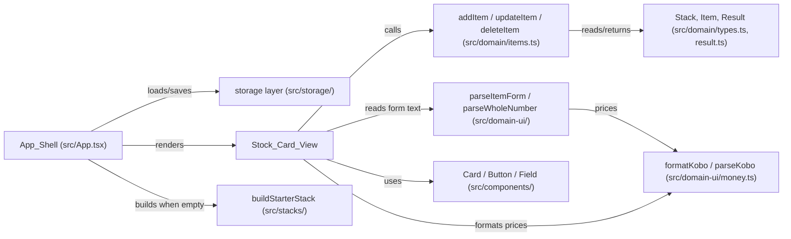
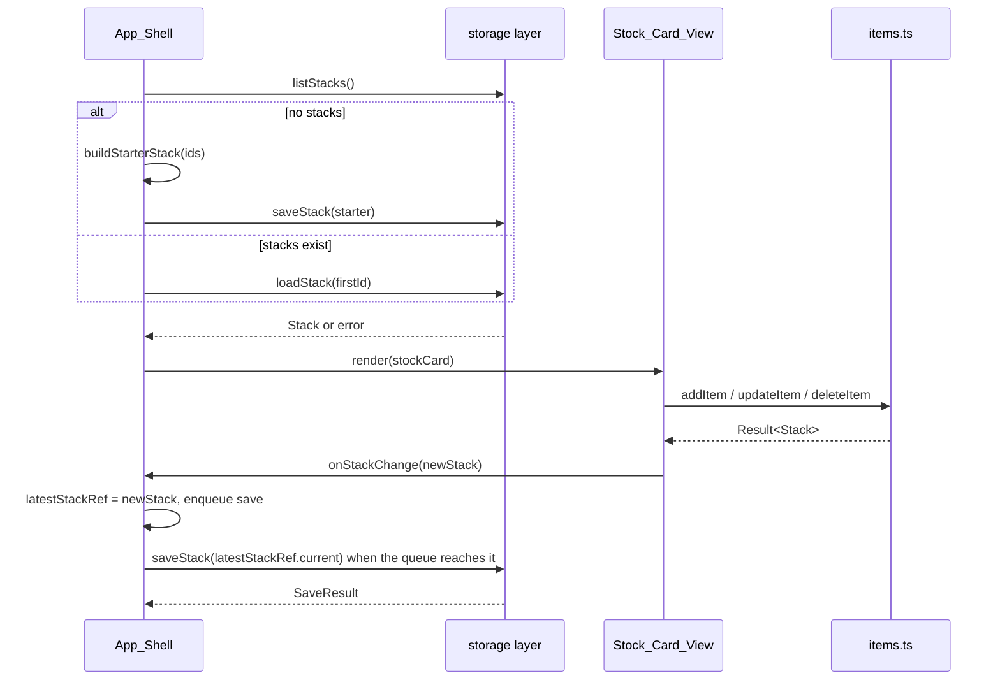

# Design: App shell and Stock card

## Overview

This spec builds the first screen the owner actually uses: a themed app shell that loads the Stack, shows the Stock card, and saves every change. Three layers grow:

- **Domain** (`src/domain/`) gains three pure functions — `addItem`, `updateItem`, `deleteItem` — and two pure checks — `isLowStock`, `isOutOfStock`. These follow the same shape as `recordSale` and the debt functions from `ghoststack-foundation`.
- **UI** (`src/components/`, `src/domain-ui/`, `src/App.tsx`, `index.html`) gains a Theme CSS file, three Shared_Components (Card, Button, Field), a Money_Formatter and Money_Parser, two pure form-reading helpers (`parseWholeNumber`, `parseItemForm`), and the Stock_Card_View screen, all wired together by the App_Shell. A small inline script in `index.html` sets the theme before React loads.
- **Starter data** (`src/stacks/`) gains a function that builds the Starter_Stack.

## Architecture

Data still flows as in `docs/ARCHITECTURE.md`: UI action → domain function → storage → UI. The domain stays free of React and storage imports; money formatting and parsing stay in the UI layer only (Requirement 5.6).



## File layout

```
src/domain/
  items.ts            addItem, updateItem, deleteItem, isLowStock, isOutOfStock
  items.test.ts
  items.property.test.ts
  result.ts            BAD_ITEM_NAME, BAD_PRICE added to the error table
  index.ts              new exports added
src/components/
  theme.css             CSS variables, light + Midnight sets, local @font-face
  fonts/
    PressStart2P-Regular.woff2   bundled pixel font (SIL OFL 1.1)
    OFL.txt                      font licence text
  Card.tsx / Card.css
  Button.tsx / Button.css
  Field.tsx / Field.css
  cards/
    StockCardView.tsx    Stock_Card_View
    StockCardView.css
    ItemForm.tsx          shared form for add + edit
    ItemRow.tsx           one row in the list
src/domain-ui/
  money.ts              formatKobo, parseKobo (UI-layer, not under src/domain)
  money.property.test.ts
  money.test.ts
  wholeNumber.ts        parseWholeNumber
  wholeNumber.test.ts
  wholeNumber.property.test.ts
  itemForm.ts           parseItemForm
  itemForm.test.ts
  itemForm.property.test.ts
src/stacks/
  starterStack.ts        buildStarterStack
  starterStack.test.ts
src/App.tsx              App_Shell: load, save queue, theme toggle, renders Stock_Card_View
index.html               inline script that sets data-theme before React loads
```

Money_Formatter and Money_Parser must not live under `src/domain/` (Requirement 5.6), so they get their own `src/domain-ui/` folder — UI-layer logic that is still pure and framework-free, which keeps it easy to unit test without a DOM.

## Data Models

Item, Sale, Stack and the other foundation types are unchanged (see `ghoststack-foundation` design). This spec adds no new persisted fields; `addItem`/`updateItem` inputs and the `StarterStackIds` shape below are the only new data shapes, all defined inline in "Components and Interfaces".

## Components and Interfaces

### Domain: item functions

All three functions share the shape already established by `recordSale` and `recordDebt`: pure, deterministic, return `Result<Stack>`, never mutate the input, take ids and never read the clock.

### Shared validation order

`addItem` and `updateItem` apply the same checks, in the same order, so they return the same error code for the same bad input (Requirement 2.4):

1. Name: trim; if empty, `BAD_ITEM_NAME`.
2. Quantity: `isWholeNumber(quantity) && quantity >= 0`; else `BAD_QUANTITY`.
3. Low-stock level: same check as quantity; else `BAD_QUANTITY` (Assumption A7 — no new code for this).
4. Cost price and sell price: `isSafeMoney(price)` (whole, safe, at least 0); else `BAD_PRICE`.
5. Card lookup: find a card with the given id and `type === "stock"`; else `CARD_NOT_FOUND`.
6. Function-specific id check (duplicate id for `addItem`, item lookup for `updateItem`/`deleteItem`).

Checks 1 to 4 do not need the Stack at all, so they run before the card lookup. This keeps the error for a bad name or price the same regardless of whether the card id is also wrong, which keeps behaviour predictable and easy to test.

### `addItem`

```ts
export interface AddItemInput {
  stack: Stack;
  stockCardId: string;
  itemId: string;
  name: string;
  quantity: number;
  costPrice: Kobo;
  sellPrice: Kobo;
  lowStockLevel: number;
}

export function addItem(input: AddItemInput): Result<Stack>
```

Order of checks:

1. Trim `name`; empty → `BAD_ITEM_NAME`.
2. `quantity` and `lowStockLevel` whole and `>= 0` → else `BAD_QUANTITY`.
3. `costPrice` and `sellPrice` safe money → else `BAD_PRICE`.
4. Find the Stock card by `stockCardId` → else `CARD_NOT_FOUND`.
5. Check `itemId` is not already used by any Item on any Stock card in the Stack (Assumption A8, same pattern `recordSale` uses for sale ids) → else `DUPLICATE_ID`.
6. Return a new Stack with a new Item (`{ id: itemId, name: trimmedName, quantity, costPrice, sellPrice, lowStockLevel }`) appended to the target Stock card's `items`. Every other card is unchanged by reference.

### `updateItem`

```ts
export interface UpdateItemInput {
  stack: Stack;
  stockCardId: string;
  itemId: string;
  name: string;
  quantity: number;
  costPrice: Kobo;
  sellPrice: Kobo;
  lowStockLevel: number;
}

export function updateItem(input: UpdateItemInput): Result<Stack>
```

Order of checks: same 1 to 4 as `addItem`. Then:

5. Find the Stock card by `stockCardId` → else `CARD_NOT_FOUND`.
6. Find the Item by `itemId` on that card → else `ITEM_NOT_FOUND`.
7. Return a new Stack where that Item is replaced with the new field values (id and list position unchanged), every other Item on that card unchanged by reference, and every other card (including any Sales log card) unchanged by reference. Because Sale objects copy `unitPrice`/`unitCost` at record time (per the foundation design), no Sale needs to change.

### `deleteItem`

```ts
export interface DeleteItemInput {
  stack: Stack;
  stockCardId: string;
  itemId: string;
}

export function deleteItem(input: DeleteItemInput): Result<Stack>
```

Order of checks:

1. Find the Stock card by `stockCardId` → else `CARD_NOT_FOUND`.
2. Find the Item by `itemId` → else `ITEM_NOT_FOUND`.
3. Return a new Stack where that Stock card's `items` has the Item removed (every other Item keeps its order), every other card unchanged by reference. Any Sale that referenced the deleted item's id is left exactly as it was (Assumption A1); the Sales log card is not touched.

### `isLowStock` and `isOutOfStock`

```ts
export function isLowStock(item: Item): boolean {
  return item.quantity <= item.lowStockLevel;
}

export function isOutOfStock(item: Item): boolean {
  return item.quantity === 0;
}
```

Both are total, pure, and take no Stack — callers (the Stock_Card_View) apply them per Item when rendering.

### Errors

Two codes are added to the one error table in `src/domain/result.ts`, next to the existing ones. No existing code or message changes (Requirement 4.2).

| Code | Message |
| --- | --- |
| `BAD_ITEM_NAME` | "Please type a name for this item." |
| `BAD_PRICE` | "Please type a price using numbers only, like 1250 or 1250.50." |

The `BAD_PRICE` message is the exact text required by Requirement 4.5. No user-facing message or UI copy in this spec mentions kobo (Requirement 4.6). The owner only ever sees Naira text. Names such as `Kobo`, `formatKobo` and `parseKobo` are internal code names.

Bad quantity and bad low-stock level reuse `BAD_QUANTITY` (Assumption A7); its existing message already fits a value of 0, since 0 is a whole number.

### Money_Formatter and Money_Parser

Both live in `src/domain-ui/money.ts`. Neither is imported by anything under `src/domain/` (Requirement 5.6).

### `formatKobo`

```ts
export function formatKobo(kobo: Kobo): string
```

Algorithm (string building, no floating-point division):

1. Convert `kobo` to its decimal digit string with `String(kobo)` (safe, since `kobo` is a non-negative safe integer — no scientific notation).
2. Left-pad with `"0"` until there are at least 3 digits, so there is always at least one whole-Naira digit plus two kobo digits.
3. Split into a whole part (all digits except the last two) and a kobo part (the last two digits) — a plain string slice, not division.
4. Insert `,` into the whole part every three digits from the right (standard grouping, done by walking the string from the end).
5. Join as `` `₦${wholePartWithCommas}.${koboPart}` ``.

Example: `125050` → digits `"125050"` → whole `"1250"`, kobo `"50"` → grouped whole `"1,250"` → `"₦1,250.50"`.

### `parseKobo`

```ts
export function parseKobo(text: string): Result<Kobo>
```

Algorithm (digit by digit, no floating-point multiplication, per Requirement 5.3):

1. Trim `text`. If it starts with one `₦`, remove that one character and trim again, so the text may have spaces around the sign and around the number (`" ₦ 1,250.50 "` is accepted). This makes `parseKobo(formatKobo(k))` return `ok(k)` for every safe `k`. If the result is empty → error (reuses `BAD_PRICE`, same message as the domain's price check, so the owner sees one consistent message). A second `₦` is not removed and fails step 3.
2. Strip `,` characters (thousands separators) — a simple character filter, not numeric.
3. Match the remaining string against `^\d+(\.\d{1,2})?$`. If it does not match (letters, more than two decimal places, a minus sign, empty after stripping, multiple dots) → error.
4. Split on `.` into a whole-digit string and an optional kobo-digit string. If there is no kobo part, treat it as `"0"`; if it has one digit, pad it to two with a trailing `"0"` (`"5"` → `"50"`), matching "Naira cents" semantics (`1250.5` means 50 kobo, not 5).
5. Build the final kobo digit string as `wholeDigits + koboDigits`, then convert it with `Number(combined)`. Step 3 has already guaranteed the string is digits only, so this is a single integer conversion of a digit string, not a float multiplication by 100. `parseInt` is not used anywhere in this spec.
6. If the result is not `Number.isSafeInteger` → error ("too large").
7. Return `ok(kobo)`.

Because every step operates on digit strings or integer parsing of a full digit string, there is no point where a fractional Naira amount is multiplied by 100 as a float, which avoids the classic `1250.1 * 100 === 125009.99999999999` class of bug.

Both functions reuse the domain's `BAD_PRICE` error code and message for invalid input, so the owner sees the same wording whether the problem is caught in the Field or in the domain call that follows.

### `parseWholeNumber`

`src/domain-ui/wholeNumber.ts`. Reads quantity and low-stock level text. Pure, framework-free, not imported by `src/domain/`.

```ts
export function parseWholeNumber(text: string): Result<number>
```

1. Trim `text`.
2. If the trimmed text does not match `/^\d+$/` (empty, letters, minus sign, decimal point, spaces inside, `1e3`, `0x10`) → error.
3. Convert with `Number(trimmed)`. If `Number.isSafeInteger` is false → error ("too large").
4. Return `ok(value)`.

`parseInt` and `parseFloat` are never used, because `parseInt("12abc")` returns 12 and would silently accept bad text. Errors reuse the `BAD_QUANTITY` code and its existing message, so the owner sees the same wording as the domain's check.

### `parseItemForm`

`src/domain-ui/itemForm.ts`. Turns the raw form text into the values `addItem`/`updateItem` need, or into per-field errors. Pure and deterministic.

```ts
export interface ParsedItemValues {
  name: string;          // trimmed
  quantity: number;
  costPrice: Kobo;
  sellPrice: Kobo;
  lowStockLevel: number;
}

export type ItemFormErrors = Partial<Record<keyof ItemFormValues, string>>;

export type ParseItemFormResult =
  | { ok: true; value: ParsedItemValues }
  | { ok: false; errors: ItemFormErrors };

export function parseItemForm(values: ItemFormValues): ParseItemFormResult
```

- `quantity` and `lowStockLevel` go through `parseWholeNumber`; `costPrice` and `sellPrice` go through `parseKobo`.
- `name` is trimmed; an empty result gives a `name` error with the `BAD_ITEM_NAME` message.
- Every field is checked, not just the first failing one, so the owner sees all problems at once. The `errors` object has an entry for exactly the fields that failed.
- The function never calls the domain and never reads the Stack. Checks that need the Stack (duplicate id, card or item lookup) stay in the domain.

### Theme and Midnight mode

`src/components/theme.css` is the one file that defines every colour, font and spacing value as a CSS variable (Requirement 6.1). Example shape:

```css
:root {
  --color-bg: #ffffff;
  --color-fg: #000000;
  --color-border: #000000;
  --color-accent: #000000;
  --color-danger-bg: #000000;
  --color-danger-fg: #ffffff;
  --color-warning-fg: #000000;
  --font-pixel: "Press Start 2P", monospace;
  --font-body: system-ui, -apple-system, "Segoe UI", Roboto, sans-serif;
  --border-width: 2px;
  --space-1: 4px;
  --space-2: 8px;
  --space-3: 16px;
  --tap-min: 44px;
}

[data-theme="midnight"] {
  --color-bg: #0b0b12;
  --color-fg: #f4f4f4;
  --color-border: #f4f4f4;
  --color-accent: #ffd166;
  --color-danger-bg: #ff6b6b;
  --color-danger-fg: #0b0b12;
  --color-warning-fg: #ffd166;
}
```

Every colour pair used for text-on-background in both sets is picked to meet a 4.5:1 contrast ratio (Requirement 6.8); this is a design-time fact about the fixed palette above, checked once against a contrast calculator rather than through generated-input tests (see Testing strategy).

`[data-theme="midnight"]` is an attribute on `<html>`, toggled by the App_Shell. No component or other CSS file sets a raw colour, font, or spacing value — everything reads a `var(--...)` (Requirement 6.1).

### Fonts

- The pixel font (Press Start 2P, SIL Open Font License 1.1) is bundled (Requirement 6.9) in `src/components/fonts/` and loaded by an `@font-face` rule in `theme.css` with a relative `url(...)` to the local `.woff2` file and `font-display: swap`. The licence text ships next to the font file.
- No stylesheet `<link>`, `@import` or script loads a font from the network (Requirement 6.9).
- `--font-pixel` is used for titles only: the Card title bar and the screen heading. Everything else (body text, Fields, Buttons, list rows, warnings, messages) uses `--font-body`, a system font stack, so numbers and prices stay easy to read. `theme.css` sets `body { font-family: var(--font-body); }` and the Card header rule is the only rule that reads `--font-pixel`.

### Midnight toggle and persistence (Assumption A2)

- Storage key: `"ghoststack:theme"`, values `"light"` or `"midnight"`.
- **Every `localStorage` and `matchMedia` access is wrapped in `try/catch` (Requirement 6.11).** Private browsing or blocked storage can throw. A failed read falls back to the system preference, and if that also fails, to `"light"`. A failed write is ignored: the theme still changes for this session.
- A small inline `<script>` in `index.html`, placed in `<head>` before the React bundle, sets the theme before React loads (no light flash, Requirement 6.10):
  1. Read the key in a `try/catch`. If it holds `"light"` or `"midnight"`, use it.
  2. Otherwise use `window.matchMedia("(prefers-color-scheme: dark)").matches` (in the same `try/catch`) to pick `"midnight"` or `"light"` (Requirement 6.6). Do not write to `localStorage` (only an explicit toggle writes a choice).
  3. Set `document.documentElement.dataset.theme` to the result.

  ```html
  <script>
    (function () {
      var theme = "light";
      try {
        var saved = localStorage.getItem("ghoststack:theme");
        if (saved === "light" || saved === "midnight") {
          theme = saved;
        } else if (window.matchMedia("(prefers-color-scheme: dark)").matches) {
          theme = "midnight";
        }
      } catch (e) {}
      document.documentElement.dataset.theme = theme;
    })();
  </script>
  ```
- On mount, the App_Shell does not decide the theme. It reads `document.documentElement.dataset.theme` as the initial toggle state.
- The toggle button calls a handler that flips the theme, sets the attribute immediately, and writes the new value to `localStorage` inside `try/catch` (Requirement 6.5).
- The toggle's visible label states the mode in words, for example "Midnight mode: on" / "Midnight mode: off" (Requirement 6.7), not just an icon.

This setting is deliberately kept out of the Stack and out of IndexedDB: it is a display preference needed before the Stack is loaded, not business data (Assumption A2).

### Shared components

All three live in `src/components/`, take no raw colour/font/spacing (only theme variables, inherited through CSS), and share a visible focus outline defined once in `theme.css` (`:focus-visible { outline: ... }`) rather than per component (Requirement 7.6).

### Card

```ts
interface CardProps {
  title: string;
  children: React.ReactNode;
  footer?: React.ReactNode;
}
function Card(props: CardProps): JSX.Element
```

Renders a title bar (`<header>` showing `title`) and a body area (`<div>` wrapping `children`), matching the "window" look (Requirement 7.2).

### Button

```ts
interface ButtonProps {
  children: React.ReactNode;
  onClick: () => void;
  variant?: "main" | "danger";
  type?: "button" | "submit";
  disabled?: boolean;
}
function Button(props: ButtonProps): JSX.Element
```

`variant="danger"` differs from `"main"` by more than colour: it also renders a warning icon (for example "⚠") before the label (Requirement 7.3). Both variants use `min-height: var(--tap-min); min-width: var(--tap-min)` (Requirement 7.5).

### Field

```ts
interface FieldProps {
  id: string;
  label: string;
  value: string;
  onChange: (value: string) => void;
  hint?: string;
  error?: string;
  type?: "text" | "number";
  inputMode?: "text" | "numeric" | "decimal";
}
function Field(props: FieldProps): JSX.Element
```

Renders a `<label htmlFor={id}>`, an `<input id={id} aria-describedby={hintId error errorId}>`, an optional hint `<span>`, and when `error` is set, an error `<span role="alert" id={errorId}>` — linking label and error to the input for screen readers (Requirement 7.4). The input itself has `min-height: var(--tap-min)` (Requirement 7.5). Layout uses relative units and `max-width` with no fixed widths wider than 360px minus padding, so the layout works at 360px without sideways scrolling (Requirement 7.7).

### Stock_Card_View

#### UI state

```ts
type FormMode = { kind: "closed" } | { kind: "add" } | { kind: "edit"; itemId: string };
type ConfirmState = { kind: "closed" } | { kind: "confirm-delete"; itemId: string };

interface ItemFormValues {
  name: string;
  quantity: string;      // raw typed text
  costPrice: string;     // raw typed Naira text
  sellPrice: string;     // raw typed Naira text
  lowStockLevel: string; // raw typed text
}

interface ItemFormState {
  values: ItemFormValues;
  fieldErrors: Partial<Record<keyof ItemFormValues, string>>;
  formError?: string; // shown when no single Field applies
}
```

All five Fields are kept as raw strings while the form is open, so a value that cannot yet be read (for example `"12."`) is never silently coerced, and whatever the owner typed survives a failed submit (Requirement 9.5).

#### Flows

**List view** (`FormMode.kind === "closed"`, `ConfirmState.kind === "closed"`):
- Items with no entries → `Card` body shows an empty-state message and one "Add an item" `Button` (Requirement 8.5).
- Items with entries → a list of `ItemRow`, each showing name, quantity, `formatKobo(sellPrice)`, and (via `isOutOfStock` checked before `isLowStock`, since "out of stock" replaces "low stock" per Requirement 8.4) either no warning, "Low stock" with an icon, or "Out of stock" with an icon (Requirement 8.3, 8.4). Order follows the Stock card's `items` array as-is (Requirement 8.8). An always-visible "Add an item" `Button` sits above or below the list (Requirement 8.6). Each row has "Edit" and "Delete" `Button`s.

**Add flow:**
1. Tapping "Add an item" sets `FormMode = { kind: "add" }` with empty `ItemFormValues`.
2. `ItemForm` renders five `Field`s (name, quantity, cost price, sell price, low-stock level); cost/sell price Fields take Naira text (Requirement 9.1, 9.2).
3. On submit: call `parseItemForm(values)`. If it returns `{ ok: false, errors }`, copy `errors` into `fieldErrors` and keep the form open with the typed values intact (Requirement 9.5) — this covers "a Field value cannot be read" without calling the domain at all.
4. If `parseItemForm` returns `{ ok: true, value }`, call `addItem` with the parsed `value` and a UI-generated id (`crypto.randomUUID()`) (Requirement 9.6). If the Result is an error, show `error.message` as `formError` (since the domain does not say which Field caused it) and keep the form open with the typed values (Requirement 9.5).
5. If the Result is success, close the form (`FormMode = { kind: "closed" }`) and hand the new Stack to the App_Shell's `onStackChange` (Requirement 9.3).
6. Cancel: set `FormMode = { kind: "closed" }` without calling any domain function (Requirement 9.4).

**Edit flow:** identical to Add, except `FormMode = { kind: "edit", itemId }`, the form opens pre-filled from the current Item (`formatKobo` used to show prices as Naira text, Requirement 10.1), and submit calls `updateItem` with that `itemId` (Requirement 10.2–10.4).

**Delete flow:**
1. Tapping "Delete" on a row sets `ConfirmState = { kind: "confirm-delete", itemId }`, showing the Item's name and two `Button`s: "Delete item" (`variant="danger"`, Requirement 11.5) and "Keep item" (Requirement 11.1).
2. "Keep item" closes the confirmation with no domain call (Requirement 11.3).
3. "Delete item" calls `deleteItem`. On success, close the confirmation and let the new Stack (with the Item removed) flow down from the App_Shell, which re-renders the list without it (Requirement 11.2). On error, show the error message (for example in the confirmation dialog) and keep the Item in the list — i.e. do not close the confirmation's underlying row — (Requirement 11.4).

Stock_Card_View only ever renders Play mode controls; no builder affordances exist in this component (Requirement 8.7).

### App_Shell

```ts
function App(): JSX.Element
```

Responsibilities:

1. **Theme toggle**: the inline script in `index.html` has already set `document.documentElement.dataset.theme` before React loads (see Theme section). The App_Shell reads that attribute as its initial toggle state, and owns the toggle's state and handler. All `localStorage` access is in `try/catch`.
2. **Load**: on mount, call `listStacks()`. The load effect runs its body once even under React StrictMode (Requirement 12.13), which runs effects twice in development. A `useRef` flag (`loadStartedRef`) is checked at the top of the effect: if it is already `true`, the effect returns; otherwise it sets the flag to `true` and starts the load. Refs survive StrictMode's simulated unmount and remount, so only one `listStacks()` call and at most one `buildStarterStack`/`saveStack(starter)` happen, and only one starter Stack is ever created. The effect does not cancel on cleanup, because the flag already prevents a second run and cancelling would drop the first run's result. If the list is non-empty, call `loadStack(ids[0])` (Assumption A3). While this is in flight, render a `Card`-free "Opening your shop…" message (Requirement 12.1).
   - If `listStacks()` returns empty, build `buildStarterStack(...)` with freshly made ids, call `saveStack(starter)`, and on success set it as the current Stack (Requirement 12.2).
   - If `loadStack` returns `{ ok: false }`, show the storage error message from `error.message` and stop — no Starter_Stack is created, so saved data is never overwritten (Requirement 12.6).
3. **Render**: once a Stack is loaded, find its one `stock`-type card and pass it to `Stock_Card_View`, ignoring the other three starter cards on screen (Requirement 13.6).
4. **Change handling**: `Stock_Card_View` calls a single `onStackChange(newStack: Stack)` prop. The App_Shell:
   - Replaces the Stack held in component state immediately, so the UI reflects the change right away (Requirement 12.4), and stores the same Stack in `latestStackRef` (a `useRef`), so the newest Stack is always readable without waiting for a re-render (Requirement 12.9).
   - Enqueues a save. Saves are serialized through a promise queue (`saveQueueRef`, a `Promise` chain): each save starts only after the previous one has finished, whether it succeeded or failed. Each queued job reads `latestStackRef.current` when it starts, not the Stack captured when it was enqueued, and calls `saveStack` with it. Saves therefore never overlap or finish out of order, and the newest write always wins (Requirement 12.10). Two quick edits can never leave the older Stack in storage.
   - If a save fails, keeps the already-applied change on screen, shows the storage error message, and exposes a "Try again" `Button`. "Try again" enqueues a new save through the same queue, which saves `latestStackRef.current`, never an older captured Stack (Requirements 12.7, 12.11). A later successful save clears the error message (Requirement 12.12).
5. The App_Shell imports only `saveStack`, `loadStack`, `listStacks` from storage, and makes no network calls (Requirement 12.5). It does not alter `src/storage/` or the `Stack` shape (Requirement 12.8).



### Starter stack

`src/stacks/starterStack.ts`:

```ts
export interface StarterStackIds {
  stackId: string;
  stockCardId: string;
  salesCardId: string;
  debtsCardId: string;
  summaryCardId: string;
}

export function buildStarterStack(ids: StarterStackIds): Stack
```

Returns a `Stack` named `"Provisions shop"`, `schemaVersion: SCHEMA_VERSION`, `currency: DEFAULT_CURRENCY`, with exactly four cards in a fixed order — `stock` ("Stock"), `sales-log` ("Sales log"), `debts` ("Money owed to you"), `daily-summary` ("Daily summary") — each using one of the supplied ids, each holding an empty list (`items: []`, `sales: []`, `debts: []`) (Requirement 13.1–13.3). Giving the same `ids` always returns a deep-equal Stack (Requirement 13.4), and the result passes `isStack` from the foundation's storage layer unchanged (Requirement 13.5), since the shape matches exactly what `isStack` already checks.

## Correctness Properties

*A property is a characteristic or behavior that should hold true across all valid executions of a system — essentially, a formal statement about what the system should do. Properties serve as the bridge between human-readable specifications and machine-verifiable correctness guarantees.*

### Reflection on redundant properties

Several prework candidates collapse into fewer, broader properties to avoid redundancy:

- The "no mutation on error" checks scattered across Requirements 1.4–1.8, 2.5–2.6, and 3.3–3.4 are all instances of one shape: *a rejected call to `addItem`/`updateItem`/`deleteItem` returns a Stack deep-equal to the input Stack.* These become a single property per function (Properties 4–6) instead of one property per error code.
- The "grows by one" / "shrinks by one" facts (Requirements 1.1, 3.1) are folded into Properties 1 and 3, alongside the field-equality and order-preservation facts, since they describe the same successful call.
- Requirements 2.2 and 2.7 (other Items unchanged; Sales unchanged) describe one successful `updateItem` call and become one property (Property 2).
- The deep-freeze check (Requirement 14.3) applies identically to all five functions and becomes one property (Property 7) parameterized over which function is called, rather than five near-identical properties.

### Property 1: Adding an item grows the list by one with the item appended

*For any* Stack containing a Stock card, and *for any* valid new item id (not already used anywhere in the Stack), name, quantity, cost price, sell price and low-stock level, calling `addItem` SHALL return a Stack whose target Stock card's `items` list is exactly the original list with one new Item appended at the end, that Item's fields equal to the given id, the trimmed name, and the given quantity, prices and low-stock level, and every other card unchanged.

**Validates: Requirements 1.1, 1.2, 1.9**

### Property 2: Updating an item changes only that item's fields

*For any* Stack containing a Stock card with an existing Item, and *for any* valid new name, quantity, cost price, sell price and low-stock level, calling `updateItem` on that Item's id SHALL return a Stack where that Item has the new (trimmed) field values at its original position, every other Item on the Stack is deep-equal to before, and every Sale in the Stack is deep-equal to before.

**Validates: Requirements 2.1, 2.2, 2.7, 2.8**

### Property 3: Deleting an item shrinks the list by one and preserves order and sales

*For any* Stack containing a Stock card with an existing Item, calling `deleteItem` on that Item's id SHALL return a Stack whose target Stock card's `items` list equals the original list with that one Item removed and every remaining Item in its original relative order, and every Sale in the Stack (including any Sale referencing the deleted item's id) deep-equal to before.

**Validates: Requirements 3.1, 3.5, 3.6**

### Property 4: Rejected `addItem` calls never change the Stack

*For any* Stack and *for any* `addItem` input that is invalid by at least one check (duplicate id, blank name, bad quantity or low-stock level, bad price, or a missing/wrong-kind card), calling `addItem` SHALL return an error whose code matches the first failing check in the documented order, and SHALL return no change — the input Stack, compared by deep equality before and after the call, SHALL be identical.

**Validates: Requirements 1.4, 1.5, 1.6, 1.7, 1.8, 1.9**

### Property 5: Rejected `updateItem` calls never change the Stack

*For any* Stack and *for any* `updateItem` input that is invalid (blank name, bad quantity or low-stock level, bad price, item not found, or a missing/wrong-kind card), calling `updateItem` SHALL return an error with the matching code and SHALL leave the input Stack unchanged by deep equality.

**Validates: Requirements 2.4, 2.5, 2.6, 2.8**

### Property 6: Rejected `deleteItem` calls never change the Stack

*For any* Stack and *for any* `deleteItem` input where the item id is not found on the target card, or the card is missing or the wrong kind, calling `deleteItem` SHALL return an error with the matching code and SHALL leave the input Stack unchanged by deep equality.

**Validates: Requirements 3.3, 3.4, 3.6**

### Property 7: Item functions never mutate a frozen input

*For any* deep-frozen Stack and *for any* input (valid or invalid) to `addItem`, `updateItem`, or `deleteItem`, and *for any* deep-frozen Item for `isLowStock` or `isOutOfStock`, the call SHALL complete (returning a Result or a boolean) without throwing, and the frozen input SHALL remain deep-equal to a snapshot taken before the call.

**Validates: Requirements 1.9, 2.8, 3.6, 14.3**

### Property 8: `addItem` and `updateItem` agree on validation errors

*For any* name, quantity, cost price, sell price and low-stock level that are invalid by the name, quantity or price checks, calling `addItem` with a fresh item id and calling `updateItem` on an existing item, using the same field values and the same target Stock card, SHALL return the same error code.

**Validates: Requirements 2.4**

### Property 9: `isLowStock` and `isOutOfStock` match their definitions

*For any* Item, `isLowStock(item)` SHALL equal `item.quantity <= item.lowStockLevel`, and `isOutOfStock(item)` SHALL equal `item.quantity === 0`.

**Validates: Requirements 4.3, 4.4**

### Property 10: Money formatting and parsing round-trip

*For all* kobo values from 0 to `Number.MAX_SAFE_INTEGER`, `parseKobo(formatKobo(kobo))` SHALL return `ok(kobo)`. `formatKobo` output starts with `₦`, so `parseKobo` accepts one optional leading `₦` and spaces around the sign and the number. For the same reason, `parseKobo` of the formatted text with any number of leading and trailing spaces added SHALL also return `ok(kobo)`.

**Validates: Requirements 5.5**

### Property 11: Invalid typed prices are rejected with an error

*For any* string that is empty after trimming, contains a letter, has more than two digits after a decimal point, starts with a minus sign, or encodes a value above `Number.MAX_SAFE_INTEGER` kobo, `parseKobo` SHALL return an error. The same holds when such a string has a leading `₦` added (for example `"₦"` alone, `"₦-5"` and `"₦₦5"` are rejected).

**Validates: Requirements 5.4, 14.13**

### Property 12: The starter stack always has the same fixed shape

*For any* five distinct ids supplied as `StarterStackIds`, `buildStarterStack` SHALL return a Stack with exactly four cards — one `stock`, one `sales-log`, one `debts`, one `daily-summary` — each holding an empty list, that passes `isStack`, and calling it twice with the same ids SHALL return deep-equal Stacks.

**Validates: Requirements 13.1, 13.2, 13.3, 13.4, 13.5**

### Property 13: No sequence of item and sale operations produces an invalid number (invariant 7)

*For any* sequence of calls to `addItem`, `updateItem`, `deleteItem` and `recordSale` (each with generated, possibly invalid input), whether each call succeeds or is rejected, the resulting Stack SHALL contain no `NaN` value, no Item with a negative or fractional quantity, and no money value (`costPrice`, `sellPrice`, `unitPrice`, `unitCost`, Sale totals) that is not a safe non-negative integer.

**Validates: Requirements 14.2**

### Property 14: `parseWholeNumber` accepts exactly digit strings that are safe integers

*For any* string, `parseWholeNumber` SHALL return `ok(n)` if and only if the trimmed string matches `/^\d+$/` and `Number(trimmed)` is a safe integer, and in that case `n === Number(trimmed)`. *For any* non-negative safe integer `n`, `parseWholeNumber(String(n))` SHALL return `ok(n)`.

**Validates: Requirements 9.7, 14.11**

### Property 15: `parseItemForm` returns parsed values for valid text and per-field errors for invalid text

*For any* valid name, quantity, low-stock level and prices, building `ItemFormValues` from their text (prices through `formatKobo`, with optional surrounding spaces) and calling `parseItemForm` SHALL return `ok` with the trimmed name and the original numbers. *For any* `ItemFormValues` where a chosen non-empty subset of fields is invalid, `parseItemForm` SHALL return `ok: false` with an error entry for exactly that subset of fields.

**Validates: Requirements 9.8, 9.9, 14.12**

## Error handling

- Domain errors follow the existing `Result<T>` pattern: every new function returns `{ ok: false, error: { code, message } }` instead of throwing, using the two new codes plus the existing `CARD_NOT_FOUND`, `ITEM_NOT_FOUND`, `DUPLICATE_ID`, and `BAD_QUANTITY`.
- UI-layer parse errors (`parseItemForm`, which uses `parseKobo` and `parseWholeNumber`) are caught before any domain call and shown as `fieldErrors` next to the specific Field, matching Requirement 9.5/10.4.
- Domain errors returned from `addItem`/`updateItem`/`deleteItem` are shown as a single `formError` at the top of the form, since the domain's error does not identify a Field.
- Storage errors (`SAVE_FAILED`, `UNREADABLE_DATA`, `NOT_FOUND`) use the existing messages from `src/storage/stackStore.ts`; the App_Shell never invents its own wording for them, and a failed save leaves the optimistic UI change in place with a retry affordance (Requirement 12.7) rather than rolling back, since rolling back would discard what the owner just typed. Saves run one at a time through a queue and always write the latest Stack.
- Theme storage errors (`localStorage` or `matchMedia` throwing) are caught and ignored; the theme falls back to the system preference or light mode and nothing is shown to the owner.

## Testing strategy

**Unit tests** (Vitest) cover specific examples and edge cases:

- `addItem`, `updateItem`, `deleteItem`: one example per error code (duplicate id, blank name, bad quantity, bad low-stock level, bad price for each of cost/sell, card not found, item not found), plus a trimming example (`"  Rice  "` → `"Rice"`).
- `isLowStock`, `isOutOfStock`: boundary examples (`quantity === lowStockLevel`, `quantity === 0`, `quantity === 1`).
- `formatKobo`: fixed examples including `0` → `"₦0.00"`, `125050` → `"₦1,250.50"`, and a value needing two comma groups.
- `parseKobo`: fixed examples for each accepted shape (`"1250"`, `"1250.5"`, `"1250.50"`, `"1,250.50"`, `"₦1,250.50"`, `" ₦ 1,250.50 "`) and each rejected shape (empty, `"₦"` alone, `"₦₦5"`, letters, three decimal places, negative, over the safe limit).
- `parseWholeNumber` (`src/domain-ui/wholeNumber.test.ts`): accepted (`"0"`, `"5"`, `" 12 "`, `"007"`) and rejected (empty, `"12abc"`, `"1.5"`, `"-1"`, `"1e3"`, `"0x10"`, `"9007199254740993"`) examples. The `"12abc"` example documents why `parseInt` is not used.
- `parseItemForm` (`src/domain-ui/itemForm.test.ts`): one all-valid example, one example per single bad field, one example with every field bad (all five errors returned together), and a name-trimming example.
- `BAD_PRICE` message: one example checking the exact text and that no message in the error table contains the word "kobo".
- `buildStarterStack`: one example checking the four card types, titles, and empty lists.
- New error table entries: one example confirming `ERROR_MESSAGES.BAD_ITEM_NAME` and `ERROR_MESSAGES.BAD_PRICE` exist and that every pre-existing key and message is untouched (Requirement 4.1, 4.2).

Component-level UI behaviour (Stock_Card_View forms, confirmation dialogs, App_Shell load/save orchestration including the save queue, "Try again" and the StrictMode load guard, Theme toggle rendering, the `index.html` theme script, and local font loading) is **not** covered by automated tests in this spec. Per Assumption A4 and `tech.md`, `@testing-library/react` and a DOM test environment need approval before they are added; until then this behaviour is checked manually against the acceptance criteria in Requirements 6 through 13. The pure logic those screens depend on (money conversion, whole-number and form parsing, item operations, low-stock checks, starter stack shape) is fully covered by the unit and property tests above, which is the highest-value automated coverage available without new tooling.

**Property tests** (fast-check, `src/domain/items.property.test.ts`, `src/domain-ui/money.property.test.ts`, `src/domain-ui/wholeNumber.property.test.ts`, `src/domain-ui/itemForm.property.test.ts`, `src/stacks/starterStack.test.ts`), each run with `numRuns: 100` or more, each tagged with its design property number:

| Property | Location |
| --- | --- |
| 1–9, 13 | `src/domain/items.property.test.ts` (Property 13 also exercises `recordSale` from `src/domain/sales.ts`) |
| 10–11 | `src/domain-ui/money.property.test.ts` |
| 14 | `src/domain-ui/wholeNumber.property.test.ts` |
| 15 | `src/domain-ui/itemForm.property.test.ts` |
| 12 | `src/stacks/starterStack.test.ts` (a property test, even though the file is not suffixed `.property.test.ts`, to sit next to the starter stack's other tests) |

Generators reuse and extend the foundation's generators:

- `arbKobo`: `fc.integer({ min: 0, max: 1_000_000_00 })`.
- `arbItemFormValues`: valid text built from generated numbers, plus a variant that corrupts a chosen subset of the five fields (blank name, letters, decimals in quantity, three-decimal prices), for Property 15. Property 14 uses `fc.string()` mixed with `fc.nat()` converted to text.
- `arbItem`: id, name (including strings that are empty or whitespace-only, to exercise `BAD_ITEM_NAME`), quantity and low-stock level from `fc.integer({ min: -5, max: 1000 })` (including negative, to exercise `BAD_QUANTITY`), prices from a mix of `arbKobo` and invalid values (negative, non-integer, above `Number.MAX_SAFE_INTEGER`).
- `arbStack`: extends the foundation's Stack generator with one or more Items per Stock card.
- `arbMoneyText`: valid Naira text strings (for the round-trip property, built by formatting a generated kobo value) and a separate `arbInvalidMoneyText` generator (letters, extra decimals, leading minus, empty) for Property 11.
- `arbItemOperation`: one of an `addItem`, `updateItem`, `deleteItem` or `recordSale` input (valid or invalid), for Property 13's sequences.

Each property test is written in the same task as the function it covers (per `money-rules.md`), so `addItem`'s tests land with `addItem`'s implementation, and so on.

## Dependencies

No new packages are needed. Everything used here — `idb`, `vitest`, `fast-check`, `react`, `react-dom`, `typescript` — is already approved and installed per `package.json` and the foundation spec. The pixel font is a single `.woff2` file committed to the repository (not an npm package) with its OFL licence text. `@testing-library/react` and a jsdom-based test environment remain unapproved per Assumption A4 and are not added in this spec.

## Decisions

- **Money_Formatter/Money_Parser live in `src/domain-ui/`, not `src/domain/` or `src/components/`.** Requirement 5.6 forbids the domain from importing them, and they are plain, framework-free functions, so they do not belong under `src/components/` either. A dedicated UI-layer-but-pure folder keeps them easy to unit test without a DOM and easy to reuse from any future card.
- **`addItem` and `updateItem` share the same validation order, expressed as the same sequence of checks rather than a shared helper function that returns early.** Keeping the order identical (not necessarily the code) is what Requirement 2.4 actually asks for, and Property 8 tests that directly; a shared helper is an implementation detail left to the coding task.
- **UI generates item ids with `crypto.randomUUID()`, matching Requirement 9.6 and the existing pattern of the caller supplying ids to domain functions.**
- **The theme is set by an inline script in `index.html` before React loads**, with all `localStorage` access in `try/catch`, to avoid the light-mode flash called out in Assumption A2. The App_Shell only reads the result and handles the toggle.
- **Saves go through a queue that always writes the latest Stack from a ref.** A queue alone could still write an older captured Stack after a newer one was queued, so each job reads the ref when it starts.
- **The load effect is guarded by a ref flag, not by cleanup.** Cleanup-based cancelling under StrictMode would discard the first run's result and start a second load, which could create a second starter Stack.
- **Quantity and low-stock text use a strict regex plus `Number.isSafeInteger`, never `parseInt`**, because `parseInt` accepts text such as `"12abc"`.
- **`parseItemForm` returns all field errors at once and never calls the domain**, so the Stock_Card_View can show every problem together and the form logic is testable without a DOM.
- **Pixel font for titles only, bundled locally.** Body text uses system fonts for readability, and there is no network font request.
- **Deferring component tests (Assumption A4)** keeps this spec's automated test suite honest about what it actually proves: pure logic is proven by property and unit tests; screen behaviour is not yet proven by automated tests and is called out as such rather than skipped silently.
