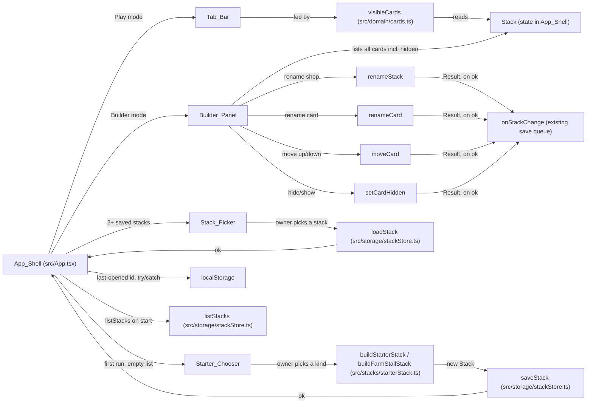

# Design: Builder mode and starter stacks

## Overview

This spec lets the owner shape a Stack without code, and gives new owners a second starter to choose from. It adds four pure Builder_Functions (`renameStack`, `renameCard`, `moveCard`, `setCardHidden`) and one pure `visibleCards` function to `src/domain/`, one optional `hidden` flag on every `Card`, one additive Starter_Function (`buildFarmStallStack`) beside `buildStarterStack`, and a set of new screens wired into the existing `App_Shell` (`src/App.tsx`): a Mode_Switch, a Builder_Panel, a Starter_Chooser and a Stack_Picker.

It builds directly on the three earlier specs:

- **`ghoststack-foundation`** — `Stack`/`Card`/`Result` types, `src/domain/result.ts`'s additive error table.
- **`app-shell-stock-card`** — the App_Shell's load/save queue (`latestStackRef`, `saveQueueRef`, `enqueueSave`), the Card/Button/Field Shared_Components, `buildStarterStack`, `isStack`.
- **`sales-and-daily-summary`** and **`debts-card-ui`** — the Tab_Bar, the four card views, the focus-management conventions (`pendingFocus` + an effect that looks the DOM node up after render) and the per-file `@vitest-environment jsdom` + `src/test/setup.ts` component-test setup, all reused unchanged.

No existing domain function's behaviour changes. `src/App.tsx` changes in the two ways the Introduction calls out (Tab_Bar driven by the Stack instead of fixed card-type tabs; first run with an empty database shows the Starter_Chooser instead of silently creating the Provisions shop) and gains the Mode_Switch, Builder_Panel, Starter_Chooser, Stack_Picker and the last-opened-stack bookkeeping. `src/domain/result.ts`'s `ERROR_MESSAGES` table gains new entries only — every existing entry, and `ERROR_CODES.length`, change only by addition (`src/domain/validate.test.ts`'s `"leaves every pre-existing entry untouched"` test asserts `ERROR_CODES.length` against a fixed count plus a literal offset; that offset is updated in the same task that adds the new codes, per Requirement 4's "additive only" framing — the existing *entries* are not touched, which is what that test and Requirement 4 actually guard).

## Architecture

Data still flows as `docs/ARCHITECTURE.md` describes: UI action → domain function → storage (via the existing save queue) → UI. Builder actions are no exception — a Builder_Panel control calls a Builder_Function, and on success passes the returned Stack to the same `onStackChange` every card view already uses.



The domain stays free of React, storage and the clock. Builder_Functions take only a `Stack` and plain values and return `Result<Stack>`, exactly like `addItem`/`recordSale`/`recordDebt` already do. `buildFarmStallStack` follows `buildStarterStack`'s existing shape: it takes `Starter_Ids` made by the caller and returns a plain `Stack`, reading no clock and calling no storage.

## File layout

```
src/domain/
  cards.ts              NEW: renameStack, renameCard, moveCard, setCardHidden,
                              visibleCards, NAME_MAX_LENGTH
  cards.test.ts         NEW: unit tests
  cards.property.test.ts NEW: property tests (Properties 1-11 below)
  result.ts             + NAME_REQUIRED, NAME_TOO_LONG, CANNOT_MOVE_FURTHER,
                           BAD_DIRECTION, MUST_STAY_VISIBLE, BAD_HIDDEN_VALUE
  types.ts              Card gets an optional `hidden?: boolean` on CardBase
  index.ts              + new exports from cards.ts
src/storage/
  isStack.ts             isCard accepts an absent or boolean `hidden`
  isStack.test.ts        + cases for hidden: absent / true / false / bad value
src/stacks/
  starterStack.ts        + buildFarmStallStack, alongside buildStarterStack
  starterStack.test.ts   + unit + property coverage for buildFarmStallStack
src/domain-ui/
  sampleItems.ts          NEW: SAMPLE_ITEMS_BY_STARTER data (see below)
  sampleItems.test.ts     NEW
src/components/
  ModeSwitch.tsx / .css   NEW: Mode_Switch
  Dialog.tsx / .css       NEW: small shared Dialog wrapper (dialog role and
                           aria attributes, focus-in, Tab loop, Escape,
                           focus-return to Opener) reused by every new dialog
  StackPicker.tsx / .css  NEW: Stack_Picker
  builder/
    BuilderPanel.tsx / .css   NEW: Builder_Panel
    BuilderCardRow.tsx        NEW: one row (title, Showing/Hidden, controls)
    RenameDialog.tsx          NEW: shared rename dialog (shop or card)
    StarterChooser.tsx / .css NEW: Starter_Chooser
src/App.tsx              Mode state, selectedCardId, visibleCards-fed Tab_Bar,
                          Builder_Panel/Starter_Chooser/Stack_Picker wiring,
                          last-opened-id localStorage, first-run branch
```

`cards.ts` is a new domain file, not an extension of `items.ts`/`debts.ts`/`sales.ts` — it operates on the Stack's own shape (`name`, `cards` order, `hidden`), not on Items/Sales/Debts, so it gets its own file next to them, following the same one-concept-per-file pattern the foundation spec established. `sampleItems.ts` lives in `src/domain-ui/` (not `src/domain/`) because it is App_Shell-facing UI data (ids are made by the caller, not by the data, per Requirement 9.11) rather than a pure business rule; it is pure and framework-free, matching `money.ts`/`wholeNumber.ts`'s existing placement rationale.

## Data Models

### `Card` gains an optional `hidden` flag

```ts
// src/domain/types.ts
interface CardBase {
  id: string;
  title: string;
  /** Absent or false means visible. True means hidden. Optional for backward compatibility. */
  hidden?: boolean;
}
```

Every one of the four card variants extends `CardBase`, so all four gain `hidden?: boolean` at once. `schemaVersion` stays `1` (Requirement 5.5) — adding an optional field does not change the shape a schema version describes; Stacks saved before this spec simply lack the key, and `hidden?: boolean` already types that as valid.

### New domain error codes (`src/domain/result.ts`)

All six are additive — appended to `ERROR_MESSAGES`, never replacing or rewording an existing entry:

```ts
export const ERROR_MESSAGES = {
  // ...existing entries, unchanged...
  NAME_REQUIRED: "Please type a name.",
  NAME_TOO_LONG: "That name is too long. Please use 40 characters or fewer.",
  CANNOT_MOVE_FURTHER: "This card can't move any further that way.",
  BAD_DIRECTION: "Please use the up or down button.",
  MUST_STAY_VISIBLE: "At least one card must stay showing.",
  BAD_HIDDEN_VALUE: "Please use the hide or show button.",
} as const;
```

`ERROR_CODES` (`Object.keys(ERROR_MESSAGES)`) grows by exactly these six keys; nothing is removed or renamed, so every existing `ErrorCode` literal, switch statement and `debtFieldErrorFor`/`ERROR_MESSAGES[code]` lookup in the codebase keeps compiling and keeps its existing behaviour. `src/domain/validate.test.ts`'s `"leaves every pre-existing entry untouched"` test is updated (its hardcoded `existing` object stays exactly as-is; only the trailing `expect(ERROR_CODES.length).toBe(Object.keys(existing).length + 2)` constant moves from `+ 2` to `+ 8`) in the same task that adds these codes — the test's purpose (no existing message silently changes) is unaffected, since the `existing` literal it compares against is untouched.

### `Starter_Ids` is reused unchanged

```ts
// src/stacks/starterStack.ts (existing)
export interface StarterStackIds {
  stackId: string;
  stockCardId: string;
  salesCardId: string;
  debtsCardId: string;
  summaryCardId: string;
}
```

`buildFarmStallStack` takes the same `StarterStackIds` shape `buildStarterStack` already takes — no new ids type, matching Requirement 9.1's "alongside `buildStarterStack`".

### Sample items (`src/domain-ui/sampleItems.ts`)

```ts
export interface SampleItemSpec {
  name: string;
  quantity: number;
  costPrice: Kobo;
  sellPrice: Kobo;
  lowStockLevel: number;
}

/** One small list of example Items per starter. Names say "Sample" so the owner can tell them apart. */
export const SAMPLE_ITEMS_BY_STARTER: Record<"provisions" | "farm-stall", readonly SampleItemSpec[]> = {
  provisions: [
    { name: "Sample: Rice (bag)", quantity: 5, costPrice: 2500000, sellPrice: 2800000, lowStockLevel: 1 },
    { name: "Sample: Bread", quantity: 10, costPrice: 40000, sellPrice: 60000, lowStockLevel: 2 },
    { name: "Sample: Bottled water", quantity: 24, costPrice: 10000, sellPrice: 15000, lowStockLevel: 6 },
  ],
  "farm-stall": [
    { name: "Sample: Tomatoes (basket)", quantity: 8, costPrice: 300000, sellPrice: 400000, lowStockLevel: 2 },
    { name: "Sample: Yams", quantity: 20, costPrice: 50000, sellPrice: 80000, lowStockLevel: 5 },
    { name: "Sample: Eggs (crate)", quantity: 6, costPrice: 180000, sellPrice: 240000, lowStockLevel: 1 },
  ],
};
```

`SampleItemSpec` has no `id` field. When the owner picks a starter with samples, the App_Shell builds the new Stack with the starter's Starter_Function, then calls `addItem` once per entry of that starter's list (a fresh `crypto.randomUUID()` per Item, Requirement 9.11), chaining the returned Stacks in memory only. Nothing is saved until every sample Item has been added, and then `saveStack` is called once with the finished Stack. The Provisions starter uses the "Provisions" list and the Farm produce stall uses the "farm-stall" list, so a farm stall never shows rice or bread. `SAMPLE_ITEMS_BY_STARTER` is plain, framework-free data (no React, no domain import beyond the `Kobo` type alias), so it sits in `src/domain-ui/` next to `money.ts` rather than in `src/domain/` or inlined in a component.

## Components and Interfaces

### Domain: `src/domain/cards.ts`

All four Builder_Functions and `visibleCards` share one validation helper and one card-order helper:

```ts
export const NAME_MAX_LENGTH = 40;

/** Trims, and checks 1-40 chars. Returns the trimmed name or an error. */
function validateName(value: unknown): Result<string> {
  if (typeof value !== "string") return err("NAME_REQUIRED");
  const trimmed = value.trim();
  if (trimmed === "") return err("NAME_REQUIRED");
  if (trimmed.length > NAME_MAX_LENGTH) return err("NAME_TOO_LONG");
  return ok(trimmed);
}

function findCardIndex(stack: Stack, cardId: string): number {
  return stack.cards.findIndex((c) => c.id === cardId);
}

/** Absent or false hidden counts as visible; only hidden === true is hidden. */
function isVisible(card: Card): boolean {
  return card.hidden !== true;
}
```

#### `renameStack`

```ts
export function renameStack(stack: Stack, name: unknown): Result<Stack> {
  const checked = validateName(name);
  if (!checked.ok) return checked;
  return ok({ ...stack, name: checked.value });
}
```

Only `name` changes; `cards` is the same array reference, so every Card and every Item/Sale/Debt inside it is untouched by reference as well as by value (Requirement 4.1, 4.2).

#### `renameCard`

```ts
export function renameCard(stack: Stack, cardId: string, title: unknown): Result<Stack> {
  const checked = validateName(title);
  if (!checked.ok) return checked;
  const index = findCardIndex(stack, cardId);
  if (index === -1) return err("CARD_NOT_FOUND");
  const cards = stack.cards.map((c, i) => (i === index ? { ...c, title: checked.value } : c));
  return ok({ ...stack, cards });
}
```

Name/title validation runs before the card lookup — the same ordering `items.ts`'s `validateItemFields` uses ahead of its card lookup — so a blank or too-long title always reports `NAME_REQUIRED`/`NAME_TOO_LONG` regardless of whether `cardId` also happens to be wrong, keeping behaviour predictable (mirrors the `app-shell-stock-card` design's "Shared validation order" decision). Only the targeted Card's `title` key changes; its `items`/`sales`/`debts`/`hidden` keys are copied through by the spread, and every other Card keeps its object reference.

#### `moveCard`

```ts
export function moveCard(stack: Stack, cardId: string, direction: unknown): Result<Stack> {
  if (direction !== "up" && direction !== "down") return err("BAD_DIRECTION");
  const index = findCardIndex(stack, cardId);
  if (index === -1) return err("CARD_NOT_FOUND");
  const neighbour = direction === "up" ? index - 1 : index + 1;
  if (neighbour < 0 || neighbour >= stack.cards.length) return err("CANNOT_MOVE_FURTHER");
  const cards = [...stack.cards];
  [cards[index], cards[neighbour]] = [cards[neighbour], cards[index]];
  return ok({ ...stack, cards });
}
```

Position is counted over `stack.cards` directly — hidden cards are never filtered out before indexing — so Requirement 2.3 holds by construction: a hidden card still occupies a position and can still be swapped with its neighbour. The swap only ever touches two array slots; every Card object itself (including hidden cards) keeps its same reference, so `renameCard`'s reasoning about records applies identically.

#### `setCardHidden`

```ts
export function setCardHidden(stack: Stack, cardId: string, hidden: unknown): Result<Stack> {
  if (typeof hidden !== "boolean") return err("BAD_HIDDEN_VALUE");
  const index = findCardIndex(stack, cardId);
  if (index === -1) return err("CARD_NOT_FOUND");
  const target = stack.cards[index];
  if (hidden && stack.cards.some((c, i) => i !== index && isVisible(c)) === false) {
    return err("MUST_STAY_VISIBLE");
  }
  const updated: Card = hidden
    ? { ...target, hidden: true }
    : (() => {
        const { hidden: _drop, ...rest } = target;
        return rest as Card;
      })();
  const cards = stack.cards.map((c, i) => (i === index ? updated : c));
  return ok({ ...stack, cards });
}
```

- `hidden: false` removes the key entirely rather than setting `hidden: false`, so "no `hidden` flag" (Requirement 3.3's literal wording) is satisfied exactly, and a Stack that is shown and then round-tripped through `setCardHidden(..., false)` becomes key-for-key identical to one that was never hidden — the same shape a pre-this-spec Stack already has (Requirement 3.7, 3.8).
- The "would leave no visible card" check (`MUST_STAY_VISIBLE`) only applies when `hidden` is `true`; `hidden: false` can never reduce visibility, so it is never blocked (Requirement 3.3 has no error branch).
- When `hidden` already matches the card's effective current state (`isVisible(target) === !hidden`) and the request is otherwise allowed, the branch above still runs but produces a Card deep-equal to the original (either the key is already absent, or it already is `hidden: true`) — satisfying Requirement 3.8 without a special-cased early return. Because the "same reference when unchanged" guarantee is not required by any acceptance criterion (only deep-equality is), no extra same-reference optimisation is added here, keeping the function's shape uniform with the other three.

#### `visibleCards`

```ts
export function visibleCards(stack: Stack): Card[] {
  return stack.cards.filter(isVisible);
}
```

A plain filter over `stack.cards` in existing order — Card order is preserved because `Array.prototype.filter` never reorders, and the result is a new array, so `stack` itself is never changed (Requirement 17.2). When at least one Card has `hidden !== true`, that Card is in the output, so the result is non-empty (Requirement 17.3).

### `src/storage/isStack.ts` change

```ts
function isCard(c: Obj): boolean {
  if (!isStr(c.id) || !isStr(c.title)) return false;
  if (c.hidden !== undefined && typeof c.hidden !== "boolean") return false;
  switch (c.type) {
    // ...unchanged per-type checks...
  }
}
```

One added line, placed right after the existing `id`/`title` check and before the `switch`, so it applies uniformly to all four card types without duplicating the check in each `case`. `c.hidden === undefined` (the key absent, as on every pre-this-spec Stack) passes, `c.hidden === true` or `=== false` passes, anything else (a string, a number, `null`) fails the whole Stack (Requirement 5.2, 5.3, 5.4). `isStack.ts` imports nothing new and gains no domain import (Requirement 5.8 — this check is a plain `typeof`, exactly like the existing `isNat`/`isStr` helpers).

### `src/stacks/starterStack.ts`: `buildFarmStallStack`

```ts
export function buildFarmStallStack(ids: StarterStackIds): Stack {
  return {
    schemaVersion: SCHEMA_VERSION,
    id: ids.stackId,
    name: "Farm produce stall",
    currency: DEFAULT_CURRENCY,
    cards: [
      { id: ids.stockCardId, type: "stock", title: "Produce in stock", items: [] },
      { id: ids.salesCardId, type: "sales-log", title: "Sales book", sales: [] },
      { id: ids.debtsCardId, type: "debts", title: "Money owed to you", debts: [] },
      { id: ids.summaryCardId, type: "daily-summary", title: "Today's totals" },
    ],
  };
}
```

Same shape as `buildStarterStack`, reading the same `DEFAULT_CURRENCY`/`SCHEMA_VERSION` constants from `src/domain/types.ts` rather than a second literal (Requirement 9.2 — "not a second copy of the value"). No card has a `hidden` key, so every card is visible by `isVisible`'s absent-means-visible rule (Requirement 9.5). `buildStarterStack` itself is not edited (Requirement 9.8); `starterStack.test.ts`'s existing `Property 12` block and its unit tests keep passing unedited, and a parallel property (Property 9 below) is added for the new function, generalised to cover both Starter_Functions together.

### UI: `src/components/ModeSwitch.tsx`

```ts
export interface ModeSwitchProps {
  mode: "play" | "builder";
  onChange: (mode: "play" | "builder") => void;
}
```

Two `Button`-styled toggle controls labelled "▸ Play" and "🛠 Builder" (icon plus text, never colour alone — Requirement 7.2, 12.3), each at least 44px (reusing `Button`'s existing sizing). The active one carries `aria-pressed="true"` and a visible "(current)" visually-hidden suffix for screen readers, so the active state is conveyed by text/attribute, not only by the shared `button--main` background colour.

### UI: `src/components/Dialog.tsx`

A small shared wrapper used by every new modal-style surface (RenameDialog, the "Choose a starter" confirmation inside Builder_Panel, Stack_Picker's own list is not a dialog but reuses the same Escape wiring where applicable):

```ts
export interface DialogProps {
  titleId: string;
  children: ReactNode;
  onClose: () => void;
  /** Element to focus first once the Dialog mounts. Defaults to the Dialog's first focusable control. */
  initialFocusRef?: RefObject<HTMLElement | null>;
}
```

- The Dialog's root element has `role="dialog"`, `aria-modal="true"` and `aria-labelledby={titleId}`, where `titleId` is the id of the heading the caller renders inside it.
- On mount, an effect focuses `initialFocusRef?.current`, or, when absent, the first focusable element inside the Dialog's root (Requirement 12.6).
- A `keydown` listener on the Dialog's root keeps focus inside. On Tab from the last focusable control it moves focus to the first one, and on Shift+Tab from the first it moves focus to the last (both with `preventDefault`). The focusable controls are looked up at key-press time, so controls that appear or become disabled are handled.
- The same listener checks `e.key === "Escape"`, calls `onClose()` and stops propagation (Requirement 19.1).
- `onClose` is always the caller-supplied close handler that also restores focus to the Opener — the Dialog itself holds no Opener reference; the caller's `onClose` is the single place that both closes state and calls `openerRef.current?.focus()`, so Escape and every other close path (Cancel button, successful submit) restore focus the same way (Requirement 12.7, 19.2). This mirrors `DebtsCardView`'s existing `pendingFocus`-plus-effect pattern — `Dialog` only adds the Escape key listener and initial-focus-on-open, leaving "which element is the Opener" to the caller, exactly as `DebtsCardView` already decides per-flow.

`RenameDialog` (`src/components/builder/RenameDialog.tsx`) wraps one `Field` (the name/title text) in a `Dialog`, used for both "Rename shop" and a given card's "Rename" — the same component, parameterised by a `label` prop ("Shop name" or "Card title") and an `onSubmit(value: string)` callback, so there is one rename UI, not two.

### UI: `src/components/builder/BuilderPanel.tsx`

```ts
export interface BuilderPanelProps {
  stack: Stack;
  onStackChange: (s: Stack) => void;
  onOpenStarterChooser: () => void;
}
```

Renders, in order:

1. The shop name (`stack.name`) with a "Rename shop" `Button` that opens `RenameDialog` for the Stack.
2. A list of every `stack.cards` entry, hidden included, in Card order (Requirement 8.2), each row rendered by `BuilderCardRow`.
3. A "Choose a starter" `Button` (Requirement 10.3) calling `onOpenStarterChooser`.

`BuilderCardRow` (`src/components/builder/BuilderCardRow.tsx`):

```ts
export interface BuilderCardRowProps {
  card: Card;
  isFirst: boolean;
  isLast: boolean;
  onlyVisible: boolean; // true when this card is the sole visible card in the Stack
  onRename: (title: string) => Result<Stack> | void;
  onMove: (direction: "up" | "down") => void;
  onToggleHidden: () => void;
}
```

- Shows `card.title`, a `Showing`/`Hidden` label with an icon (`●`/`○`, never colour alone — Requirement 8.2, 12.3), a "Rename" `Button`, "Move up"/"Move down" `Button`s, and a "Hide"/"Show" `Button`.
- Each control's accessible label is built from the card's own title, e.g. `` `Move ${card.title} up` ``, `` `Rename ${card.title}` ``, `` `Hide ${card.title}` `` (Requirement 8.4) — `Button`'s existing `children` can be the visible short text ("Move up") while an `aria-label` attribute (passed through a small `Button` prop addition, `ariaLabel?: string`, additive and optional so every existing `Button` call site is unaffected) carries the full card-named text.
- "Move up" is `disabled` when `isFirst`; "Move down" is `disabled` when `isLast` (Requirement 8.5).
- "Hide" is `disabled` when `onlyVisible` is true for this row, and a short note ("At least one card must stay showing.") is shown next to it in that case (Requirement 8.8) — computed by `BuilderPanel` as `visibleCards(stack).length === 1 && isVisible(card)` per row, passed down as `onlyVisible`.
- An error returned by a Builder_Function call is shown next to that row's control (`role="alert"`), and the Stack is left unchanged because `onStackChange` is only called on `result.ok` (Requirement 8.7).
- `BuilderPanel` never renders an "Add card" or "Delete card" control, and no drag-and-drop affordance exists anywhere in this tree (Requirement 8.10); it never reads or shows `card.items`/`card.sales`/`card.debts` (Requirement 8.11, 14.1) — only `card.title`/`card.hidden` are read.

#### Focus after Move/Hide (Requirement 15)

`BuilderPanel` copies the pattern `DebtsCardView` already uses (a `pendingFocus` state, a `data-` attribute on the controls, and an effect that looks the DOM node up after render):

```ts
type PendingFocus =
  | undefined
  | { cardId: string; control: "up" | "down" | "hide-show" };
const [pendingFocus, setPendingFocus] = useState<PendingFocus>(undefined);
```

- Each control in `BuilderCardRow` carries `data-builder-card="<card id>"` and `data-builder-control="up" | "down" | "hide-show"`. The panel root has a `rootRef`, and the effect finds a control with `rootRef.current?.querySelector(...)` on those two attributes (the card id escaped the same way `DebtsCardView`'s `escapeAttr` does). No per-row refs are passed down, so `BuilderCardRowProps` carries no `moveUpRef`/`moveDownRef`/`hideShowRef`.
- After a successful `moveCard` or `setCardHidden` call, the click handler calls `setPendingFocus({ cardId, control })` with the control that was pressed.
- An effect keyed on `[pendingFocus, stack.cards]` runs after the render that shows the new order. It looks up the target control. If the target is `disabled` (the card is now first so "Move up" is disabled, or now last so "Move down" is disabled), it focuses the opposite control of the same card instead: "Move down" when "Move up" was pressed, "Move up" when "Move down" was pressed (Requirement 15.1, 15.3). The "Hide"/"Show" control is one button whose label changes, so it is never missing after a hide or show, and it is focused directly (Requirement 15.2).
- The effect ends by calling `setPendingFocus(undefined)`, as `DebtsCardView`'s effect does.

### UI: `src/components/builder/StarterChooser.tsx`

```ts
export interface StarterChooserProps {
  onPick: (kind: "provisions" | "farm-stall", withSamples: boolean) => Promise<{ ok: true } | { ok: false; message: string }>;
  onCancel?: () => void; // present only when opened from Builder_Panel
}
```

- Shows exactly two choices, "Provisions shop" and "Farm produce stall", each with a one-line plain-language description and one main action Button (Requirement 10.4, 10.9).
- A "Cancel" button is rendered only when `onCancel` is supplied — i.e. only when opened from the Builder_Panel's "Choose a starter" control, not on first run (Requirement 10.8; on first run there is nothing to cancel back to, since no Stack exists yet).
- On pick, calls `onPick`; while pending, shows a disabled/loading state on the chosen Button. On failure, stays on the Starter_Chooser, shows the existing plain-language save error (`STORAGE_ERROR_MESSAGES.SAVE_FAILED`, surfaced by the App_Shell's `saveStack` call) and offers a "Try again" Button that re-invokes the same `onPick` call with the same choice (Requirement 10.7).
- Laid out as a single column of two cards, each `width: 100%` within a `max-width: 360px`-safe container, using the Theme variables' existing spacing tokens — no fixed pixel widths wider than the smallest supported viewport (Requirement 10.9, 12.9).

### UI: `src/components/StackPicker.tsx`

```ts
export interface StackPickerProps {
  stacks: { id: string; name: string }[];
  currentStackId: string;
  onPick: (id: string) => void;
  /** True while a save is in flight; the control is disabled so no switch starts mid-save. */
  disabled: boolean;
}
```

- Renders nothing interactive beyond a plain name display when `stacks.length < 2` (Requirement 11.2) — in that case it shows `<span>{currentName}</span>` and no `<select>`/list, per the "SHALL NOT show an empty or single-choice picker" wording.
- When `stacks.length >= 2`, renders each stack's name as a selectable control (a `<select>` or a row of `Button`s — a `<select>` is used here since the picker is a single "pick one of several named things" control, distinct from the Builder_Panel's per-card action buttons; it meets the 44px minimum via the Theme's existing `--tap-min` applied to its CSS). Selecting a different id calls `onPick(id)` (Requirement 11.1, 11.3).
- Sets `disabled` on the `<select>` while the `disabled` prop is true (a save is in flight).
- Has no delete affordance of any kind (Requirement 11.9).

## App_Shell changes (`src/App.tsx`)

### Selection by card id, fed by `visibleCards`

```ts
const [selectedCardId, setSelectedCardId] = useState<string | undefined>(undefined);

const visible = stack ? visibleCards(stack) : [];
const selectedCard = visible.find((c) => c.id === selectedCardId) ?? visible[0];
const tabs = visible.map((c) => ({ id: c.id, label: c.title }));
```

`selectedTab: CardType` is replaced by `selectedCardId: string | undefined` (Requirement 6.4). The selected card is derived during render, with no effect and no second render: if `selectedCardId` no longer points at a visible card, `visible[0]` is used. That one rule satisfies Requirement 6.5 ("if the selected card becomes hidden, select the first visible card") and 7.6 ("returning to Play mode shows the previously selected card, or the first visible card if now hidden"), for both triggers (a Builder action hiding the card, and a mode switch). `selectedCardId` itself is only changed by the owner's tab clicks and by `openStack`/the Starter_Chooser, and it may hold a stale id while hidden, which is harmless: if the card is shown again, it becomes the selected card again. The same `selectedCard` value is used for the Tab_Bar's `selectedId` (`selectedCard?.id`), for the panel ids (`panel-${selectedCard.id}` and `aria-labelledby="tab-${selectedCard.id}"`, matching the `tab-${id}` and `panel-${id}` ids `TabBar` already builds), and for choosing which view to render. The Tab_Bar is not rendered when `visible` is empty (it cannot be, since at least one card always stays visible). `selectTab` keeps resetting `dayRange` when the chosen card's `type` is `"daily-summary"`, looking the type up from the card id instead of comparing the id to the string. Rendering the selected card's view switches from a `CardType`-keyed `switch` to looking the card up by `selectedCard?.type`, keeping each existing `*CardView`'s own props (which already take the typed card, e.g. `StockCard`) by narrowing `selectedCard` with the same `c.type === "stock"` guards already used for `stockCard`/`salesCard`/etc. — those four lookups (`stockCard`, `salesCard`, `debtsCard`, `summaryCard`) are kept as-is for passing the *specific* card to each view (a view needs its card even when another type is selected, e.g. `StockCardView` needs `salesCardId`), only the Tab_Bar feed and the selected-tracking move off `CardType`.

### Mode_Switch, Builder_Panel wiring

```ts
const [mode, setMode] = useState<"play" | "builder">("play"); // Requirement 7.3
```

- Play mode (`mode === "play"`): renders the Tab_Bar fed by `tabs` above and the selected card's view, exactly as today — no Builder control is rendered in this branch (Requirement 7.4).
- Builder mode (`mode === "builder"`): renders `BuilderPanel` instead of the Tab_Bar/card-view block (Requirement 7.5). Switching `mode` back to `"play"` does not itself change `selectedCardId`; the render-time `selectedCard` derivation above falls back to the first visible card if the previously selected card is now hidden (Requirement 7.6).

**Tab labels now come from card titles.** Today `App.tsx` uses fixed labels ("Stock", "Sales log", "Debts", "Daily summary"). After this change each label is `card.title`, so a renamed card shows its new name. The Provisions starter's debts card is titled "Money owed to you" (`src/stacks/starterStack.ts`), so its tab label changes from "Debts" to "Money owed to you". The other three Provisions titles ("Stock", "Sales log", "Daily summary") match the old labels. Any existing test that finds that tab by the name "Debts" may break. When the Tab_Bar wiring in `App.tsx` is changed, the full suite (`vitest --run`) is run and every failing test that depended on the old "Debts" label is reported, not edited.
- `ModeSwitch` is rendered above both branches, always visible, with `mode`/`setMode` wired directly.

### Starter_Chooser wiring (first run and "Choose a starter")

```ts
type LoadState =
  | { kind: "loading" }
  | { kind: "error"; message: string }
  | { kind: "choosing" }   // NEW: empty database, no auto-created stack
  | { kind: "ready" };
```

The load effect's branch that today calls `buildStarterStack` unconditionally on an empty `listStacks()` result is replaced:

```ts
const stacks = await listStacks();
if (stacks.length === 0) {
  setLoadState({ kind: "choosing" });   // Requirement 10.1 — no stack is built here
  return;
}
// stacks.length > 0: load the last-opened id, or stacks[0], exactly as today's "loaded = result.value" path
```

`LoadState.kind === "choosing"` renders the Starter_Chooser full-screen, with no `onCancel` (first run has nothing to cancel to — Requirement 10.8's "Cancel" only appears for the Builder_Panel-opened case). Picking a kind there runs the same `onPick` handler Builder_Panel's chooser uses:

1. Wait for the save queue (`await saveQueueRef.current`), so the Stack that is open (when opened from the Builder_Panel) has its last change written before it is replaced.
2. Make four fresh card ids and one stack id with `crypto.randomUUID()` and call the matching Starter_Function.
3. When `withSamples` is true, call `addItem` once per entry of that starter's list in `SAMPLE_ITEMS_BY_STARTER` (Provisions uses the Provisions list, the Farm produce stall uses the farm list). All of this happens in memory. If any `addItem` call returns an error, the pick fails with that error's message and nothing is saved.
4. Call `saveStack` once with the finished Stack. On success set `stack`/`selectedCardId`/`mode: "play"`/`loadState: "ready"` (Requirement 10.5) and write the new id as the last-opened id (see below).
5. On failure (step 3 or 4), `onPick` returns `{ ok: false, message }`. `loadState` stays `"choosing"` (or the Builder_Panel stays open), the chooser shows the error and the retry button (Requirement 10.7), and no stack is created, saved or opened.

The sample Items are therefore either all in the one saved Stack or not saved at all.

Opening the chooser from Builder_Panel ("Choose a starter") uses a separate piece of state, e.g. `const [starterChooserOpen, setStarterChooserOpen] = useState(false)`, rendered as an overlay/dialog over the Builder_Panel (with `onCancel={() => setStarterChooserOpen(false)}`, Requirement 10.8) rather than replacing `loadState`, since in that case a Stack is already loaded and `loadState` is already `"ready"`.

Every previously saved Stack is untouched by a new pick (Requirement 10.6) because `saveStack` only ever `put`s the one new Stack's record (`src/storage/db.ts`'s `keyPath: 'id'` means a `put` with a fresh id can only insert, never overwrite another record).

### Stack_Picker wiring, save sequencing, and last-opened id

```ts
const [savedStacks, setSavedStacks] = useState<{ id: string; name: string }[]>([]);
```

`savedStacks` is refreshed (via `listStacks()`) after every successful save or load so renames and newly created stacks show up in the Stack_Picker (Requirement 11.6). Switching stacks:

```ts
async function openStack(id: string) {
  await saveQueueRef.current;   // the open stack's last change is written first
  const result = await loadStack(id);
  if (!result.ok) {
    setSaveError(result.error.message);   // existing saveError surface, reused — Requirement 11.5
    return;                                 // current stack stays open
  }
  latestStackRef.current = result.value;
  setStack(result.value);
  setSelectedCardId(visibleCards(result.value)[0]?.id);
  setMode("play");
  rememberLastOpenedId(result.value.id);
}
```

Requirement 11.4 ("finish every pending save before opening another stack") is satisfied by waiting for the existing save queue. `enqueueSave` chains each save onto `saveQueueRef.current` and reads `latestStackRef.current` when its turn comes, not when it was queued. If `openStack` reassigned `latestStackRef.current` while a save was still waiting, that save would write the *newly opened* stack instead of the one the owner just edited, and the last edit would be lost. So `openStack` first does `await saveQueueRef.current`, and only then loads and replaces the open stack. The Starter_Chooser's `onPick` does the same before it replaces the open stack (see above).

To keep the owner from starting a switch while a save is running, the App_Shell tracks `const [savesInFlight, setSavesInFlight] = useState(0)`. `enqueueSave` increments it when it queues a save and decrements it in a `finally` after that save settles. `StackPicker` receives `disabled={savesInFlight > 0}`. A save that fails still settles, so the picker is enabled again and the existing "Try again" control stays available.

`rememberLastOpenedId`:

```ts
function rememberLastOpenedId(id: string) {
  try {
    localStorage.setItem("ghoststack:lastOpenedStackId", id);
  } catch {
    // Last-opened tracking is best-effort; the stack stays open either way.
  }
}

function readLastOpenedId(): string | null {
  try {
    return localStorage.getItem("ghoststack:lastOpenedStackId");
  } catch {
    return null;
  }
}
```

Both wrapped in try/catch per Requirement 11.8, stored only in `localStorage`, never written into the `Stack` object or IndexedDB. On start, when `stacks.length > 0`: read the last-opened id; if it is non-null and `loadStack(id)` succeeds, open that one; otherwise (no stored id, or that stack no longer loads) fall back to `stacks[0].id`, mirroring today's `loadStack(stacks[0].id)` call (Requirement 11.7).

### Unreadable data (Requirement 10.2)

`listStacks()` (`src/storage/stackStore.ts`) returns an empty list when the read fails, because its `catch` block returns `[]`. It also drops any record that fails `isStack`. So the App_Shell cannot tell a first run from unreadable data: both give an empty list, and both show the Starter_Chooser. A failed read never reaches the `{ kind: "error" }` branch, which is only reached when `listStacks` returns at least one stack and `loadStack` then fails with `UNREADABLE_DATA`. If the owner picks a starter while the data is unreadable, `saveStack` is the call that fails. The chooser then shows the existing save error, stays open, and creates nothing (Requirement 10.7).

> **Note: Requirement 10.2 needs to be reconciled with this behaviour.** Requirements 10.1 and 10.2 say unreadable data shows the existing error instead of the Starter_Chooser. This design follows the behaviour described above instead, because telling the two cases apart would need a change to `listStacks`. `requirements.md` has not been edited.

## Correctness Properties

*A property is a characteristic or behavior that should hold true across all valid executions of a system — essentially, a formal statement about what the system should do. Properties serve as the bridge between human-readable specifications and machine-verifiable correctness guarantees.*

### Reflection on redundant properties

- Requirements 1.5, 1.6 and 1.7 (blank name, too-long name, non-string name — for both `renameStack` and `renameCard`) are three input-validation branches of the same contract and are folded into one property (Property 1) covering all three bad-input shapes for both functions.
- Requirements 1.8, 2.5 and 3.5 ("card id matches no card ⇒ `CARD_NOT_FOUND`") are the identical guarantee repeated for three functions and are folded into one property (Property 6) parameterised over all three Builder_Functions that take a `cardId`.
- Requirement 2.3 ("position counted over all cards, hidden included") is not a separate guarantee from 2.2 ("swap with neighbour") — it is a statement about how 2.2's position is computed — so it is folded into Property 3, whose generator includes Stacks with hidden cards among the ones being swapped.
- Requirements 2.7 and 2.8 (move up then down, and move down then up) are the same round-trip property in each direction and are folded into one property (Property 4).
- Requirement 4.3 (card count unchanged) is implied by 4.2's per-position id/type preservation (if every position's id/type is unchanged, the count cannot change) and is folded into Property 8 rather than stated separately.
- Requirement 4.5 (error leaves input as an Unchanged_Stack) and Requirement 4.7 (frozen input never throws or changes) describe the same "never mutate the input" guarantee, one for the error path specifically and one for all paths on a frozen input; the frozen-input property (Property 10) subsumes the error-path case (a frozen input makes a mutation attempt observable as a thrown error, so Property 10's "never throws, input stays deep-equal" covers both success and failure paths for a frozen Stack, and a non-frozen Stack's non-mutation on error is additionally covered by the success/failure-independent Property 9).
- Requirement 4.9 ("never returns NaN or a non-finite number") has no numeric field for any Builder_Function to write (they only ever write `name`/`title`/order/`hidden`), so it is satisfied vacuously by construction; it is folded into the Stack_Checker-acceptance property (Property 11) rather than written as its own numeric property, since `isStack` already checks every numeric field that does exist (on Items/Sales/Debts) and those are proven untouched by Property 9.
- Requirements 5.2 and 5.3 (`isStack` accepts absent, `true`, and `false` `hidden`) are two branches of one contract and are folded into one property (Property 12).
- Requirement 9.2, 9.3, 9.4, 9.5 and 9.6 (fixed shape, fixed titles, empty records, no hidden flag, `isStack` acceptance, for any Starter_Ids) all describe one "`buildFarmStallStack`'s output has this exact fixed shape for any ids" contract and are folded into one property (Property 13), generalised to run over both `buildStarterStack` and `buildFarmStallStack` so it also re-confirms (without duplicating) `starterStack.test.ts`'s existing `Property 12` for the original function.
- Requirement 14.1 and 14.4 (hiding changes only what is displayed; Daily summary figures stay the same) are both consequences of "a Builder_Function never changes any Item/Sale/Debt", already Property 9's statement, and are not restated as separate properties.
- Requirement 17.2 and 17.3 (`visibleCards` returns only visible cards in order; non-empty when input has a visible card) are one contract about the same function and are folded into one property (Property 14).

### Property 1: Name validation is consistent for `renameStack` and `renameCard`

*For any* Stack, any existing card id in it, and any value that is not a string, or is a string that is empty or all-whitespace after trimming, calling `renameStack(stack, value)` or `renameCard(stack, cardId, value)` SHALL return an error with code `NAME_REQUIRED`; and *for any* value that is a string whose trimmed length is greater than 40, calling either function SHALL return an error with code `NAME_TOO_LONG`; and *for any* other string value, calling either function SHALL return `ok` with the Stack's (or the targeted Card's) name set to the trimmed value.

**Validates: Requirements 1.5, 1.6, 1.7, 1.3, 1.4**

### Property 2: `renameCard` changes only the targeted Card's title

*For any* Stack and any existing card id in it, and any valid name, `renameCard(stack, cardId, name)` SHALL return a Stack in which the Card with that id has `title` equal to the trimmed name, every other field of that Card is unchanged, and every other Card is deep-equal to its counterpart in the input.

**Validates: Requirements 1.4**

### Property 3: `moveCard` swaps a Card with its neighbour, counting hidden cards

*For any* Stack with at least two cards (some possibly hidden) and any existing card id that has a neighbour in the given direction, `moveCard(stack, cardId, direction)` SHALL return a Stack in which that Card and its immediate neighbour (counted over all cards, hidden included) have exchanged positions, and every other Card keeps its position.

**Validates: Requirements 2.2, 2.3**

### Property 4: Moving a Card up then down (or down then up) returns the original Stack

*For any* Stack and any existing card id that has a neighbour in the first direction, moving that Card in one direction and then immediately moving it back in the other direction SHALL return a Stack deep-equal to the original Stack.

**Validates: Requirements 2.7, 2.8**

### Property 5: Invalid `moveCard` direction is rejected

*For any* Stack, any existing card id, and any value other than the exact strings `"up"` or `"down"`, `moveCard(stack, cardId, direction)` SHALL return an error with code `BAD_DIRECTION`, and the Stack SHALL be unchanged.

**Validates: Requirements 2.6**

### Property 6: An unknown card id is rejected the same way by every card-targeting Builder_Function

*For any* Stack and any id that does not match any Card in it, calling `renameCard`, `moveCard`, or `setCardHidden` with that id (and otherwise-valid arguments) SHALL return an error with code `CARD_NOT_FOUND`.

**Validates: Requirements 1.8, 2.5, 3.5**

### Property 7: `setCardHidden` can only hide a Card when another Card stays visible, and only changes the targeted Card's `hidden` flag

*For any* Stack and any existing card id, `setCardHidden(stack, cardId, true)` SHALL return an error with code `MUST_STAY_VISIBLE` whenever that Card is the only visible Card in the Stack, and SHALL otherwise return a Stack in which that Card's `hidden` flag is `true` and every other Card is unchanged; `setCardHidden(stack, cardId, false)` SHALL always return a Stack in which that Card has no `hidden` flag and every other Card is unchanged.

**Validates: Requirements 3.2, 3.3, 3.4**

### Property 8: Invalid `hidden` value is rejected

*For any* Stack, any existing card id, and any value that is not a boolean, `setCardHidden(stack, cardId, hidden)` SHALL return an error with code `BAD_HIDDEN_VALUE`, and the Stack SHALL be unchanged.

**Validates: Requirements 3.6**

### Property 9: Builder_Functions never change any Item, Sale or Debt, and preserve Stack and Card identity on success

*For any* Stack and any call to `renameStack`, `renameCard`, `moveCard`, or `setCardHidden` (whether it succeeds or fails), every Item, Sale and Debt reachable from the returned value (the new Stack on success, or the original Stack on failure) SHALL be deep-equal to its counterpart in the input Stack; and *for any* such call that succeeds, the Stack's `id` and `currency`, and every Card's `id` and `type`, SHALL be unchanged, and (for `moveCard` specifically) the result's Card ids SHALL be a permutation of the input's Card ids.

**Validates: Requirements 4.1, 4.2, 4.3, 4.4, 14.1, 14.4**

### Property 10: Builder_Functions never throw on or mutate a frozen Stack

*For any* deeply frozen Stack and any call to `renameStack`, `renameCard`, `moveCard`, or `setCardHidden` with any arguments (valid or invalid), the call SHALL complete without throwing, and the frozen Stack SHALL remain deep-equal to a snapshot taken before the call.

**Validates: Requirements 4.5, 4.7**

### Property 11: A successful Builder_Function call keeps at least one Card visible and is accepted by the Stack_Checker

*For any* Stack with at least one visible Card, and any successful call to `renameStack`, `renameCard`, `moveCard`, or `setCardHidden`, the returned Stack SHALL have at least one visible Card, and SHALL be accepted by `isStack`.

**Validates: Requirements 4.6, 4.9, 13.11**

### Property 12: `isStack` accepts every valid `hidden` value and rejects every invalid one

*For any* Stack that `isStack` accepts, setting any one Card's `hidden` field to be absent, `true`, or `false` SHALL still be accepted by `isStack`; and setting it to any value that is neither absent nor a boolean SHALL be rejected by `isStack`.

**Validates: Requirements 5.2, 5.3, 5.4, 13.8**

### Property 13: Each Starter_Function returns its fixed shape for any ids, and the result is always accepted by the Stack_Checker

*For any* `Starter_Ids` made of non-empty strings, `buildStarterStack(ids)` and `buildFarmStallStack(ids)` SHALL each return a Stack with `schemaVersion` 1, the shared default currency, its own fixed name and four cards in its own fixed order, types and titles (using the given ids), no Items, Sales or Debts, and no `hidden` flag on any card; calling either function twice with the same ids SHALL return deep-equal Stacks; and `isStack` SHALL accept the result.

**Validates: Requirements 9.2, 9.3, 9.4, 9.5, 9.6, 9.7, 13.7**

### Property 14: `visibleCards` returns exactly the visible Cards, in order, without changing the Stack

*For any* Stack, `visibleCards(stack)` SHALL return a list containing exactly the Cards whose `hidden` is not `true`, in the same relative order as `stack.cards`, SHALL be non-empty whenever `stack.cards` contains at least one such Card, and SHALL NOT change `stack`.

**Validates: Requirements 17.2, 17.3**

### Property 15: Saving then loading a Stack preserves `hidden` flags

*For any* Stack (with any mix of absent, `true`, or `false` `hidden` flags across its cards), saving it with `saveStack` and then loading it with `loadStack` SHALL return a Stack deep-equal to the one saved.

**Validates: Requirements 5.7**

### Property 16: At least one Card stays visible through any sequence of Builder_Function calls

*For any* Stack with at least one visible Card, and any sequence of calls to `renameStack`, `renameCard`, `moveCard`, and `setCardHidden` where each call's Stack is the previous call's successful result (or, on an error, the same Stack as before that call), the Stack after every step in the sequence SHALL have at least one visible Card.

**Validates: Requirements 13.5**

## Error Handling

- The six new error codes (`NAME_REQUIRED`, `NAME_TOO_LONG`, `CANNOT_MOVE_FURTHER`, `BAD_DIRECTION`, `MUST_STAY_VISIBLE`, `BAD_HIDDEN_VALUE`) are added to `ERROR_MESSAGES` only — no existing code's message changes, and `src/domain/result.ts`'s existing `ok`/`err`/`domainError` helpers are reused unchanged.
- Every Builder_Panel control shows a returned error's `message` directly next to the control that produced it (`role="alert"`), reusing the same "error text next to the Field/control" convention `ItemForm`/`DebtForm` already use — no new error-to-friendly-text mapping layer is needed (unlike `debtFieldErrorFor`), because none of the six new messages need to avoid a technical term the way the money-related codes needed to avoid "kobo".
- A Builder_Function error never calls `onStackChange` — the Builder_Panel's state (and therefore the saved Stack) is left exactly as it was (Requirement 8.7), matching every existing card view's "only call `onStackChange` on `result.ok`" convention.
- `CARD_NOT_FOUND` is reused as-is from the existing error table for all three card-targeting Builder_Functions (Requirement 1.8, 2.5, 3.5), rather than adding three new codes — it already exists and already has the right plain-language message ("We could not find this card. Go back and pick it again.").
- A `loadStack` failure from the Stack_Picker (Requirement 11.5) reuses the existing `saveError`-style alert surface in `App.tsx`, showing the storage error's message while leaving `stack` untouched, so the currently open Stack stays usable.
- A `saveStack` failure from the Starter_Chooser (Requirement 10.7) shows the existing `STORAGE_ERROR_MESSAGES.SAVE_FAILED`-sourced message and keeps the owner on the Starter_Chooser with a "Try again" control that retries the same pick — no stack is left half-created, since `saveStack` either fully succeeds or the in-memory `stack` state is never updated on failure. This also covers the unreadable-data case described above.
- `localStorage` reads and writes for the last-opened id are always wrapped in try/catch (Requirement 11.8); a failure there never surfaces to the owner and never blocks opening or switching stacks — the app falls back to `stacks[0]` exactly as if no id had been stored.
- Sample Items are all added to the new Stack in memory and saved once. An `addItem` failure, or a `saveStack` failure, shows the error on the Starter_Chooser and keeps the owner there, with nothing saved. The sample data is fixed and valid, so an `addItem` failure is not expected in practice.

## Testing Strategy

**Unit tests** (Vitest):

- `src/domain/cards.test.ts`: one example per acceptance-criterion branch not fully exercised by a property below — e.g. `renameStack`/`renameCard` with a name of exactly 40 and 41 characters (boundary), `moveCard` on a 1-card Stack (both directions error with `CANNOT_MOVE_FURTHER`), `setCardHidden(true)` on the last visible Card among several hidden ones, `setCardHidden(false)` on a Card that already has no `hidden` key (no-op), `visibleCards` on a Stack with every Card hidden (returns `[]`) and on a Stack with no Cards (returns `[]`).
- `src/storage/isStack.test.ts`: a Stack with `hidden` absent on every card (today's existing fixture, re-asserted accepted); a Card with `hidden: true`; a Card with `hidden: "yes"` (rejected); a Card with `hidden: null` (rejected).
- `src/stacks/starterStack.test.ts`: `buildFarmStallStack`'s fixed name, titles, order and empty records with one fixed `StarterStackIds` fixture (mirrors the existing `buildStarterStack` unit tests); `buildStarterStack`'s existing tests are not edited.
- `src/domain-ui/sampleItems.test.ts`: each starter's list in `SAMPLE_ITEMS_BY_STARTER` has at least one entry, the lists for the two starters share no Item name, every entry's `name` contains "Sample", and every entry passes `addItem`'s own field validation when run through it with a fixed Stack fixture (a light integration check, not a new property, since `addItem`'s own validation is already property-tested in `app-shell-stock-card`).
- Component tests (`@vitest-environment jsdom`, `src/test/setup.ts`, mirroring `DebtsCardView.test.tsx`'s structure) per Requirement 18:
  - `ModeSwitch.test.tsx`: both buttons render with the right `aria-pressed`, clicking the inactive one calls `onChange`.
  - `BuilderPanel.test.tsx`: a rename error appears next to the right control; "Move up" is disabled on the first row and "Move down" on the last; after a successful move, focus lands on the same card's moved-to-disabled-state opposite control when applicable; the lone visible card's "Hide" button is disabled with the explanatory note.
  - `StarterChooser.test.tsx`: a failed save shows the retry control and stays on the chooser; "Cancel" (when present) calls `onCancel` without picking a Starter_Function.
  - `StackPicker.test.tsx`: renders no picker control for one stack; renders a working picker for two or more, calling `onPick` with the chosen id; the control is disabled when `disabled` is true.
  - An `App`-level test (`src/App.test.tsx`) for the Starter_Chooser: with a `saveStack` that fails, picking a starter from the chooser shows the existing save error, stays on the chooser, and creates nothing (no stack is opened and `listStacks` still returns an empty list). A second case picks the farm stall with samples and checks that the one saved Stack holds the farm sample Items and none of the Provisions ones.
  - An `App`-level test for save sequencing: with two saved stacks, edit the open stack, switch to the other stack immediately, switch back, and the edit is still there. While a save is in flight, the Stack_Picker is disabled.
  - An `App`-level test for tab selection: hiding the selected card in Builder mode and returning to Play mode shows the first visible card, with the tab, panel id and view all agreeing.
  - A hidden-Sales-log test (in `StockCardView.test.tsx` or a new `App`-level test): with the Sales log card hidden, "Record a sale" from the Stock card view still succeeds and the Sale is saved onto the (hidden) Sales log card — exercising `recordSale` unchanged, combined with a hidden card, per Requirement 14.3.
  - `Dialog.test.tsx` / `RenameDialog` tests: the dialog has `role="dialog"`, `aria-modal="true"` and an `aria-labelledby` that points at its heading. Pressing Escape closes it and returns focus to the Opener, per Requirement 19.1, 19.2. Pressing Tab on the last control moves focus to the first control, and Shift+Tab on the first moves it to the last, so focus never leaves the dialog.

**Property tests** (fast-check, `numRuns: 100` minimum, `src/domain/cards.property.test.ts` unless noted), each tagged with its design property number and Feature name:

```ts
// Feature: builder-mode-and-starter-stacks, Property N: <title>
```

| Property | Function(s) under test | Notes |
| --- | --- | --- |
| 1 | `renameStack`, `renameCard` | generator mixes non-strings, whitespace-only strings, strings >40 chars (trimmed), and valid strings |
| 2 | `renameCard` | |
| 3 | `moveCard` | generator includes Stacks where some cards (including the target or its neighbour) are hidden |
| 4 | `moveCard` | round trip, both directions |
| 5 | `moveCard` | generator draws `direction` from strings other than `"up"`/`"down"`, plus non-strings |
| 6 | `renameCard`, `moveCard`, `setCardHidden` | shared `cardId` generator draws an id guaranteed absent from the Stack |
| 7 | `setCardHidden` | generator includes Stacks with exactly one visible Card to exercise `MUST_STAY_VISIBLE` |
| 8 | `setCardHidden` | generator draws non-boolean `hidden` values |
| 9 | all four Builder_Functions | shared "any call, success or failure" property; reuses the `invariants.property.test.ts` style of building a Stack with Items/Sales/Debts fixtures to check they survive untouched |
| 10 | all four Builder_Functions | uses a `deepFreeze` helper, following the same pattern as `debts.property.test.ts`'s existing one |
| 11 | all four Builder_Functions | checks `isStack(result.value)` on every successful call |
| 12 | `isStack` (`src/storage/isStack.test.ts` or `cards.property.test.ts`) | generator draws a valid Stack, then overwrites one Card's `hidden` with an absent/true/false/invalid value |
| 13 | `buildStarterStack`, `buildFarmStallStack` (`src/stacks/starterStack.test.ts`) | generalises the existing `Property 12` fixture to run for both functions |
| 14 | `visibleCards` | |
| 15 | `saveStack` + `loadStack` (`src/storage/stackStore.test.ts`) | extends the existing round-trip test with Stacks carrying a mix of `hidden` values |
| 16 | all four Builder_Functions, sequenced | generates a short sequence of Builder_Function calls (`fc.array` of a tagged-union "next call" generator) and folds them left to right, checking `visibleCards(stack).length >= 1` after every step |

Each property test is written in the same task as the function(s) it covers, per `money-rules.md`'s practice (carried over even though this feature is not money logic, for consistency with the rest of the codebase).

**Why PBT does not cover every requirement**: UI rendering, focus order, mode switching, dialog wiring, tab-label truncation, and accessibility attributes (Requirements 6–8, 10–12, 15, 16, 18, 19) are component- and interaction-level behaviours without a meaningful "for all inputs" input space distinct from the small set of UI states already enumerated above; they are covered by the component tests listed, following the same split `debts-card-ui` used between its domain-level properties and its `DebtsCardView.test.tsx` component tests.

**Existing tests stay unchanged**: no file under `src/domain/items.ts`, `sales.ts`, `debts.ts`, or their tests is edited. `src/storage/isStack.ts` gains one additional check inside `isCard` but every existing accepted/rejected fixture in `isStack.test.ts` keeps its same verdict (none of them set `hidden` today, so the new check's `c.hidden !== undefined` guard never triggers for them). `src/stacks/starterStack.ts`'s `buildStarterStack` is not edited, and its existing unit tests and `Property 12` block in `starterStack.test.ts` are not edited (Property 13 above is added alongside them, not in place of them). `src/domain/validate.test.ts`'s `"leaves every pre-existing entry untouched"` test keeps its `existing` literal untouched and only its trailing length-offset constant changes, so every pre-existing message assertion in that test keeps passing. `src/App.tsx`'s existing card-view components (`StockCardView`, `SalesLogCardView`, `DebtsPanel`/`DebtsCardView`, `DailySummaryCardView`) are not edited; only the lookup/selection/wiring code around them in `App.tsx` changes. The one expected exception is a test that finds the Provisions debts tab by the old label "Debts" (the tab is now named "Money owed to you"). Such a test is reported after the full suite is run, not edited as part of the tab wiring.

## Requirements Traceability

| Requirement | Design coverage |
| --- | --- |
| 1.1–1.9 (`renameStack`, `renameCard`) | `src/domain/cards.ts` `renameStack`, `renameCard`; Properties 1, 2; unit tests |
| 2.1–2.8 (`moveCard`) | `src/domain/cards.ts` `moveCard`; Properties 3, 4, 5; unit tests |
| 3.1–3.8 (`setCardHidden`) | `src/domain/cards.ts` `setCardHidden`; Properties 7, 8; unit tests |
| 4.1–4.9 (Builder_Functions keep data safe) | Properties 9, 10, 11; `src/domain/cards.ts` shared helpers |
| 5.1–5.8 (`hidden` flag, storage compatibility) | `src/domain/types.ts` `CardBase.hidden`; `src/storage/isStack.ts`; Properties 12, 15; unit tests |
| 6.1–6.8 (Tab_Bar follows the Stack) | `App.tsx` selection-by-id section; Property 14 (`visibleCards`); component tests |
| 7.1–7.7 (Mode_Switch) | `ModeSwitch.tsx`; `App.tsx` mode state; component tests |
| 8.1–8.11 (Builder_Panel controls) | `BuilderPanel.tsx`, `BuilderCardRow.tsx`; Error Handling; component tests |
| 9.1–9.12 (Farm stall starter, sample items) | `src/stacks/starterStack.ts` `buildFarmStallStack`; `src/domain-ui/sampleItems.ts`; Property 13; `App.tsx` sample-item wiring |
| 10.1–10.9 (Starter_Chooser) | `StarterChooser.tsx`; `App.tsx` first-run and "Choose a starter" sections; Error Handling |
| 11.1–11.9 (Stack_Picker) | `StackPicker.tsx`; `App.tsx` save-sequencing and last-opened-id sections |
| 12.1–12.9 (Accessibility, plain wording) | `ModeSwitch`, `Dialog`, `BuilderPanel`, `StarterChooser`, `StackPicker` — Theme-variable and `Button`/`Field`/`Card` reuse throughout |
| 13.1–13.14 (Property-based tests) | Properties 1–16; Testing Strategy table |
| 14.1–14.4 (Hiding changes only display) | Property 9; `App.tsx` type-based lookups (`stockCard`/`salesCard`/etc.) unchanged |
| 15.1–15.3 (Focus in Builder_Panel) | `BuilderPanel.tsx` "Focus after Move/Hide" section |
| 16.1–16.3 (Tab label overflow) | `TabBar.css` truncation rule (new, scoped to `.tab-bar__tab` text); accessible name unchanged (full `title` stays as `children`/text content, visually truncated via CSS `text-overflow`) |
| 17.1–17.5 (`visibleCards`) | `src/domain/cards.ts` `visibleCards`; Property 14 |
| 18.1–18.5 (Component tests) | Testing Strategy component-test list |
| 19.1–19.2 (Escape closes dialog) | `Dialog.tsx` Escape handling; component test |
