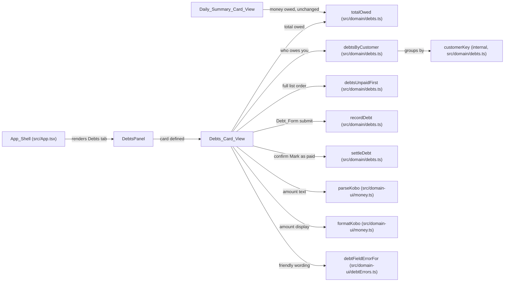

# Design: Debts card view, "Record a debt" and "Mark as paid"

## Overview

This spec finishes the everyday loop for money owed to the owner. It adds two pure domain functions — `debtsUnpaidFirst` and `debtsByCustomer` — and wires the existing `recordDebt` and `settleDebt` into a new Debts_Card_View, replacing the "Coming soon" placeholder in the App_Shell. It builds on `ghoststack-foundation` (`recordDebt`, `settleDebt`, `totalOwed`, `Debt`/`Stack` types), `app-shell-stock-card` (Card/Button/Field, `formatKobo`, `parseKobo`, the App_Shell's load/save queue, focus-management conventions) and `sales-and-daily-summary` (`salesNewestFirst`'s tie-break shape, the Tab_Bar, `Daily_Summary_Card_View`). None of that existing code changes except `src/App.tsx`, which gains the Debts tab wiring.

- **Domain** (`src/domain/debts.ts`) gains `debtsUnpaidFirst` and `debtsByCustomer` (both pure, no clock, no React, no id making). `recordDebt`, `settleDebt`, `totalOwed` are unchanged.
- **UI** (`src/domain-ui/`, `src/components/cards/`) gains a Customer-key helper, a kobo-to-friendly-wording error mapper, a Debts_Card_View, a Debt_Form, a "Mark as paid" confirmation, and a small `DebtsPanel` that shows either the view or the missing-card message.
- **App_Shell** (`src/App.tsx`) gains the Debts card lookup and wiring, replacing the placeholder paragraph, by rendering `DebtsPanel`.
- **Testing** gains jsdom + `@testing-library/react` as new dev dependencies (not yet installed), configured per-file so the existing Node-environment domain tests are unaffected, plus a shared `src/test/setup.ts` imported explicitly by component tests.

## Architecture

Data flow is unchanged from `docs/ARCHITECTURE.md` and the previous two specs: UI action → domain function → storage (via the existing save queue) → UI. The domain stays free of React, storage and the clock; the new debt id and the current time are read in the UI layer, exactly as `StockCardView` already does for `recordSale` (Requirement 4.11).



(The Customer-key helper placement is settled in "Components and Interfaces" below — it lives in `src/domain/debts.ts` as an internal, unexported helper, not in `src/domain-ui/`, because grouping by Customer key is `debtsByCustomer`'s own domain logic, not UI formatting or parsing.)

## File layout

```
src/domain/
  debts.ts                  + debtsUnpaidFirst, debtsByCustomer, customerKey (internal)
                               (recordDebt, settleDebt, totalOwed unchanged)
  debts.test.ts              (new unit test examples added)
  debts.property.test.ts     (new property tests added alongside existing invariant-5 test)
  index.ts                   new exports added
src/domain-ui/
  debtErrors.ts              debtFieldErrorFor(code) -> friendly text, never says "kobo"
  debtErrors.test.ts
src/components/cards/
  DebtsCardView.tsx          Debts_Card_View
  DebtsCardView.css
  DebtForm.tsx                customer-name + amount form, mirrors SaleForm.tsx's shape
  DebtsPanel.tsx             DebtsCardView when a Debts card exists, else the missing-card message
  DebtsCardView.test.tsx     component tests (new: jsdom + @testing-library/react)
src/test/
  setup.ts                   shared component-test setup (cleanup, crypto.randomUUID fallback)
src/App.tsx                 + debtsCard lookup, Debts tab wiring via DebtsPanel
vite.config.ts               unchanged (environment stays 'node'; no setupFiles); jsdom set per-file
package.json                 + devDependencies: @testing-library/react, @testing-library/jest-dom (or none), jsdom
```

No new top-level folders. `debtErrors.ts` sits in `src/domain-ui/` next to `money.ts`: it is UI-layer text mapping (Requirement 4.14 explicitly forbids touching `src/domain/result.ts`), the same reasoning the previous two specs used for `formatKobo`/`parseWholeNumber`.

## Data Models

No persisted shape changes. `Debt`, `Stack` and the four `Card` variants are unchanged (`src/domain/types.ts`). This spec adds one UI-only type, the result of `debtsByCustomer`, defined in the domain (it is returned data, not a UI concern):

```ts
// src/domain/debts.ts
export interface CustomerTotal {
  /** The customer's name as first typed (trimmed), from their earliest unpaid debt in the input. */
  name: string;
  /** Sum, in kobo, of that customer's unpaid debt amounts. */
  total: Kobo;
}
```

`CustomerTotal` is exported from `src/domain/debts.ts` and re-exported from `src/domain/index.ts`, matching how `RecordDebtInput`/`SettleDebtInput` are already exported next to the functions that use them.

## Components and Interfaces

### Domain: `customerKey` (internal helper, `src/domain/debts.ts`)

```ts
function customerKey(customer: string): string {
  return customer.trim().replace(/\s+/g, " ").toLowerCase();
}
```

Not exported — it is an implementation detail of `debtsByCustomer`, used only inside this file. `trim()` removes leading/trailing spaces, `replace(/\s+/g, " ")` collapses any run of whitespace (including tabs/newlines) to one space, `toLowerCase()` folds case. Per Assumption A1, no accent folding is applied. This matches the Glossary's "Customer key" definition and Requirement 2.3's "Ada" / " ada " / "ADA" example.

### Domain: `debtsUnpaidFirst` (`src/domain/debts.ts`)

```ts
export function debtsUnpaidFirst(debts: readonly Debt[]): Debt[]
```

Follows the same indexed-sort shape as `salesNewestFirst` in `src/domain/sales.ts` (Requirement 1.3/1.4 mirror that function's tie-break rules exactly, per Assumption A3):

1. Build `indexed = debts.map((debt, index) => ({ debt, index, t: Date.parse(debt.date) }))` so input order is available as a tie-breaker without mutating `debts`.
2. Sort `indexed` with a comparator that:
   - First compares by status group: any entry with `debt.status === "unpaid"` sorts before any entry with `debt.status === "paid"` (Requirement 1.1).
   - Within the same status group, a `NaN` parse (unparseable date) sorts **after** every parseable date in that group (Requirement 1.4).
   - When both dates parse, compare descending by parsed time — newest first (Requirement 1.2).
   - When both compare equal within the same group (same parsed time, or both unparseable), compare by `index` **descending** — the Debt that appears later in the input list sorts first (Requirement 1.3, 1.4).
3. Return `indexed.map((entry) => entry.debt)` — a new array; the elements themselves are the same `Debt` object references as in the input, and `debts` is never reordered or written to (Requirement 1.5). An empty `debts` returns `[]` (Requirement 1.7, since `indexed` is empty and `.map` on an empty array returns `[]`).

`debtsUnpaidFirst` never reads `Date.now()` or any other clock — `date` on each `Debt` is the only source of time read (Requirement 1.6).

### Domain: `debtsByCustomer` (`src/domain/debts.ts`)

```ts
export function debtsByCustomer(debts: readonly Debt[]): Result<CustomerTotal[]>
```

Algorithm, following the same running-sum-with-overflow-check shape as `dailyTotal`/`estimatedProfit` in `src/domain/sales.ts`:

1. Walk `debts` in input order. For each `debt` with `debt.status === "unpaid"`:
   a. Compute `key = customerKey(debt.customer)`.
   b. If `key` is not yet in the running map, insert it with `{ name: debt.customer.trim(), total: 0, firstIndex: <this debt's position> }` (Requirement 2.3, 2.4 — the name is the trimmed, not lower-cased, text of the *first* unpaid debt seen for that key, preserving the owner's original capitalization and spacing style minus the outer whitespace).
   c. Add `debt.amount` to that key's running `total`. If the new `total` is not `Number.isSafeInteger`, return `err("AMOUNT_TOO_BIG")` immediately (Requirement 2.7, 2.10 — checked on every addition, the same pattern `dailyTotal` uses, so a single pass never produces `NaN` or an unsafe number before detecting the overflow).
2. Every paid debt is skipped entirely in step 1 — it contributes to no key's `total` and does not create a new key (Requirement 2.2).
3. Convert the running map's entries to a `CustomerTotal[]`, dropping the internal `firstIndex` from the public shape, and sort by `total` descending; when two entries have equal `total`, the entry whose `firstIndex` is smaller (appeared earlier in the input) sorts first (Requirement 2.5, Assumption A2).
4. Return `ok(sorted)`. When no unpaid debt exists, the running map stays empty and `ok([])` is returned (Requirement 2.6).

`debtsByCustomer` builds a new map and a new array on every call and never writes to `debts` or any `Debt` (Requirement 2.8), and never reads the clock (Requirement 2.9). Because every addition is checked with `Number.isSafeInteger` before it is kept, the function never returns `ok` with a `NaN` or unsafe total (Requirement 2.10) — it either returns `ok` with every total a safe integer, or `err("AMOUNT_TOO_BIG")`.

### UI-layer: `debtFieldErrorFor` (`src/domain-ui/debtErrors.ts`)

```ts
export function debtFieldErrorFor(code: ErrorCode): string
```

A small, total mapping function, covering exactly the domain error codes `recordDebt`/`settleDebt`/`parseKobo` can produce that mention kobo or need friendlier wording:

```ts
const FRIENDLY_AMOUNT_TEXT =
  "Please type an amount using numbers only, like 1250 or 1250.50.";

export function debtFieldErrorFor(code: ErrorCode): string {
  if (code === "BAD_AMOUNT" || code === "AMOUNT_TOO_BIG" || code === "BAD_PRICE") {
    return FRIENDLY_AMOUNT_TEXT;
  }
  return ERROR_MESSAGES[code];
}
```

1. `BAD_AMOUNT` (from `recordDebt`), `AMOUNT_TOO_BIG` (from `recordDebt` or `debtsByCustomer`), and `BAD_PRICE` (from `parseKobo`) all map to the one friendly Naira-text sentence, which never contains the word "kobo" (Requirement 4.14). `BAD_PRICE`'s existing message in `src/domain/result.ts` happens not to mention kobo today, but it is included here so the Debt_Form's amount Field always shows the same wording regardless of which of the three codes produced the error, and so a future change to `BAD_PRICE`'s domain message cannot leak the word "kobo" through this Field without a design change here too.
2. Every other code (for example `BAD_CUSTOMER`, `CARD_NOT_FOUND`, `DEBT_NOT_FOUND`, `DEBT_ALREADY_PAID`) passes through unchanged via `ERROR_MESSAGES[code]`.
3. `src/domain/result.ts` is not imported for writing, only `ErrorCode` and `ERROR_MESSAGES` are imported for reading — the file itself stays unchanged, satisfying Requirement 4.14's "`src/domain/result.ts` SHALL stay unchanged."

### UI: `DebtForm` (`src/components/cards/DebtForm.tsx`)

```ts
export interface DebtFormProps {
  initialCustomerText: string;
  initialAmountText: string;
  onSubmit: (customerText: string, amountText: string) => void;
  onCancel: () => void;
  customerError?: string;
  amountError?: string;
  formError?: string;
  idPrefix?: string;
}
function DebtForm(props: DebtFormProps): JSX.Element
```

Mirrors `SaleForm.tsx`'s shape (raw text Fields, a `formError` paragraph at the top, Save/Cancel `Button`s) and `ItemForm.tsx`'s per-Field error wiring: two `Field`s (customer name — plain text; amount — `inputMode="decimal"`, the same `inputMode` `ItemForm` uses for its price Fields), each receiving its own error prop straight through to `Field`'s `error`, so the Field component's existing `aria-describedby`/`role="alert"` wiring links each message to its Field for screen readers (Requirement 4.13 — no new wiring needed, `Field.tsx` is unchanged and reused as-is).

### UI: `DebtsCardView` (`src/components/cards/DebtsCardView.tsx`)

```ts
export interface DebtsCardViewProps {
  stack: Stack;
  card: DebtsCard;
  onStackChange: (s: Stack) => void;
}
function DebtsCardView(props: DebtsCardViewProps): JSX.Element
```

#### UI state

```ts
type FormMode = { kind: "closed" } | { kind: "add" };
interface DebtFormState {
  customerText: string;
  amountText: string;
  customerError?: string;
  amountError?: string;
  formError?: string;
}
type ConfirmMode = { kind: "closed" } | { kind: "confirm-pay"; debtId: string };

const [formMode, setFormMode] = useState<FormMode>({ kind: "closed" });
const [debtForm, setDebtForm] = useState<DebtFormState>({ customerText: "", amountText: "" });
const [confirm, setConfirm] = useState<ConfirmMode>({ kind: "closed" });
const [settleError, setSettleError] = useState<string | undefined>();
const [notice, setNotice] = useState("");          // "Debt recorded" / "Debt marked as paid"
const noticeTimeout = useRef<ReturnType<typeof setTimeout> | undefined>(undefined);
const [pendingFocus, setPendingFocus] = useState<PendingFocus>(undefined); // where focus goes after a form/confirmation closes
const rootRef = useRef<HTMLDivElement | null>(null);              // view's root element, scope for focus queries
const recordButtonRef = useRef<HTMLButtonElement | null>(null);   // "Record a debt" button (focus target and fallback)
const notYetButtonRef = useRef<HTMLButtonElement | null>(null);   // focus target when the confirmation opens
const customerFieldRef = useRef<HTMLInputElement | null>(null);   // focus target when the form opens
```

with

```ts
type PendingFocus = { kind: "record" } | { kind: "pay"; debtId: string } | undefined;
```

This is the same `FormMode`/`error`-at-top-or-next-to-Field`/`aria-live` shape `StockCardView` already uses for its Add/Edit item form and sale form, extended with a `ConfirmMode` shaped like `StockCardView`'s existing `confirm-delete` state for the delete confirmation. One `noticeTimeout` ref is reused for both "Debt recorded" and "Debt marked as paid" (Requirement 3.10 only requires one confirmation at a time, not one notice at a time, but reusing a single ref mirrors `StockCardView`'s single `noticeTimeout` and keeps the two messages from ever overlapping, which also satisfies "the Debts_Card_View SHALL show only one confirmation at a time" by construction of `ConfirmMode` being a single value).

#### Rendering order: total, who-owes-you, full list, record button

1. **Total owed** (Requirement 3.2): `const owed = totalOwed(card.debts)`, shown at the top via the existing `totalOwed` from `src/domain/debts.ts`. When `Number.isSafeInteger(owed)` is true, show `formatKobo(owed)`. When it is false, show `ERROR_MESSAGES.AMOUNT_TOO_BIG` (read-only import from `src/domain/result.ts`) in place of the Naira figure, and the rest of the view still renders. `totalOwed` itself is not changed. Unaffected by any `debtsByCustomer` error (Requirement 3.6 — computed independently, so showing it never depends on `debtsByCustomer` succeeding).
2. **"Who owes you"** (Requirement 3.3, 3.6, 3.9): compute `const byCustomer = debtsByCustomer(card.debts)`.
   - If `!byCustomer.ok`, render `byCustomer.error.message` in place of the list (Requirement 3.6).
   - Else if `byCustomer.value.length === 0`, render a friendly message, e.g. "No one owes you money right now." (Requirement 3.9 — this covers both "no debts at all" and "debts exist but none unpaid", since both leave `byCustomer.value` empty).
   - Else render one row per `CustomerTotal`: `{name}` and `formatKobo(total)`.
3. **Full debt list** (Requirement 3.4, 3.5, 3.7): compute `const ordered = debtsUnpaidFirst(card.debts)`. Render one row per Debt, in that order:
   - Customer name (`debt.customer`, shown as stored — not the Customer key).
   - Amount via `formatKobo(debt.amount)`.
   - Date: `Date.parse(debt.date)`-based display via `new Date(debt.date).toLocaleString()`, the same pattern `SalesLogCardView` uses for `sale.time` — an unparseable date renders the literal "Invalid Date" text and the row still renders normally, never throwing (Requirement 3.7, mirroring `SalesLogCardView`'s handling of unparseable Sale times, Assumption A3).
   - Status label with icon, never colour alone (Requirement 3.5): `debt.status === "unpaid" ? { icon: "●", text: "Not paid" } : { icon: "✓", text: "Paid" }`, rendered the same way `ItemRow` renders its low-stock warning (`<span aria-hidden="true">{icon}</span> {text}`).
   - A "Mark as paid" `Button`, rendered only when `debt.status === "unpaid"` (Requirement 5.1), carrying a `data-debt-pay-button={debt.id}` attribute so the focus effect can find it. It stays mounted while a form or confirmation is open.
4. **Empty state** (Requirement 3.8): when `card.debts.length === 0`, skip steps 2–3's lists and show a friendly message ("You have no debts recorded yet.") plus the one "Record a debt" button; total owed still shows `formatKobo(0)` from step 1 (`totalOwed([])` is `0`, no special case needed).
5. **"Record a debt" button** (Requirement 4.1): rendered once, always mounted, including while the form or a confirmation is open, so it is always a valid focus target (it is the fallback target in the Focus section) — kept outside the `card.debts.length === 0` branch so it also shows in the empty state (Requirement 3.8).

All Play-mode only, no builder controls, no edit/delete affordance anywhere in this component (Requirement 3.10) — there is no builder-mode prop at all, matching how `SalesLogCardView` and `DailySummaryCardView` are already Play-mode-only components with no mode prop.

#### "Record a debt" flow

1. Tapping "Record a debt" resets `debtForm` to `{ customerText: "", amountText: "" }`, and sets `formMode = { kind: "add" }` (Requirement 4.1, 4.2).
2. A `useEffect` keyed on `formMode.kind === "add"` calls `customerFieldRef.current?.focus()` once the form has mounted (Requirement 9.1 — moves focus to the customer name Field when the form opens).
3. On submit:
   a. Call `parseKobo(amountText)`. If it fails, set `debtForm = { ...debtForm, amountError: debtFieldErrorFor(parsed.error.code) }`, keep the form open with both typed Fields unchanged, and do not call `recordDebt` (Requirement 4.3, 4.6).
   b. Otherwise call:
      ```ts
      recordDebt({
        stack,
        debtsCardId: card.id,
        customer: customerText,
        amount: parsed.value,
        debtId: crypto.randomUUID(),      // made in the UI layer, Requirement 4.11
        date: new Date().toISOString(),    // read in the UI layer, Requirement 4.11
      })
      ```
   c. If the Result is `{ ok: false, error: { code: "BAD_CUSTOMER", message } }`, set `debtForm = { ...debtForm, customerError: message }`, keep the form open with both typed Fields (Requirement 4.7).
   d. If the Result's error code is `BAD_AMOUNT` or `AMOUNT_TOO_BIG`, set `debtForm = { ...debtForm, amountError: debtFieldErrorFor(code) }`, keep the form open with both typed Fields (Requirement 4.8, 4.14).
   e. Any other error code (for example `CARD_NOT_FOUND`, `DUPLICATE_ID`): set `debtForm = { ...debtForm, formError: message }` at the top of the form (Requirement 4.9).
   f. On success: `setFormMode({ kind: "closed" })`, call `onStackChange(result.value)`, trigger the "Debt recorded" notice (Requirement 4.5, 4.12), and `setPendingFocus({ kind: "record" })` (Requirement 9.2).
4. Cancel: `setFormMode({ kind: "closed" })` without calling `recordDebt` (Requirement 4.10), then `setPendingFocus({ kind: "record" })`.

#### "Mark as paid" flow

1. Tapping "Mark as paid" on a Debt row clears `settleError` and sets `confirm = { kind: "confirm-pay", debtId }` (Requirement 5.1, 5.2). All "Mark as paid" buttons stay mounted while a confirmation is open. Requirement 5.10 (one confirmation at a time) holds because `confirm` is a single value: tapping another "Mark as paid" simply replaces the targeted `debtId`, so two confirmations can never show at once.
2. The confirmation shows the customer's name and `formatKobo(debt.amount)` for the targeted Debt, with "Yes, mark as paid" and "Not yet" buttons, both using the shared `Button` component so they inherit its 44px tap-area and focus-outline styling (Requirement 5.2, 5.9, Assumption A8). When the confirmation opens, a `useEffect` keyed on `confirm` focuses the "Not yet" button via `notYetButtonRef`.
3. "Yes, mark as paid": call `settleDebt({ stack, debtsCardId: card.id, debtId })`.
   - On success: `setConfirm({ kind: "closed" })`, call `onStackChange(result.value)`, trigger the "Debt marked as paid" notice (Requirement 5.3, 5.4, 5.5), and `setPendingFocus({ kind: "pay", debtId })`.
   - On error: `setConfirm({ kind: "closed" })`, `setSettleError(result.error.message)` (shown as a dismissible `role="alert"` message near the list, cleared on the next successful action), `setPendingFocus({ kind: "pay", debtId })`, and leave the Stack unchanged — `onStackChange` is not called (Requirement 5.8).
4. "Not yet": `setConfirm({ kind: "closed" })` without calling `settleDebt` (Requirement 5.7), then `setPendingFocus({ kind: "pay", debtId })`.

A card re-render after a successful `settleDebt` shows the targeted Debt with `status: "paid"` (from the new Stack flowing back down through `card.debts`), so its "Mark as paid" button no longer renders, and `totalOwed` over the new Stack is exactly `debt.amount` less than before (Requirement 5.4) — both follow directly from `settleDebt`'s existing behaviour (it only flips one Debt's `status` and nothing else) with no extra UI-side arithmetic needed.

#### Notices: "Debt recorded" / "Debt marked as paid"

```ts
const showNotice = (text: string) => {
  if (noticeTimeout.current !== undefined) clearTimeout(noticeTimeout.current);
  setNotice(text);
  noticeTimeout.current = setTimeout(() => {
    noticeTimeout.current = undefined;
    setNotice("");
  }, 3000);
};

useEffect(() => {
  return () => {
    if (noticeTimeout.current !== undefined) clearTimeout(noticeTimeout.current);
  };
}, []);
```

rendered once near the top of the returned JSX: `<p aria-live="polite">{notice}</p>` — the same always-present-live-region pattern `StockCardView` already uses for "Sale recorded" (Requirement 4.12, 5.5, 5.6). The cleanup effect clears any pending timeout on unmount, so a `setNotice` call never fires after the component is gone (Requirement 5.6's "clear the ... message and cancel the pending 3-second removal of it" is satisfied because there is nothing left to clear or remove once unmounted — the ref's timeout is what gets cancelled, and `notice` state simply stops existing with the component).

#### Focus management (Requirement 9)

```ts
useEffect(() => {
  if (pendingFocus === undefined) return;
  let target: HTMLElement | null = null;
  if (pendingFocus.kind === "pay") {
    target = rootRef.current?.querySelector<HTMLElement>(
      `[data-debt-pay-button="${CSS.escape(pendingFocus.debtId)}"]`,
    ) ?? null;
  } else {
    target = recordButtonRef.current;
  }
  (target ?? recordButtonRef.current)?.focus();
  setPendingFocus(undefined);
}, [pendingFocus, card.debts]);
```

The effect is keyed on `pendingFocus` and the rendered list (`card.debts`), so it runs after the render that follows a Stack change and finds the freshly rendered buttons.

1. **Opening** (Requirement 9.1): the Debt_Form's customer name `Field` receives focus via `customerFieldRef`, wired through `Field`'s existing `id`/`htmlFor` — `DebtForm` forwards a `ref` prop on its first `Field`'s underlying `<input>` (a small, local addition to how `Field` is used here; `Field.tsx` itself is unchanged, the `ref` is attached the same way any React DOM ref is attached to a component that forwards it, or — if simpler — `DebtsCardView` calls `document.getElementById(`${idPrefix}-customer`)?.focus()` after the form mounts, avoiding any change to `Field.tsx`'s props at all; this exact mechanism is an implementation detail decided during coding, not fixed further here).
2. **Opening a confirmation**: the "Not yet" button is focused via `notYetButtonRef` in an effect keyed on `confirm`.
3. **Closing** (Requirement 9.2, 9.3): every path that closes the Debt_Form or the "Mark as paid" confirmation — submit success, Cancel, "Not yet", and the `settleDebt` error path — calls `setPendingFocus` with the opener: `{ kind: "record" }` when the Debt_Form was opened via "Record a debt", or `{ kind: "pay", debtId }` when a confirmation was opened from that debt's "Mark as paid". After the next render the effect above finds the target (for `pay`, the element whose `data-debt-pay-button` equals the debt id, queried within `rootRef`; for `record`, `recordButtonRef`). If the target no longer exists (for example a settled debt, whose "Mark as paid" button is gone), focus falls back to the "Record a debt" button (Requirement 9.3). It then calls `focus()` and clears `pendingFocus`.
4. All "Mark as paid" buttons and the "Record a debt" button stay mounted while a form or confirmation is open, so a focus target always exists. The Debt_Form's own error paths (4.6–4.9) do **not** set `pendingFocus`, because the form stays open on those paths.

### App_Shell changes (`src/App.tsx`)

1. **Debts card lookup**: `debtsCard` is already computed today (`const debtsCard = stack?.cards.find((c) => c.type === "debts")`) but is untyped beyond the base `Card` union member check — it is narrowed the same way `salesCard` already is: `stack?.cards.find((c): c is DebtsCard => c.type === "debts")`, giving it the `DebtsCard` type `DebtsCardView` needs.
2. **Rendering the Debts panel**, replacing the placeholder:
   ```tsx
   {selectedTab === "debts" && (
     <DebtsPanel stack={stack} card={debtsCard} onStackChange={onStackChange} />
   )}
   ```
   `DebtsPanel` (`src/components/cards/DebtsPanel.tsx`) has props `{ stack: Stack; card?: DebtsCard; onStackChange: (s: Stack) => void }`. It renders `<DebtsCardView stack={stack} card={card} onStackChange={onStackChange} />` when `card` is defined, and otherwise the paragraph "Debts can't be shown because this shop has no Debts card." (Requirement 6.1, 6.4). `debtsCard` is still narrowed in `App.tsx` with the type-guard `find`, and no non-null assertion is used anywhere in this wiring (Requirement 6.5): `DebtsPanel` checks `card` itself before reading `card.id` or passing it on.
3. **No other change**: the Tab_Bar, `StockCardView`, `SalesLogCardView`, `DailySummaryCardView`, the load effect, `enqueueSave`, `latestStackRef`, and the theme toggle are untouched (Requirement 6.3). Only the `selectedTab === "debts"` branch's JSX changes, so the Debts_Card_View mounts only while that tab is selected and never runs its effects (its notice-timeout cleanup, its focus effects) while another tab is shown (Requirement 6.6) — the same "only the selected panel is mounted" structural guarantee the previous spec established for the other three panels.

### Daily summary check (Requirement 7)

`DailySummaryCardView` (`src/components/cards/DailySummaryCardView.tsx`, read above) already computes `const debtsCard = stack.cards.find((c) => c.type === "debts")` and renders `formatKobo(totalOwed(debts))` using the same `totalOwed` function `DebtsCardView` uses for its own total-owed row (both import it from `src/domain/debts.ts`). This already satisfies Requirement 7.1 and 7.2 — both views call the exact same function over the exact same `card.debts` array drawn from the one `Stack` the App_Shell holds, so they can never disagree for the same Stack. Per Requirement 7.3 and Assumption A7, **this file is left unchanged** by this spec. In particular, the unsafe-total handling added to `DebtsCardView` (showing `ERROR_MESSAGES.AMOUNT_TOO_BIG` instead of a Naira figure) is not added to `DailySummaryCardView`, and `totalOwed` is not changed either: the Daily summary stays exactly as it is. Requirement 7.4 ("after recording or settling a debt, selecting the Daily summary tab shows the updated money owed") follows automatically: `recordDebt`/`settleDebt` return a new `Stack` that flows through `onStackChange` into the one `stack` state in `App.tsx`, which both `DebtsCardView` and `DailySummaryCardView` read on their next render — there is no separate cached total anywhere to go stale.

## Correctness Properties

*A property is a characteristic or behavior that should hold true across all valid executions of a system — essentially, a formal statement about what the system should do. Properties serve as the bridge between human-readable specifications and machine-verifiable correctness guarantees.*

### Reflection on redundant properties

- Requirements 1.2, 1.3 and 1.4 (ordering within a group, same-date tie-break, unparseable-date placement and its own tie-break) all describe one ordering contract for `debtsUnpaidFirst`, exactly as `salesNewestFirst`'s three guarantees were folded into one property (Property 23) in the previous spec's design. They are folded into Property 2 here, together with the grouping guarantee from 1.1, mirroring that precedent.
- Requirement 1.7 (empty list returns empty list) is a degenerate case of the permutation guarantee (an empty list is trivially a permutation of itself) and is covered by a unit test rather than a separate property.
- Requirements 2.3 and 2.4 (grouping by Customer key; name-as-first-typed and summed total) are one statement about what each `CustomerTotal` entry must contain, folded into Property 4.
- Requirement 2.6 (empty list when no unpaid debt exists) is a degenerate case of Property 4 and Property 5 (zero groups, trivially ordered) and is covered by a unit test rather than a separate property.
- Requirements 2.7 and 2.10 (overflow returns `AMOUNT_TOO_BIG`; never `NaN`/unsafe) describe the same guarantee from two angles — "the bad case is handled" and "the good case is never corrupted" — and are folded into one property (Property 6), the same way Property 21 in the previous spec's design combined its equivalent pair for `dailyTotal`/`estimatedProfit`.
- Requirements 1.5, 1.6, 2.8 and 2.9 ("no mutation", "never reads the clock") are folded into one frozen-input property (Property 7) shared across both new domain functions, matching the previous spec's Property 22 and Property 7 from the spec before that.
- Requirement 8.7 ("money-rules invariant 5: sum of Customer totals equals `totalOwed`") is its own property (Property 8) because it cross-checks two functions against each other, a different shape of guarantee than any single-function property above.
- Requirement 8.8 ("counts only unpaid debts") restates Requirement 2.2 and is the same property as Property 3 below — not duplicated.
- Requirement 8.12 ("settling a debt reduces that customer's total by exactly that amount, others unchanged") is its own property (Property 9) because it is about the interaction between `settleDebt` and `debtsByCustomer` across two calls, not a property of either function alone.

### Property 1: `debtsUnpaidFirst` is a permutation of its input

*For any* list of Debts, `debtsUnpaidFirst(debts)` SHALL return a list that is a permutation of `debts` — the same Debt objects, by reference, none lost, none repeated, none added.

**Validates: Requirements 1.1, 1.7**

### Property 2: `debtsUnpaidFirst` groups unpaid before paid and orders each group newest-first with later-input ties winning

*For any* list of Debts, in the list returned by `debtsUnpaidFirst(debts)`: every Debt with `status === "unpaid"` SHALL appear before every Debt with `status === "paid"`; and within each status group, for any two Debts both having a parseable `date`, the one with the later parsed `date` SHALL come first; any Debt in a group whose `date` cannot be parsed SHALL come after every Debt in that same group with a parseable `date`; and when two Debts in the same group compare equal (same parsed date, or both unparseable), the Debt that appears later in `debts` SHALL come first in the output.

**Validates: Requirements 1.2, 1.3, 1.4**

### Property 3: `debtsByCustomer` ignores every paid debt

*For any* list of Debts, changing the `customer`, `amount`, or `date` of any Debt whose `status` is `"paid"`, or adding or removing Debts whose `status` is `"paid"`, SHALL NOT change the result of `debtsByCustomer` on the rest of the list.

**Validates: Requirements 2.2, 8.8**

### Property 4: `debtsByCustomer` groups unpaid debts by Customer key, with the first-typed name and the correct sum

*For any* list of Debts, for every distinct Customer key present among the unpaid Debts, `debtsByCustomer(debts)` SHALL return (when it returns `ok`) exactly one `CustomerTotal` whose `name` equals the trimmed `customer` text of the first unpaid Debt in `debts` with that Customer key, and whose `total` equals the sum of `amount` over every unpaid Debt in `debts` with that Customer key — and SHALL return no `CustomerTotal` for any Customer key that has no unpaid Debt.

**Validates: Requirements 2.3, 2.4**

### Property 5: `debtsByCustomer` orders Customer totals largest-first with earlier-first-appearance ties winning

*For any* list of Debts such that `debtsByCustomer(debts)` returns `ok(totals)`, for any two entries in `totals`, the one with the larger `total` SHALL come first; and when two entries have an equal `total`, the entry whose Customer key's first unpaid Debt appears earlier in `debts` SHALL come first.

**Validates: Requirements 2.5**

### Property 6: `debtsByCustomer` never returns `NaN` or an unsafe total, and overflow always returns `AMOUNT_TOO_BIG`

*For any* list of Debts, `debtsByCustomer(debts)` SHALL either return `ok(totals)` where every entry's `total` is a safe integer, or return an error result with code `AMOUNT_TOO_BIG` — and SHALL NEVER return `ok(totals)` containing a `NaN`, `Infinity`, or non-safe-integer `total`.

**Validates: Requirements 2.7, 2.10, 8.11**

### Property 7: `debtsUnpaidFirst` and `debtsByCustomer` never mutate a frozen input

*For any* deep-frozen list of Debts, calling `debtsUnpaidFirst` or `debtsByCustomer` (with any input, valid or invalid) SHALL complete without throwing, and the frozen input SHALL remain deep-equal to a snapshot taken before the call.

**Validates: Requirements 1.5, 1.6, 2.8, 2.9, 8.6, 8.10**

### Property 8: The sum of Customer totals equals `totalOwed`

*For any* list of Debts such that `debtsByCustomer(debts)` returns `ok(totals)`, the sum of `total` over every entry in `totals` SHALL equal `totalOwed(debts)`.

**Validates: Requirements 8.7**

### Property 9: Settling a debt reduces exactly that customer's total by that debt's amount

*For any* Stack with a Debts card containing at least one unpaid Debt, and for any such unpaid Debt `d` in it, comparing `debtsByCustomer` on the Debts card's list before and after calling `settleDebt` for `d`: the Customer total for `d`'s Customer key SHALL decrease by exactly `d.amount` (becoming absent, meaning a total of `0`, when no unpaid Debt for that Customer key remains), and every other Customer key's total SHALL be unchanged.

**Validates: Requirements 8.12**

## Error Handling

- `debtsByCustomer` reuses the existing `AMOUNT_TOO_BIG` error code and message from `src/domain/result.ts` — no new error code is added by this spec, matching the Confirmed decision on overflow handling used by `dailyTotal`/`estimatedProfit`. `debtsUnpaidFirst` is a total function and never returns a `Result`; it cannot fail.
- `recordDebt` and `settleDebt` are unchanged; `DebtsCardView`'s form and confirmation reuse their existing error codes (`BAD_AMOUNT`, `BAD_CUSTOMER`, `AMOUNT_TOO_BIG`, `CARD_NOT_FOUND`, `DUPLICATE_ID` for `recordDebt`; `CARD_NOT_FOUND`, `DEBT_NOT_FOUND`, `DEBT_ALREADY_PAID` for `settleDebt`).
  - `BAD_CUSTOMER` → shown next to the customer name Field (Requirement 4.7).
  - `BAD_AMOUNT`, `AMOUNT_TOO_BIG` (from `recordDebt`), and `parseKobo`'s `BAD_PRICE` → all shown next to the amount Field via `debtFieldErrorFor`, in the shared friendly wording that never says "kobo" (Requirement 4.8, 4.14).
  - Any other `recordDebt` error (`CARD_NOT_FOUND`, `DUPLICATE_ID`) → shown as a `formError` at the top of the Debt_Form (Requirement 4.9).
  - Any `settleDebt` error → the confirmation closes and the message is shown near the debt list; the Stack is left unchanged, so the UI never shows a debt as paid when `settleDebt` did not actually settle it (Requirement 5.8).
- `debtsByCustomer` returning an error never hides the total owed or the full debt list — those two come from `totalOwed` and `debtsUnpaidFirst`, computed independently in the same render (Requirement 3.6).
- If `totalOwed(card.debts)` is not a safe integer, `DebtsCardView` shows `ERROR_MESSAGES.AMOUNT_TOO_BIG` at the top instead of a Naira figure, and the rest of the view still renders. `totalOwed` and the Daily summary are unchanged.
- A Stack with no Debts card is not an error that stops the app: `DebtsPanel` (rendered by `App.tsx`) shows "Debts can't be shown because this shop has no Debts card." in place of `DebtsCardView` and never calls `recordDebt`/`settleDebt`/`debtsByCustomer` with an undefined card (Requirement 6.4).
- An unparseable Debt `date` is not an error state in the UI: the Debt still renders in the full list (via `debtsUnpaidFirst`'s defined placement for it) with its date shown as `"Invalid Date"`, and the app does not crash (Requirement 3.7).

## Testing Strategy

**Unit tests** (Vitest, `src/domain/debts.test.ts`) cover specific examples and edge cases:

- `debtsUnpaidFirst`: an empty list (→ `[]`); a list mixing paid and unpaid Debts (→ all unpaid first, in original relative grouping checked by status); two Debts in the same group with the same `date` (→ later input position first); a Debt with an unparseable `date` mixed with parseable ones in the same group (→ sorts last in that group).
- `debtsByCustomer`: an empty list (→ `ok([])`); a list with only paid debts (→ `ok([])`); two Debts whose `customer` text differs only by case or by leading/trailing/collapsible whitespace (for example `"Ada"`, `" ada "`, `"ADA"`) (→ one `CustomerTotal`, not two); the returned `name` equals the first-typed (trimmed) customer text, not a later or lower-cased one; a tie between two customers' totals (→ earlier-first-unpaid-debt customer first); a list engineered to overflow (→ `err("AMOUNT_TOO_BIG")`).
- `debtFieldErrorFor` (`src/domain-ui/debtErrors.test.ts`): `BAD_AMOUNT`, `AMOUNT_TOO_BIG`, and `BAD_PRICE` all return the one friendly sentence and it never contains the substring `"kobo"`; every other `ErrorCode` returns `ERROR_MESSAGES[code]` unchanged.
- `DebtsCardView`/`DebtForm` component behaviour (new, `src/components/cards/DebtsCardView.test.tsx`, using `@testing-library/react`): recording a debt successfully; the `BAD_CUSTOMER` message appearing next to the customer Field; the amount-Field friendly message appearing for a bad amount; a `CARD_NOT_FOUND`-style error appearing at the top of the form; "Mark as paid" opening a confirmation showing the right name and amount; confirming settles the debt and shows "Paid"; "Not yet" leaves the debt unpaid; a paid debt showing no "Mark as paid" button; the empty-state message and "Record a debt" button when there are no debts; the missing-Debts-card message when `DebtsPanel` is rendered with no `card`; an unsafe total owed (a Debts card fixture whose amounts sum past `Number.MAX_SAFE_INTEGER`) showing the `AMOUNT_TOO_BIG` message instead of a Naira figure while the list still renders; and focus: after Cancel, "Not yet" and a successful submit, focus returns to the opener ("Record a debt" or that debt's "Mark as paid"), falling back to "Record a debt" when the debt's button is gone (for example after it is paid). The notice tests use `vi.useFakeTimers()` and `vi.advanceTimersByTime(3000)` to check the 3-second clear, and restore real timers afterward (`vi.useRealTimers()` in `afterEach`).

**Property tests** (fast-check, `numRuns: 100` minimum, each tagged with its design property number), added to `src/domain/debts.property.test.ts` alongside the existing invariant-5 (`totalOwed`) test:

| Property | Location |
| --- | --- |
| 1, 2, 7 (debtsUnpaidFirst part) | `src/domain/debts.property.test.ts` |
| 3, 4, 5, 6, 7 (debtsByCustomer part), 8 | `src/domain/debts.property.test.ts` |
| 9 | `src/domain/debts.property.test.ts` (uses both `settleDebt` and `debtsByCustomer`) |

Generators extend the existing `debtArb`/`debtsArb`/`stackArb` already defined in `src/domain/debts.property.test.ts` (read above — `debtArb` takes an explicit `id`, `debtsArb` builds a tuple of 0–8 Debts with a fixed `date`, `stackArb` wraps them in a full `Stack`):

- `arbDebtDate`: extends the fixed-`DATE` generator used today to a mix of several distinct dates plus occasional unparseable strings, via `fc.oneof({ weight: 4, arbitrary: arbIsoInstant }, { weight: 1, arbitrary: fc.constantFrom("", "not-a-date", "2024-13-45") })`, so Properties 2 and 7 exercise both the ordering and the unparseable-date path. `arbIsoInstant` is the same `fc.date(...).map(d => d.toISOString())` generator pattern introduced in `sales.property.test.ts`.
- `arbCustomerName`: a small alphabet of base names (for example `fc.constantFrom("Ada", "Bola", "Chidi")`) combined with `fc.constantFrom` over whitespace/case variants (padding, extra internal spaces, case changes) via `fc.tuple` and string composition, so Property 4's grouping is exercised by names that must collide as well as names that must not.
- `arbDebtWithKeyCollisions`: extends `debtArb` to draw `customer` from `arbCustomerName` and `date` from `arbDebtDate`, replacing the fixed `"debt-i"` id and `DATE` constant used by today's `debtArb`/`debtsArb` for the new property tests (the existing invariant-5 test's generators are untouched, since Requirement 8.16 requires the existing tests to keep passing without edits to their expected results).
- `arbOverflowingDebts` (Property 6's overflow branch): a short list of unpaid Debts sharing one Customer key, with `amount` values near `Number.MAX_SAFE_INTEGER`, built the same way the previous specs' overflow properties constructed deliberately-overflowing inputs.
- Deep-freeze helper: reuse the existing `deepFreeze` function already defined in `src/domain/debts.property.test.ts` for Property 7.

Generators for Properties 1 through 5, 8 and 9 use bounded amounts (`fc.integer({ min: 1, max: 1_000_000 })`, as the existing `debtArb` already does) and short lists (0–8 or similar), so a generated list does not overflow by accident (Requirement 8.15). Property 6 is the one exception and builds overflowing lists on purpose.

Each property test is written in the same task as the function it covers, per `money-rules.md` and Requirement 8.13.

### Component test setup: jsdom + `@testing-library/react`

`package.json`'s current `devDependencies` (checked above) do not yet include `@testing-library/react`, `@testing-library/dom`, or `jsdom` — none of the three are installed in `node_modules`. This spec adds them as new dev dependencies:

- `jsdom` — the DOM environment Vitest needs for any test that renders a component.
- `@testing-library/react` — `render`, `screen`, `fireEvent`/`userEvent`-free query helpers for asserting on rendered output and firing events.
- (`@testing-library/jest-dom` is optional — Vitest's built-in `expect` already covers the assertions this spec's tests need, such as `screen.getByText(...)`'s own throw-on-not-found behaviour and `toBeDefined`/`toBeNull`; it is not required and is not added unless a task turns out to need a specific matcher like `toBeDisabled`.)

`vite.config.ts`'s `test.environment` is `'node'` today (checked above), and every existing domain test (`src/domain/**/*.test.ts`) relies on that — switching the global environment to `'jsdom'` would still work for those tests (they do not touch the DOM), but it is unnecessary and adds a heavier default environment to every test file, including the many pure-function property tests that run hundreds of iterations each. Instead, per-file environment overrides are used, which Vitest supports via a docblock comment at the top of a test file:

```ts
// @vitest-environment jsdom
```

placed as the first line of `src/components/cards/DebtsCardView.test.tsx` (and any other new `*.test.tsx` component test file). This is the standard Vitest mechanism for overriding `test.environment` per file without touching the shared config, so `vite.config.ts` itself does not change, and every existing `src/domain/**/*.test.ts` and `src/domain-ui/**/*.test.ts` file keeps running under `'node'` exactly as before (Requirement 8.16's "existing tests SHALL keep passing"). `include` in `vite.config.ts` already matches `src/**/*.test.{ts,tsx}`, so a new `.test.tsx` file is picked up with no config change at all.

**Shared setup file (`src/test/setup.ts`)**: component tests import it explicitly (`import "../../test/setup";`) as the second line of each `.test.tsx` file, after the `@vitest-environment` docblock. It is deliberately not registered through `vite.config.ts` `setupFiles`, because a global setup file would also run in the Node environment for every existing domain test and would load `@testing-library/react` there for no reason. `vite.config.ts` therefore does not change. The file:

- calls `afterEach(cleanup)` with `cleanup` from `@testing-library/react`, so rendered components are unmounted between tests;
- stubs `crypto.randomUUID` (with `vi.stubGlobal("crypto", ...)` or by defining it on `globalThis.crypto`) only when `typeof crypto?.randomUUID !== "function"`, so a jsdom without it still gives `DebtsCardView` an id to use.

Notice tests call `vi.useFakeTimers()` and `vi.advanceTimersByTime(3000)`, and restore real timers afterward with `vi.useRealTimers()` in `afterEach`, so a fake clock never leaks into other tests.

## Dependencies

New dev dependencies: `jsdom`, `@testing-library/react` (and its peer, `@testing-library/dom`, installed transitively). No other new packages. `fast-check`, `vitest`, `react`, `react-dom`, `idb` are already installed and approved, carried over from the previous three specs. Per `tech.md`'s "Ask before adding a new package" — these three are explicitly pre-approved by Requirement 8.17 ("component tests using `@testing-library/react` and jsdom (already approved)"), so no additional confirmation step is needed before the implementation tasks install them.

## Decisions

- **`customerKey` lives in `src/domain/debts.ts` as an unexported helper, not in `src/domain-ui/`.** Grouping debts by a normalized customer identity is `debtsByCustomer`'s own domain logic — it decides which Debts are "the same customer" for the purpose of a sum, which is a business rule, not a display-formatting or input-parsing concern the way `formatKobo`/`parseKobo` are. It is not exported because no other module needs it; `debtsByCustomer` is the only caller.
- **`CustomerTotal` is defined and exported from `src/domain/debts.ts`, not from a UI file.** It is the return shape of a domain function, the same way `RecordDebtInput` and `SettleDebtInput` are domain-defined input shapes next to the functions that use them.
- **The kobo-to-friendly-wording mapping is a small lookup table (`debtFieldErrorFor`), not a general string-replace on the domain message.** `src/domain/result.ts` must stay unchanged (Requirement 4.14), and a string-replace on `"kobo"` would be fragile (it would need to also fix capitalization, grammar, and would silently do the wrong thing if a domain message's wording changes in the future). A fixed table over the three known codes that currently need friendlier amount wording is simple, total, and easy to extend if a new code needs the same treatment later.
- **`debtsByCustomer`'s overflow check runs on every addition, not once at the end**, mirroring the decision already made for `dailyTotal`/`estimatedProfit` in the previous spec, for the same reason: catching an overflow the moment it happens avoids ever holding or returning a value that has already become unsafe.
- **The Debt_Form and the "Mark as paid" confirmation share one `noticeTimeout` ref and one `notice` string state**, rather than two independent timers, because the two messages ("Debt recorded", "Debt marked as paid") can never be relevant at the same instant from the one component (only one form or confirmation is open at a time, per Requirement 3.10/5.10), so one shared mechanism is simpler and cannot leave a stale notice visible from a different flow.
- **Focus is restored through a `pendingFocus` state and an effect, not a stored DOM node.** The handler that closes a form or confirmation records the opener (`{ kind: "record" }` or `{ kind: "pay", debtId }`), and an effect after the next render looks the target up (`data-debt-pay-button` equal to the debt id, within the view's root ref, or the "Record a debt" button ref). A stored node could be stale after a Stack change re-renders the list; a lookup after render cannot. If the target is gone (for example a debt that was just paid has no "Mark as paid" button), focus falls back to "Record a debt" (Requirement 9.3). All "Mark as paid" buttons and the "Record a debt" button stay mounted while a form or confirmation is open, so a target always exists.
- **jsdom and `@testing-library/react` are introduced via a per-file `@vitest-environment jsdom` pragma, not a global config change.** This keeps every existing and future pure-logic test (the majority of the suite, including all property tests) running under the lighter `'node'` environment by default, and scopes the DOM environment's cost to the handful of component test files that actually need it.
- **The Debts tab's missing-card message lives in a small `DebtsPanel` component (`src/components/cards/DebtsPanel.tsx`), not as an inline paragraph in `App.tsx`.** Putting the "card defined or not" branch in a component lets a component test render it with no card and check the message, without having to mount all of `App`.
- **Component tests import `src/test/setup.ts` explicitly instead of using `setupFiles`.** A global `setupFiles` entry would run in the Node environment for every existing test; the explicit import keeps `vite.config.ts` unchanged.
- **An unsafe total owed shows the existing `AMOUNT_TOO_BIG` message in `DebtsCardView` only.** `totalOwed` and `DailySummaryCardView` are left unchanged.

## Requirements Traceability

| Requirement | Design coverage |
| --- | --- |
| 1.1–1.7 (`debtsUnpaidFirst`) | `src/domain/debts.ts` `debtsUnpaidFirst`; Properties 1, 2, 7; unit tests |
| 2.1–2.10 (`debtsByCustomer`) | `src/domain/debts.ts` `debtsByCustomer`, `customerKey`, `CustomerTotal`; Properties 3–8; unit tests |
| 3.1–3.12 (Debts_Card_View, total owed) | `DebtsCardView.tsx` rendering order section (including the unsafe-total message); Error Handling |
| 4.1–4.14 (Record a debt) | `DebtsCardView.tsx` "Record a debt" flow; `DebtForm.tsx`; `debtErrors.ts`; Error Handling |
| 5.1–5.10 (Mark as paid) | `DebtsCardView.tsx` "Mark as paid" flow; Error Handling |
| 6.1–6.6 (Tab wiring, missing card) | `App.tsx` changes; `DebtsPanel.tsx` |
| 7.1–7.4 (Daily summary stays in step) | "Daily summary check" section (no file change) |
| 8.1–8.17 (Tests and money rules) | Testing Strategy; Properties 1–9; component test setup |
| 9.1–9.3 (Focus) | `DebtsCardView.tsx` Focus management section (`pendingFocus`); Decisions |
