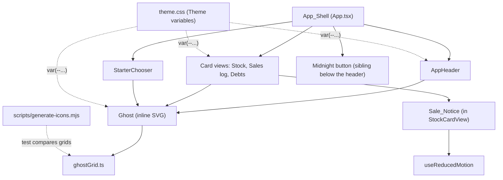

# Design Document

## Overview

This spec is visual polish only. It adds a pixel ghost, a header, friendly empty-state lines, a moonlit midnight palette, a small sale animation, one styling pass, a contrast check, a small-screen layout pass and a screenshots list.

Rules that hold for the whole design:

- Nothing in `src/domain/`, `src/domain-ui/` or `src/storage/` changes.
- No new package is added. No font, image or icon file is added.
- Existing test files are not edited and must still pass.
- Existing text, roles, class names, ids and accessible names stay. New elements and new text are only added.
- The only new logic is in `src/theme/`: `contrast.ts` (pure `contrastRatio`), `parseThemeVariables.ts` and `palettePairs.ts`. Everything else is markup, CSS and one small hook.

### Design decisions

| Decision | Choice | Why |
| --- | --- | --- |
| Ghost drawing source | One shared constant in `src/components/ghostGrid.ts`. `scripts/generate-icons.mjs` stays as it is. | The script is plain Node and cannot import TypeScript. A test parses the grid out of the script and compares it, so the two cannot drift and the icon output does not change. |
| Ghost colour | `fill="currentColor"` on a wrapper that sets `color` from a Theme variable | No hard-coded colour in the component. |
| Header heading | One new `<h1>` "GhostStack" inside `AppHeader` | `App.tsx` has no `h1` today. Existing `h2` and `h3` keep their levels. |
| Empty-state wording | A new `<p>` next to the existing `<p>` | A test that matches the existing text still finds exactly one element. |
| Reduced motion | A hook `useReducedMotion` plus a CSS `@media (prefers-reduced-motion: reduce)` rule | The hook decides the class. The CSS rule is a second safety net. |
| Sale animation restart | One Sale_Notice element that alternates the classes `sale-notice--pop` and `sale-notice--pop-b`, chosen by the parity of a sale counter. Both classes run the same keyframes, defined under two names. | The class changes on each sale, so the browser restarts the animation. The element is never remounted, so the live region keeps its identity. The text, role and timing stay the same. |
| Midnight button position | A sibling rendered directly below `AppHeader` in `App.tsx` | `AppHeader` takes no children and holds no button. The button code, label and handler stay in `App.tsx`. |
| Contrast check | A unit test that reads `theme.css` from disk and uses `parseThemeVariables` | The palette is the single source of truth. The test fails when a colour changes badly. |
| Colour scan | A unit test over every `.css` file except `theme.css` | Keeps `theme.css` the only file with colour values (Requirement 4.5). |

### Facts found in the repo

- `src/App.tsx` returns `<main>`. It holds the Midnight `<Button onClick={toggleTheme}>` with the labels "Midnight mode: on" and "Midnight mode: off". It then renders `NoticeArea` and the screens. There is no `<h1>`.
- The load states are `loading`, `error`, `choosing` and `ready`. The loading screen is `<p>Opening your shop…</p>`. The error screen is `<p role="alert">`. The choosing screen renders `StarterChooser`.
- `theme.css` defines `--color-bg`, `--color-fg`, `--color-muted-fg`, `--color-border`, `--color-accent`, `--color-title-bg`, `--color-title-fg`, `--color-danger-bg`, `--color-danger-fg`, `--color-warning-bg`, `--color-warning-fg`, `--color-focus`, `--font-pixel`, `--font-body`, `--border-width`, `--space-1` to `--space-4` and `--tap-min`. Light values are in `:root`. Midnight values are in `[data-theme="midnight"]`, which sets every colour variable but none of the font, border-width, spacing or tap-size variables.
- `Field` renders `span.field__error` with `role="alert"` and `id`. `ItemForm` and `StockCardView` render `p.item-form__error` with `role="alert"`.
- `StockCardView` shows the Sale_Notice as `<p aria-live="polite">{saleNotice}</p>`. It sets "Sale recorded" and clears it after 3000 ms. The empty state is `<div className="stock-card__empty"><p>You have no items yet.</p>{addButton}</div>`.
- `scripts/generate-icons.mjs` holds `GHOST`, a 16-row array of 16-character strings. A `#` is a filled cell. A `.` is empty. `GRID` is 16.
- New Theme variables are added to `theme.css`. The final names are listed in "Theme and Palette". Colour variables: `--color-surface`, `--color-ghost`, `--color-accent-fg`, `--color-hover-bg`, `--color-hover-fg`, `--color-active-bg`, `--color-active-fg`, `--color-disabled-bg`, `--color-disabled-fg`, `--color-error-fg`, `--color-notice-bg`, `--color-notice-fg`, `--color-tab-selected-bg`, `--color-tab-selected-fg`, `--color-tab-bg`, `--color-tab-fg`. Other variables: `--font-size-title`, `--font-size-body`, `--line-height`, `--radius`, `--max-content-width`, `--measure`, `--space-5`.

## Architecture

The data flow does not change. The new code only draws things and reads one media query.

### File layout

```
src/
  theme/
    contrast.ts            NEW  pure contrastRatio(a, b)
    contrast.test.ts       NEW  fast-check properties and unit tests
    parseThemeVariables.ts NEW  reads theme.css text into two maps
    parseThemeVariables.test.ts NEW
    palettePairs.ts        NEW  Pair_List and the "not used for text" list
    palette.test.ts        NEW  reads theme.css, checks every pair in both themes
  components/
    Ghost.tsx              NEW  Ghost_Mascot (inline SVG)
    Ghost.css              NEW  ghost colour and size rules
    ghostGrid.ts           NEW  shared GHOST grid (16 strings of 16 chars)
    AppHeader.tsx          NEW  header with h1 and decorative ghost
    AppHeader.css          NEW
    useReducedMotion.ts    NEW  hook over matchMedia
    theme.css              EDIT midnight palette, new variables, base rules
    Card.css, Button.css, Field.css, Dialog.css  EDIT styling pass
    cards/*.css, builder/*.css, backup/*.css, NoticeArea css    EDIT styling pass
    cards/StockCardView.tsx    EDIT tagline, ghost, Sale_Notice alternating class
    cards/SalesLogCardView.tsx EDIT tagline, ghost
    cards/DebtsCardView.tsx    EDIT tagline, ghost
    builder/StarterChooser.tsx EDIT ghost, extra intro line
    Field.tsx              EDIT separate error icon element
    cards/ItemForm.tsx (and the other forms with p.item-form__error) EDIT error icon element
  App.tsx                  EDIT insert AppHeader
  test-helpers/ (or src/test/) matchMedia mock helper   NEW
docs/
  SCREENSHOTS.md           NEW  manual screenshots list
```

Notes:

- `src/theme/` is new and sits outside the Protected_Folders. It has no React code and no storage code.
- Tests for new components sit next to them, like the existing tests.
- The `matchMedia` mock helper is a test-only file. It is not imported by app code.
- The Ghost and the Header use the existing CSS import pattern (`import "./Ghost.css"`).

### How the pieces relate



### Header and headings

`AppHeader` is placed first inside `<main>` in `App.tsx`, so it shows on every load state. The Midnight button stays in `App.tsx`. It is rendered directly below `AppHeader` as a sibling, outside the `<header>` landmark. `AppHeader` takes no children. The button's code, label and handler stay in `App.tsx` and are unchanged.

Because the header sits inside `<main>`, a `<header>` there does not get the page-level banner role. This is fine. The `<h1>` is the heading that matters. The `h2` of each Card and the `h2` "Choose a starter" keep their levels.

### Theme and CSS rules

- `theme.css` is the only file with colour, font family, font size or spacing values.
- Other CSS files use `var(--...)`. Layout units such as `ch`, `%`, `px` for media-query breakpoints and `0` are allowed. The colour scan only checks colour values.
- A short `@media (prefers-reduced-motion: reduce)` block in the shared stylesheet sets `animation: none` and `transition: none` for every class this spec adds.
- A `@media (min-width: 768px)` block raises the content width and spacing through Theme variables.

## Components and Interfaces

### Shared ghost grid (`src/components/ghostGrid.ts`)

```ts
/** 16 rows of 16 characters. "#" is a filled cell, "." is empty. */
export const GHOST_GRID: readonly string[] = [
  ".....######.....",
  "...##########...",
  "..############..",
  "..############..",
  "..##..####..##..",
  "..##..####..##..",
  "..##..####..##..",
  "..############..",
  "..############..",
  "..####....####..",
  "..############..",
  "..############..",
  "..############..",
  "..############..",
  "..###..##..###..",
  "..#...####...#..",
];
export const GHOST_SIZE_CELLS = 16;

/** Pure helper: the filled cells as {x, y} pairs, row by row. */
export function ghostCells(): { x: number; y: number }[];
```

The rows above are copied from `scripts/generate-icons.mjs` without change. The script is not edited, so the three icon PNGs stay byte for byte the same.

The sync test reads `scripts/generate-icons.mjs` as text, finds the `const GHOST = [` array with a small regular expression, reads the quoted rows, and checks that they equal `GHOST_GRID`. It also checks that every row has 16 characters and that there are 16 rows. If the test cannot find the array, it fails with a clear message.

### Ghost (`src/components/Ghost.tsx`)

```ts
export type GhostSize = 24 | 48 | 96;

export interface GhostProps {
  /** Pixel width and height. Default 48. */
  size?: GhostSize;
  /** When given, the ghost is an image with this accessible name. */
  title?: string;
}

export function Ghost(props: GhostProps): JSX.Element;
```

Markup:

- One `<svg viewBox="0 0 16 16" width={size} height={size} shape-rendering="crispEdges" fill="currentColor" className="ghost">`.
- One `<rect x y width="1" height="1" />` for each filled cell from `ghostCells()`. No `fill` attribute is set on a `<rect>`. They inherit `currentColor`.
- Without `title`: `aria-hidden="true"` and `focusable="false"`. No `<title>`, no `role`.
- With `title`: `role="img"`, a first child `<title>{title}</title>`, no `aria-hidden`, and `focusable="false"`.
- No `tabIndex`, no `onClick`, no animation.

`Ghost.css` sets `.ghost { color: var(--color-ghost); flex: none; display: inline-block; }`. `--color-ghost` is a new Theme variable defined in both themes. It must reach 3:1 against the page and card backgrounds (Requirement 8.10).

Size is a union type, so a wrong size does not compile. The component does not read the DOM and has no state.

### AppHeader (`src/components/AppHeader.tsx`)

```ts
/** AppHeader takes no props and no children. */
export function AppHeader(): JSX.Element;
```

Markup:

```html
<header class="app-header">
  <div class="app-header__title">
    <Ghost size={48} />              <!-- decorative -->
    <h1 class="app-header__name">GhostStack</h1>
  </div>
</header>
<!-- App.tsx renders the Midnight <Button> here, as a sibling after the header -->
```

- The `h1` uses `--font-pixel` and the title bar colours.
- The ghost inside the header sits on the title bar, so `AppHeader.css` sets `.app-header .ghost { color: var(--color-title-fg); }`. This overrides the default `--color-ghost` and is covered by the "ghost on title bar" pair (3:1, both themes).
- The text wraps (`overflow-wrap: anywhere`, `min-width: 0`) so it never causes sideways scrolling at 360px.
- The header holds no button, link or other control. The Midnight button is a sibling below it, not a child.
- The header shows on the `loading`, `choosing`, `error` and `ready` screens, because `App.tsx` renders it before the screen switch.

#### Implementation notes for App.tsx

- Before editing `App.tsx`, list every existing test that queries "GhostStack" or heading roles. Current list, from the verified facts:
  - `src/App.starter.test.tsx`: `findByRole`/`getByRole("heading", { name: "Choose a starter" })`, 5 places.
  - `src/components/builder/StarterChooser.test.tsx`: `getByRole("heading", { name: "Choose a starter" })`.
  - No existing test queries "GhostStack" on screen. `src/pwa/manifestConfig.test.ts` checks `MANIFEST.name === "GhostStack"`, which is the manifest only, not the DOM.
- If an existing "GhostStack" element is found in `App.tsx`, move it into the header and reuse it. Do not add a second `h1`.
- Current finding: none exists and `App.tsx` has no `h1`, so `AppHeader` adds the one `h1`.

### Empty states

Each empty state gets two changes: a separate tagline `<p>` and a decorative 48px ghost. The existing `<p>` is not edited.

Stock card (inside `div.stock-card__empty`):

```html
<div class="stock-card__empty">
  <Ghost size={48} />
  <p>You have no items yet.</p>
  <p class="empty-tagline">Raise your first one!</p>
  <Button>Add an item</Button>
</div>
```

Sales log card:

```html
<div class="sales-card__empty">             <!-- existing wrapper, or a new one if none exists -->
  <Ghost size={48} />
  <p>No sales yet.</p>
  <p class="empty-tagline">Your first sale will show up here.</p>
</div>
```

Debts card:

```html
<div class="debts-card__empty">
  <Ghost size={48} />
  <p>You have no debts recorded yet.</p>
  <p class="empty-tagline">Nobody owes you anything right now.</p>
  <Button>…existing action…</Button>
</div>
```

Rules:

- The tagline texts are exact: "Raise your first one!", "Your first sale will show up here.", "Nobody owes you anything right now."
- Each tagline has 8 words or fewer and ends with "." or "!".
- The reading order is ghost, existing text, tagline, then the existing action button. The existing button label and handler do not change.
- The implementer reads each card view and keeps its existing wrapper element and class names. If a view has no wrapper, a new `div` with a new class name is added.
- A test that uses `getByText("You have no items yet.")` finds one element, because the tagline text is different.
- The empty state shows no money amount.

### StarterChooser additions

- One decorative `Ghost size={48}` placed next to the existing `<h2>` "Choose a starter". The `h2` keeps its level and text. The ghost goes in a wrapper `div` with the `h2`, or sits before it in the same flex row. The `h2` element is not wrapped in anything that changes its accessible name.
- A new line `<p class="starter-chooser__extra">Pick a starter to raise your shop.</p>` placed directly after the existing intro `<p>` "Pick the one that is closest to your business."
- Every existing label, button and message stays.

### useReducedMotion (`src/components/useReducedMotion.ts`)

```ts
const QUERY = "(prefers-reduced-motion: reduce)";

/** True when the browser asks for less motion, or cannot tell us. */
export function useReducedMotion(): boolean;
```

Behaviour:

- If `typeof window === "undefined"` or `typeof window.matchMedia !== "function"`, return `true`. No animation plays.
- Otherwise call `window.matchMedia(QUERY)`. The initial value is `mql.matches`.
- In a `useEffect`, subscribe to changes. Use `mql.addEventListener("change", handler)` when it exists. Fall back to `mql.addListener(handler)` for old browsers. Remove the listener in the cleanup.
- `handler` sets state to `event.matches`.
- The state initialiser reads the media query once, so the first render is already correct.

The hook is not stored and sends nothing anywhere.

### Sale_Notice (inside `StockCardView.tsx`)

Today: `<p aria-live="polite">{saleNotice}</p>`. After the change:

```tsx
const reducedMotion = useReducedMotion();
const [saleCount, setSaleCount] = useState(0);
// in showSaleNotice(): setSaleCount((n) => n + 1);

const popClass = saleCount % 2 === 0 ? "sale-notice--pop-b" : "sale-notice--pop";

<p
  aria-live="polite"
  className={saleNotice && !reducedMotion ? `sale-notice ${popClass}` : undefined}
>
  {saleNotice}
</p>
```

Rules:

- The `<p>` stays one element, with no `key`, so it is never remounted. It keeps the same `aria-live`, position, text and 3000 ms timing.
- The first sale makes the counter 1 (odd) and uses `sale-notice--pop`. The second sale makes it 2 (even) and uses `sale-notice--pop-b`. Each sale therefore changes the class, and the browser restarts the animation.
- Without motion (Reduced_Motion on), neither class is added.
- The animation class is added only while there is notice text and Reduced_Motion is off.
- CSS: two `@keyframes` blocks, `sale-notice-pop` and `sale-notice-pop-b`, with identical content. Each animates `transform` (translateY from 8px to 0) and `opacity` (0 to 1) over 500ms, once, with no flashing. `.sale-notice--pop` uses the first name and `.sale-notice--pop-b` uses the second. Two names are needed because a browser only restarts an animation when the `animation-name` changes. The shared reduced-motion media rule sets `animation: none`.
- `showSaleNotice` still runs before `onStackChange`, and nothing in the sale path waits for the animation.

### Field and form error icons

Field today:

```html
<span class="field__error" id="…-error" role="alert">{error}</span>
```

After:

```html
<span class="field__error-row">
  <span class="field__error-icon" aria-hidden="true">⚠ Problem:</span>
  <span class="field__error" id="…-error" role="alert">{error}</span>
</span>
```

- The `span.field__error` keeps its id, role, class and text. A test that reads the alert gets only the message.
- The icon element is a sibling, not a child, of the alert. The `aria-describedby` still points at the `field__error` id.
- Form-level errors do the same for `p.item-form__error`: an `aria-hidden` icon element placed before the paragraph, in a wrapper. The paragraph keeps `role="alert"` and its text.
- The icon text is the same everywhere: "⚠" followed by "Problem:" so meaning is never colour only. Because it is `aria-hidden`, screen readers read only the message.
- The implementer finds every `field__error` and `item-form__error` with a search, including `DebtForm.tsx`, `SaleForm.tsx`, `ItemForm.tsx`, the delete confirmation in `StockCardView.tsx` and any builder dialogs.

### contrastRatio (`src/theme/contrast.ts`)

```ts
/** WCAG 2.x contrast ratio between two hex colours. Result is from 1 to 21. */
export function contrastRatio(a: string, b: string): number;
```

- Accepts `#rgb` and `#rrggbb`, upper or lower case. Anything else throws `Error` with a message that includes the bad value, for example `Not a hex colour: "red"`.
- A 3-digit colour is expanded by doubling each digit before it is used.
- Each channel `c` (0 to 255) becomes `s = c / 255`, then `s <= 0.04045 ? s / 12.92 : ((s + 0.055) / 1.055) ** 2.4`.
- Relative luminance `L = 0.2126 R + 0.7152 G + 0.0722 B`.
- Ratio is `(max(L1, L2) + 0.05) / (min(L1, L2) + 0.05)`.
- The function is pure and has no imports.

Because the larger luminance always goes on top, the result is the same in both orders, is at least 1, and is at most 21 (black on white). A colour on itself gives exactly 1, because both luminances are equal and the fraction is `x / x`.

### parseThemeVariables (`src/theme/parseThemeVariables.ts`)

```ts
export type ThemeVariables = Readonly<Record<string, string>>;

export interface ParsedTheme {
  /** Variables of the :root block (light theme), fully resolved. */
  light: ThemeVariables;
  /** Variables of the [data-theme="midnight"] block, with light values filled in for any variable it does not set. */
  midnight: ThemeVariables;
}

/** Reads the text of theme.css. Throws Error with a clear message on a bad file. */
export function parseThemeVariables(cssText: string): ParsedTheme;
```

Steps:

1. Remove CSS comments (`/* ... */`, including multi-line ones) from the text.
2. Find the top-level `:root { ... }` block and the top-level `[data-theme="midnight"] { ... }` block, skipping the contents of any at-rule. If either is missing, throw `Error("theme.css has no :root block")` or the same for midnight.
3. In each block, read every `--name: value;` declaration. Names start with `--`. Values are trimmed. The last declaration of a name wins.
4. Build the midnight map as the light map with the midnight declarations laid over it.
5. Resolve `var(--other)` references. A reference may be a whole value or a part of it. References resolve inside the same theme's map (midnight resolves against the merged midnight map). Chains are followed until the value has no `var(`.
6. Throw `Error` when a reference names a variable that does not exist: `Unknown variable --x used by --y`. Throw `Error` when a reference loops: `Circular variable reference: --a -> --b -> --a`.
7. For any variable whose name starts with `--color-`, the final value must be a `#rgb` or `#rrggbb` hex colour. Otherwise throw `Error` that names the variable and the value: `--color-bg is not a hex colour: "red"`.
8. Non-colour variables (fonts, sizes) are returned as text and are not checked.

The parser only supports what `theme.css` uses. It is not a full CSS parser. It reads only the top-level `:root` block and the top-level `[data-theme="midnight"]` block. It ignores the contents of at-rules (for example `@media`, `@supports` and `@font-face`), so a `:root` block inside an `@media` rule is never read. To do this, the parser walks the text at brace depth 0 and skips any at-rule block by matching its closing brace.

### Pair list (`src/theme/palettePairs.ts`)

```ts
export type PairKind = "text" | "ui";
export type ThemeName = "light" | "midnight";

export interface PalettePair {
  /** Short plain name used in failure messages, for example "body text on page". */
  name: string;
  /** Variable name of the foreground, for example "--color-fg". */
  fg: string;
  /** Variable name of the background, for example "--color-bg". */
  bg: string;
  kind: PairKind;
  /** 4.5 for text pairs, 3 for ui pairs. */
  minRatio: number;
  /** Themes the pair is checked in. Normally both. */
  themes: readonly ThemeName[];
}

export const PAIR_LIST: readonly PalettePair[];

/** Colour variables that are drawn but are not used for text, with a short reason each. */
export const NOT_USED_FOR_TEXT: Readonly<Record<string, string>>;
```

`PAIR_LIST` holds the 23 pairs listed in the table in "Theme and Palette". One of them is `{ name: "ghost on title bar", fg: "--color-title-fg", bg: "--color-title-bg", kind: "ui", minRatio: 3, themes: ["light", "midnight"] }`, for the ghost drawn inside `AppHeader`. The state pairs (hover, active, disabled, error, notice, tabs) each have their own named Theme variables, so the CSS never reuses a pair that does not fit. The test in `palette.test.ts` reads `theme.css`, so it cannot pass with a made-up pair.

`NOT_USED_FOR_TEXT` holds colour variables that appear in no pair, each with a one-line comment, for example a `--color-accent` used only as a fill whose text is covered by the accent button pair. Any `--color-*` variable that is in neither a pair nor this list makes the test fail (Requirement 8.6).

### Test helper (`matchMedia` mock)

```ts
export interface MatchMediaController {
  /** Set the current answer and tell every listener. */
  setMatches(value: boolean): void;
  /** Put the original window.matchMedia back. */
  restore(): void;
}

export function installMatchMedia(initial: boolean): MatchMediaController;
export function removeMatchMedia(): () => void; // deletes window.matchMedia, returns a restore function
```

The mock returns a `MediaQueryList`-like object with `matches`, `media`, `addEventListener`, `removeEventListener`, `addListener`, `removeListener`, and `onchange: null`. It keeps a set of listeners and calls them with `{ matches }` when `setMatches` runs.

### Layout rules (CSS only)

- Global: `*, *::before, *::after { box-sizing: border-box }`, `body` and `main` without horizontal overflow, `overflow-wrap: anywhere` on text containers.
- `main` is centred with `max-width: var(--max-content-width)`. Reading text blocks use `max-width: 70ch`.
- Every button, tab, input, select, checkbox row, file chooser and close control has `min-height: var(--tap-min)` and `min-width: var(--tap-min)`. Neighbouring targets have a gap of at least `var(--space-2)`.
- The tab bar wraps (`flex-wrap: wrap`) or scrolls sideways inside itself (`overflow-x: auto`). It never widens the page.
- Rows stack in one column by default. At `min-width: 768px` they may use columns.
- Text size uses `rem`-based Theme variables so 200% browser text does not cut text off.
- `index.html` already has the viewport tag. It is not changed.

### Screenshots list (`docs/SCREENSHOTS.md`)

A numbered list. Each entry has: file name in the form `NN-screen-name-WIDTH-THEME.png`, viewport width, theme, mode, and numbered steps. A short setup part explains how to set the browser to 360px and 768px, how to turn on Midnight mode, how to use "Add sample items", and how to keep "reduced motion" off. The list covers at least the starter chooser, the Stock card with items, the Stock card empty state, the "Sale recorded" notice, the Sales log, the Debts card, the Daily summary, Builder mode, the backup controls, and the update and offline notices. Files are saved in `docs/screenshots/`. No script is used.

## Data Models

No stored data changes. No new storage key. The types below are in-memory only and live in `src/theme/` and `src/components/`.

```ts
// src/theme/parseThemeVariables.ts
/** Map from a CSS variable name (with the leading "--") to its final value text. */
export type ThemeVariables = Readonly<Record<string, string>>;

export interface ParsedTheme {
  light: ThemeVariables;
  midnight: ThemeVariables;
}

// src/theme/palettePairs.ts
export type PairKind = "text" | "ui";
export type ThemeName = "light" | "midnight";

export interface PalettePair {
  name: string;
  fg: string;                      // CSS variable name, for example "--color-fg"
  bg: string;                      // CSS variable name, for example "--color-bg"
  kind: PairKind;
  minRatio: number;                // 4.5 for "text", 3 for "ui"
  themes: readonly ThemeName[];
}

/** Colour variables that are not part of a text pair, each with a short reason. */
export type NotUsedForText = Readonly<Record<string, string>>;

// src/components/Ghost.tsx
export type GhostSize = 24 | 48 | 96;
export interface GhostProps {
  size?: GhostSize;
  title?: string;
}

// src/components/ghostGrid.ts
export const GHOST_GRID: readonly string[];   // 16 strings of 16 characters
export const GHOST_SIZE_CELLS = 16;
```

Constraints:

- `PalettePair.minRatio` is 4.5 when `kind` is `"text"`. It is 3 when `kind` is `"ui"`. A unit test over `PAIR_LIST` checks this, and checks that every `fg` and `bg` starts with `--color-`.
- `GHOST_GRID` has exactly 16 rows and each row has exactly 16 characters, made only of `#` and `.`.
- `ThemeVariables` values for `--color-*` names are always lower or upper case `#rrggbb` or `#rgb` after parsing. Other values stay as text.
- The midnight map has a key for every key in the light map.

## Theme and Palette

### Light_Theme (unchanged values, plus new variables)

| Variable | Value |
| --- | --- |
| `--color-bg` | `#ffffff` |
| `--color-surface` | `#ffffff` |
| `--color-fg` | `#000000` |
| `--color-muted-fg` | `#4d4d4d` |
| `--color-border` | `#000000` |
| `--color-accent` | `#000000` |
| `--color-accent-fg` | `#ffffff` |
| `--color-title-bg` | `#000000` |
| `--color-title-fg` | `#ffffff` |
| `--color-danger-bg` | `#000000` |
| `--color-danger-fg` | `#ffffff` |
| `--color-warning-bg` | `#ffe08a` |
| `--color-warning-fg` | `#000000` |
| `--color-focus` | `#0040d0` |
| `--color-ghost` | `#000000` |
| `--color-hover-bg` | `#000000` |
| `--color-hover-fg` | `#ffffff` |
| `--color-active-bg` | `#4d4d4d` |
| `--color-active-fg` | `#ffffff` |
| `--color-disabled-bg` | `#e6e6e6` |
| `--color-disabled-fg` | `#595959` |
| `--color-error-fg` | `#b00020` |
| `--color-notice-bg` | `#e8f5e9` |
| `--color-notice-fg` | `#000000` |
| `--color-tab-selected-bg` | `#000000` |
| `--color-tab-selected-fg` | `#ffffff` |
| `--color-tab-bg` | `#f0f0f0` |
| `--color-tab-fg` | `#000000` |

### Moonlit_Palette (midnight, concrete values)

A blue-violet night background, pale moon-white text and a warm gold accent.

| Variable | Value | Role |
| --- | --- | --- |
| `--color-bg` | `#14122b` | blue-violet background |
| `--color-surface` | `#1d1a3d` | card background, lighter blue-violet |
| `--color-fg` | `#f4f1ff` | moon-white text |
| `--color-muted-fg` | `#b9b4dd` | muted lavender text |
| `--color-border` | `#a79fe0` | soft violet border |
| `--color-accent` | `#ffd166` | warm gold accent |
| `--color-accent-fg` | `#14122b` | text on gold |
| `--color-title-bg` | `#f4f1ff` | title bar background |
| `--color-title-fg` | `#14122b` | title bar text |
| `--color-danger-bg` | `#ff7b8a` | soft red |
| `--color-danger-fg` | `#14122b` | text on soft red |
| `--color-warning-bg` | `#3d3200` | dark amber |
| `--color-warning-fg` | `#ffd166` | gold text |
| `--color-focus` | `#8fb8ff` | pale blue focus ring |
| `--color-ghost` | `#f4f1ff` | moon-white ghost fill |
| `--color-hover-bg` | `#ffd166` | gold hover fill |
| `--color-hover-fg` | `#14122b` | text on gold hover |
| `--color-active-bg` | `#d9a93f` | darker gold, pressed |
| `--color-active-fg` | `#14122b` | text on pressed gold |
| `--color-disabled-bg` | `#2a2650` | dim violet |
| `--color-disabled-fg` | `#a8a2d6` | dim lavender text |
| `--color-error-fg` | `#ff9aa8` | soft rose error text |
| `--color-notice-bg` | `#2f2a5e` | violet notice panel |
| `--color-notice-fg` | `#f4f1ff` | moon-white notice text |
| `--color-tab-selected-bg` | `#ffd166` | gold selected tab |
| `--color-tab-selected-fg` | `#14122b` | text on selected tab |
| `--color-tab-bg` | `#1d1a3d` | unselected tab background |
| `--color-tab-fg` | `#f4f1ff` | unselected tab text |

`[data-theme="midnight"]` sets `color-scheme: dark;` so native form controls and scrollbars switch to dark rendering too.

### Contrast table

Ratios computed with the formula in Requirement 7.2, run once as a Node script against the values above (not guessed).

| Pair | Min | Light ratio | Light result | Midnight ratio | Midnight result |
| --- | --- | --- | --- | --- | --- |
| body text on page | 4.5 | 21.00 | ok | 16.39 | ok |
| body text on card | 4.5 | 21.00 | ok | 14.89 | ok |
| muted text on page | 4.5 | 8.45 | ok | 9.24 | ok |
| muted text on card | 4.5 | 8.45 | ok | 8.39 | ok |
| title text on title bar | 4.5 | 21.00 | ok | 16.39 | ok |
| accent button text on accent | 4.5 | 21.00 | ok | 12.65 | ok |
| danger text on danger | 4.5 | 21.00 | ok | 7.34 | ok |
| warning text on warning | 4.5 | 16.28 | ok | 8.80 | ok |
| hover text on hover background | 4.5 | 21.00 | ok | 12.65 | ok |
| active text on active background | 4.5 | 8.45 | ok | 8.42 | ok |
| disabled text on disabled background | 4.5 | 5.61 | ok | 5.90 | ok |
| error text on page | 4.5 | 7.33 | ok | 9.07 | ok |
| error text on card | 4.5 | 7.33 | ok | 8.24 | ok |
| notice text on notice background | 4.5 | 18.67 | ok | 11.70 | ok |
| selected tab text on selected tab background | 4.5 | 21.00 | ok | 12.65 | ok |
| unselected tab text on unselected tab background | 4.5 | 18.43 | ok | 14.89 | ok |
| focus outline on page | 3 | 7.94 | ok | 9.09 | ok |
| focus outline on card | 3 | 7.94 | ok | 8.26 | ok |
| border on page | 3 | 21.00 | ok | 7.54 | ok |
| border on card | 3 | 21.00 | ok | 6.85 | ok |
| ghost fill on page | 3 | 21.00 | ok | 16.39 | ok |
| ghost fill on card | 3 | 21.00 | ok | 14.89 | ok |
| ghost on title bar | 3 | 21.00 | ok | 16.39 | ok |

Every pair clears its minimum in both themes, so no colour needs adjusting. `--color-disabled-fg` on `--color-disabled-bg` is the tightest pair (5.61 and 5.90) and still clears 4.5 with margin.

## Styling Pass

### Button states, non-colour cues

- Default: `--color-accent` background, `--color-accent-fg` text, `var(--border-width) solid var(--color-border)`.
- Hover: `--color-hover-bg` / `--color-hover-fg`, plus `text-decoration: underline` on the label and `box-shadow: inset 0 0 0 var(--border-width) currentColor`, which thickens the border. The border colour does not change. The change is not colour-only.
- Active (pressed): `--color-active-bg` / `--color-active-fg`, plus a 1px downward `transform: translateY(1px)` so the press is felt, not just seen.
- Disabled: `--color-disabled-bg` / `--color-disabled-fg`, plus `cursor: not-allowed` and a dashed border, text stays at the Contrast_Minimum.
- Keyboard focus: the shared `:focus-visible` outline in `--color-focus`, shown on top of whichever state above is active. `--color-focus` is used only inside `:focus-visible` rules, never for hover.
- Danger and main variants keep their class names (`.button`, `.button--danger`) and only swap which colour variables they read.

### Title bars, borders, spacing

- Every Card, Dialog and picker title bar: `background: var(--color-title-bg); color: var(--color-title-fg); font-family: var(--font-pixel); font-size: var(--font-size-title);`.
- Every bordered Surface: `border: var(--border-width) solid var(--color-border); border-radius: var(--radius);`.
- All gaps, padding and margin come from `--space-1` through the new `--space-5`, never a literal pixel value.

### Field and form error icon element

- `Field.tsx`: wraps the existing `span.field__error` in a row with a new sibling `span.field__error-icon` carrying `aria-hidden="true"` and the text `"⚠ Problem:"`. The alert span keeps its id, role and text.
- Form-level errors (`p.item-form__error` in `ItemForm.tsx`, `SaleForm.tsx`, `DebtForm.tsx`, the delete confirmation in `StockCardView.tsx`, and builder dialogs): same pattern, an `aria-hidden` icon element placed before the paragraph in a shared wrapper.

### Per-surface checklist

| Surface | Border | Title bar | Spacing vars | Button_States | Notes |
| --- | --- | --- | --- | --- | --- |
| Card | yes | yes | yes | n/a | existing `.card` class reused |
| Dialog | yes | yes | yes | n/a | existing `.dialog` class reused |
| Field | yes (input) | n/a | yes | n/a | error icon added |
| Button | n/a | n/a | yes | yes | 5 states |
| NoticeArea | yes | no | yes | n/a | uses `--color-notice-*` |
| Stack_Picker | yes | yes | yes | yes (list rows) | |
| Tab_Bar | yes | no | yes | yes (selected/unselected) | wraps or scrolls |
| Mode_Switch | n/a | n/a | yes | yes | reuses Button |
| forms (ItemForm, SaleForm, DebtForm) | yes (fields) | no | yes | yes (submit button) | error icon added |
| Starter_Chooser | yes (cards) | yes | yes | yes | ghost added |

### Existing CSS files with hard-coded colours

The grep for hex, `rgb()` and named colours across `src/**/*.css` (excluding `theme.css`) found none: every existing stylesheet already reads `var(--color-*)`. No file needs a colour-to-variable change. The colour scan test (Requirement 13.9) is still added as a guard against future regressions, and it is expected to pass immediately against the current codebase. The new state variables above (`--color-hover-*`, `--color-active-*`, `--color-disabled-*`, `--color-error-fg`, `--color-notice-*`, `--color-tab-*`) are the ones that `Button.css`, `Field.css`, `NoticeArea.css` and `TabBar.css` switch to reading, in place of whatever single variable they reused before (for example `Button.css` reading `--color-accent` for every state becomes reading `--color-hover-bg`/`--color-active-bg`/`--color-disabled-bg` per state).

## Layout Pass

- At 360px: `body`/`main` show no horizontal scrollbar; `main` has no fixed width below `var(--max-content-width)`; long words wrap with `overflow-wrap: anywhere`.
- At 768px (`@media (min-width: 768px)`): `--max-content-width` and spacing variables switch to larger values; cards still stack in one column.
- Reading text blocks (empty-state text, form help text, dialog body text) get `max-width: 70ch`.
- Every tap target (button, tab, checkbox row, file chooser, select, close control) gets `min-height: var(--tap-min); min-width: var(--tap-min);` (44px), with `var(--space-2)` minimum gap between neighbours.
- `Tab_Bar`: `flex-wrap: wrap` on narrow screens, or `overflow-x: auto` inside the bar only, never widening the page.
- Data list rows (stock, sales, debts) stack their fields in one column under 768px; may use a grid at 768px and above.
- Text is sized with `rem`-based Theme variables so that raising browser text to 200% does not cut content off or cause sideways scroll.
- `index.html`'s `<meta name="viewport" content="width=device-width, initial-scale=1">` is not changed; zoom stays enabled.

## Screenshots List

`docs/SCREENSHOTS.md` holds a short setup section (how to resize to 360px/768px, how to toggle Midnight mode, how to run "Add sample items", how to keep reduced motion off) followed by a numbered list. Each entry: `NN-screen-name-WIDTH-THEME.png`, viewport width, theme, mode, and the steps to reach the screen. Files are saved under `docs/screenshots/`. Required entries: starter chooser, Stock card with items, Stock card empty state, "Sale recorded" notice, Sales log, Debts card, Daily summary, Builder mode, backup controls, update notice, offline notice — each at 360px and 768px, in both themes where practical. No script or new package is used to produce the list.

## Correctness Properties

*A property is a characteristic or behavior that should hold true across all valid executions of a system-essentially, a formal statement about what the system should do. Properties serve as the bridge between human-readable specifications and machine-verifiable correctness guarantees.*

Only `contrastRatio` is pure logic suitable for property-based testing; everything else in this spec is markup, CSS or a thin hook and is covered by unit and component tests instead.

### Property 1: Contrast is symmetric

For any two valid hex colours `a` and `b`, `contrastRatio(a, b)` equals `contrastRatio(b, a)`.

**Validates: Requirements 7.3, 12.1**

### Property 2: Contrast stays within range

For any two valid hex colours `a` and `b`, `contrastRatio(a, b)` is at least 1 and at most 21.

**Validates: Requirements 7.4, 12.2**

### Property 3: A colour against itself is 1

For any valid hex colour `a`, `contrastRatio(a, a)` equals 1.

**Validates: Requirements 7.5, 12.4**

### Property 4: 3-digit and 6-digit hex agree

For any valid 3-digit hex colour, `contrastRatio` against a fixed second colour gives the same result whether the 3-digit colour or its expanded 6-digit form is used.

**Validates: Requirements 12.5**

Black on white equalling 21 (Requirement 7.5, 12.3) is a fixed example, not a universal statement, so it stays a unit test rather than a property.

## Error Handling

- `contrastRatio` throws `Error("Not a hex colour: \"<value>\"")` for anything that is not `#rgb` or `#rrggbb`. Callers (the palette test) let this propagate so a bad palette value fails the test with the value named.
- `parseThemeVariables` throws a distinct, clearly worded `Error` for each failure: a missing top-level `:root` or midnight block (a `:root` that appears only inside an at-rule such as `@media` counts as missing), an unresolved CSS comment left by a parsing bug, a `var()` chain that cannot be followed, a reference cycle (names the chain, e.g. `--a -> --b -> --a`), a reference to an unknown variable (names both variables), and a `--color-*` value that is not a hex colour after resolution (names the variable and the value).
- If `window.matchMedia` is missing or not a function, `useReducedMotion` returns `true` so no animation plays; this is a safe default, not a thrown error.
- The Sale_Notice is never remounted. It alternates `sale-notice--pop` and `sale-notice--pop-b` by sale counter parity, so no new error case arises from the animation.

## Testing Strategy

### Property-based tests (fast-check)

- Each property above becomes one fast-check test in `src/theme/contrast.test.ts`, run with at least 100 iterations (`fc.assert(fc.property(...), { numRuns: 100 })` or higher).
- Each test carries a tag comment: `// Feature: design-polish, Property 1: Contrast is symmetric`, and so on for Properties 2 to 4.

### Unit tests

- `contrast.test.ts`: the four property tests above, plus the `#000000`/`#ffffff` = 21 example and a throw test for invalid hex text (Requirements 7.5, 7.6, 12.3, 12.7).
- `parseThemeVariables.test.ts`: comments are ignored, `var()` chains resolve, a cycle throws, an unknown reference throws, a non-hex `--color-*` value throws naming the variable and value, and a `:root` block inside `@media` is ignored (its values do not change the result).
- `palette.test.ts`: reads `theme.css` from disk, parses both themes, computes every `PAIR_LIST` pair in both themes, and fails with a message naming the pair, the theme and the measured ratio when a ratio is below its minimum, when a named pair's variable is missing, or when a `--color-*` variable in `theme.css` is in neither `PAIR_LIST` nor `NOT_USED_FOR_TEXT`.
- CSS colour-scan test: reads every `.css` file except `theme.css`, strips `/* */` comments and quoted strings first, checks property values only (not selectors), rejects hex/`rgb()`/named colours other than `transparent`, `inherit`, `currentColor`, ignores hyphenated tokens (class-like or custom-property names), and allows `px` media-query breakpoints and `ch` units. When this test flags existing CSS, the fix is always to change that CSS to a Theme variable, never to loosen the test.
- Ghost grid sync test: parses `GHOST` out of `scripts/generate-icons.mjs` and compares it row by row to `GHOST_GRID`.
- `docs/SCREENSHOTS.md` existence/content test: checks the file exists and lists the required screen names.

### Component tests

- Ghost: no-`title` case has `aria-hidden="true"`, `focusable="false"`, no `<title>`; `title` case has `role="img"`, accessible name equal to the title, no `aria-hidden`; renders at 24/48/96 with no hard-coded colour (asserted via computed style or snapshot of attributes, not literal hex in markup).
- `AppHeader`: shows text "GhostStack" and a decorative Ghost; page keeps exactly one `h1`.
- Empty states: each shows its `Existing_Text` (matched by exactly one element) and its `Empty_Tagline`.
- `StarterChooser`: existing heading, labels and buttons unchanged; new intro line present.
- Sale_Notice: carries a pop class when Reduced_Motion is off, and neither pop class when on. After two sales within 3 seconds, the notice is the same DOM node (strict reference equality, `toBe`), its class changes from one pop class to the other, and its text stays "Sale recorded".
- `useReducedMotion`: reports `true` when `matchMedia` is deleted, and updates when the mocked media query's `matches` changes, using a shared `installMatchMedia`/`removeMatchMedia` test helper that supports a controllable mock and a deleted-`matchMedia` case.

Existing test files are not edited. `npm run build` (TypeScript strict) and `npm run check:pwa` must still pass after this spec. The project has no `lint` script, so no lint step is added or required.

## Requirements Traceability

| Requirement | Design sections | Tests |
| --- | --- | --- |
| 1. Ghost mascot | Shared ghost grid, Ghost component | Ghost component tests, ghost grid sync test |
| 2. Header | AppHeader, Header and headings | AppHeader component test |
| 3. Empty states | Empty states, StarterChooser additions | Empty-state and StarterChooser component tests |
| 4. Moonlit theme | Theme and Palette, Theme and CSS rules | palette.test.ts, colour-scan test |
| 5. Sale animation | useReducedMotion, Sale_Notice | useReducedMotion tests, Sale_Notice component tests |
| 6. Styling pass | Styling Pass | colour-scan test, Button/Field component behaviour (existing tests) |
| 7. Contrast function | contrastRatio, parseThemeVariables | contrast.test.ts, parseThemeVariables.test.ts |
| 8. Palette contrast check | Theme and Palette, Pair list | palette.test.ts |
| 9. Small/medium layout | Layout Pass | layout CSS reviewed manually; existing tests unaffected |
| 10. Screenshots list | Screenshots List | SCREENSHOTS.md existence/content test |
| 11. Plain wording | Empty states, StarterChooser additions | manual word-count/punctuation check in tagline constants |
| 12. Property-based tests | Correctness Properties | contrast.test.ts property tests |
| 13. Component tests | Testing Strategy | all component tests listed above |
| 14. No behaviour change | Overview rules, Data Models constraints | existing test suite run unchanged, `npm run build`, `npm run check:pwa` |

## Risks

- The colour-scan test could mis-flag a hyphenated class or custom-property name as a colour; the scan rules explicitly ignore hyphenated tokens to reduce this.
- Existing text-matching tests rely on empty-state strings staying byte-for-byte identical; the tagline is always a separate element to avoid breaking `getByText` matches.
- Moving to the Moonlit_Palette changes every visual midnight screenshot; screenshots in `docs/SCREENSHOTS.md` must be recaptured after this spec, which is already listed as a manual step, not a test dependency.
