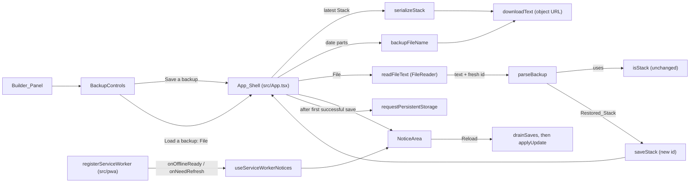
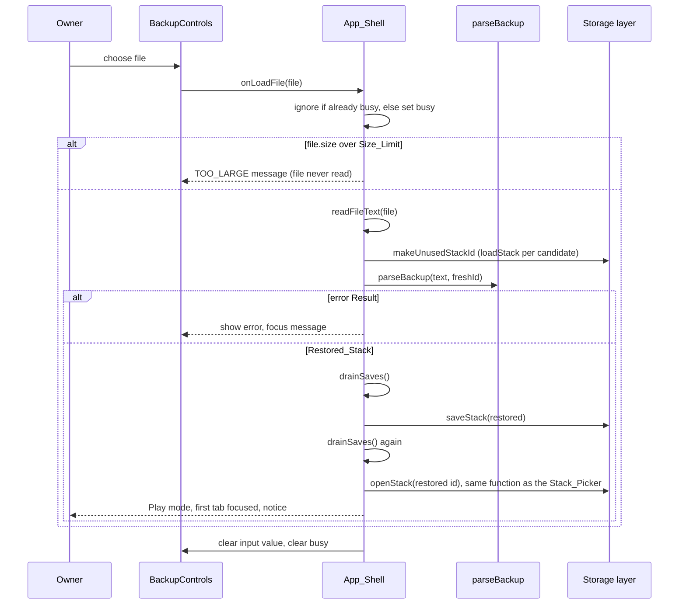
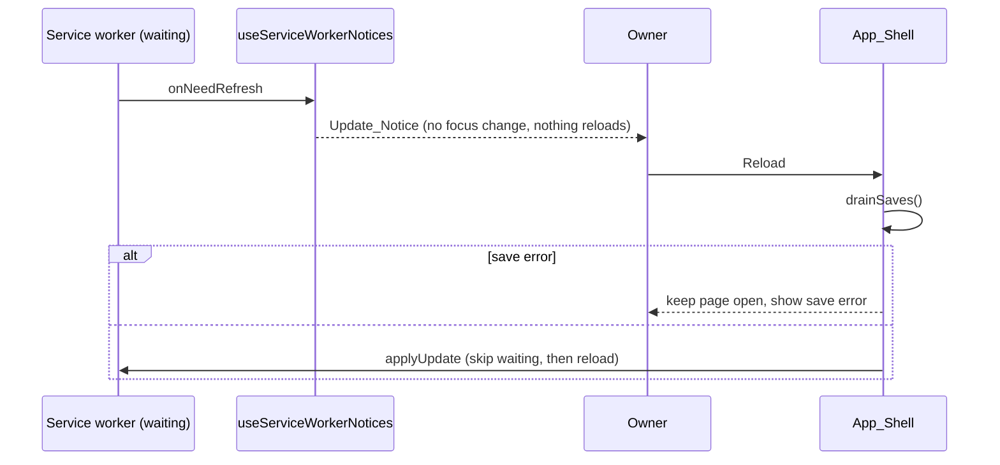

# Design: PWA offline support and stack backup

## Overview

This spec makes GhostStack installable and usable with no internet, and lets the owner keep a copy of a shop in a file.

It adds:

- Three pure functions in `src/domain-ui/`: `serializeStack`, `parseBackup(text, freshId)` and `backupFileName`, plus one small shared helper `cutText` for surrogate-safe cutting.
- A `vite-plugin-pwa` setup in `vite.config.ts` (prompt mode), the `BASE_PATH` constant and the `MANIFEST` object in `src/pwa/manifestConfig.ts` (imported by `vite.config.ts`), three generated icons, and a small registration module.
- A Notice_Area in the App_Shell for the Offline_Notice, the Update_Notice and the "Backup loaded" message.
- Backup_Controls inside the Builder_Panel: "Save a backup" and "Load a backup".
- A `npm run check:pwa` script and a manual test list at `docs/OFFLINE_TESTING.md`.

It builds on the earlier specs and reuses their pieces unchanged:

- `isStack` (`src/storage/isStack.ts`) as the shape check (Stack_Checker).
- `saveStack`, `loadStack`, `listStacks` (`src/storage/stackStore.ts`), and `readLastOpenedId` / `rememberLastOpenedId` (`src/storage/lastOpened.ts`).
- The App_Shell's `latestStackRef`, `saveQueueRef`, `enqueueSave`, `openStack(id)` (the function the Stack_Picker uses to open a saved Stack), `refreshSavedStacks`, `selectedCardId`, `mode`.
- The shared `Button` (it already has `ariaLabel`, `buttonRef` and `dataAttributes` props), `Card`, `Field`, `TabBar`, `Dialog` and the Theme variables in `src/components/theme.css`.
- The focus pattern used by `BuilderPanel` and `DebtsCardView`: set a pending focus, then focus the DOM node in an effect after render.

Nothing in `src/domain/`, `src/storage/*.ts` (existing files), the Stack `schemaVersion` or the `ERROR_MESSAGES` table changes. `ERROR_MESSAGES` is not touched because `src/domain/validate.test.ts` counts its keys. Backup errors therefore use their own small error table next to `parseBackup` (see Data Models). The only edits to existing files are additive: `vite.config.ts`, `index.html`, `package.json` (two scripts and one dev dependency), `src/vite-env.d.ts` (one types reference), `src/App.tsx`, and `src/components/builder/BuilderPanel.tsx` (one optional prop).

### Design decisions

| Decision | Choice | Why |
| --- | --- | --- |
| PWA tooling | `vite-plugin-pwa` with `registerType: "prompt"`, `strategies: "generateSW"` | Approved dev dependency. The plugin is expected to have Vite 8 peer support ([release notes](https://github.com/vite-pwa/vite-plugin-pwa/releases)); this is to be verified at install (see "Install rule" below). Prompt mode never calls `skipWaiting`, which is what Requirement 4 needs. |
| Alternative: hand-written service worker | Rejected | Needs a hand-made precache list with file hashes. Easy to get wrong, and `check:pwa` would have to rebuild what Workbox already does. |
| Alternative: plugin `injectManifest` | Rejected | Only useful if we needed custom service worker code. We need none: no runtime caching, no network calls. |
| Alternative: plugin `autoUpdate` | Rejected | It reloads the page by itself, which can lose a half-typed sale. |
| Service worker registration | Our own module calling `registerSW` from `virtual:pwa-register`, with `injectRegister: false` | Lets us guard on production build and on browser support, and lets us pass callbacks to the App_Shell. |
| Icons | Node script `scripts/generate-icons.mjs` using only `node:zlib` and `node:fs`, output committed to `public/icons/` | No new package (Requirement 1.10). The build does not need the script, so builds stay fast and the output is reviewable. |
| Backup layout | Wrapper `{ format, backupVersion, stack }` | Lets a future layout be detected without touching the Stack `schemaVersion`. |
| Parse approach | `JSON.parse`, wrapper checks, `isStack`, then rebuild from known fields | Drops unknown keys and shares nothing with the parsed temporary (Requirement 8.13). |
| Backup error table | New table `BACKUP_ERROR_MESSAGES` beside `parseBackup`, not in `ERROR_MESSAGES` | Keeps `validate.test.ts` and every existing test passing without edits (Requirement 16.1). |
| `backupFileName` hyphen rule | Replace each run of characters other than a-z and 0-9 with one hyphen | Also collapses runs like `a - b` to `a-b`. A small, deliberate tightening of the wording in Requirement 6.11. It still satisfies Requirement 14.12. |
| Where the date comes from | UI layer reads `new Date()` (local time) and passes `{ year, month, day }` | Keeps `backupFileName` pure (Requirement 7.4). |
| Where `BASE_PATH` and `MANIFEST` live | `src/pwa/manifestConfig.ts`, imported by `vite.config.ts` | The manifest test imports them without loading the config file (which pulls in the plugin). |
| When to ask for persistent storage | After the first successful save of user data, not on page load | Browsers are more likely to grant it once the app holds data. Refusals are ignored (Requirement 5.6). |
| Opening a restored Stack | Call the existing `openStack(id)` after the second `drainSaves` | One code path with the Stack_Picker, no repeated state swap. |

### Facts found in the repo

- **Font format:** the pixel font is `src/components/fonts/PressStart2P-Regular.woff2`, loaded by `@font-face` in `src/components/theme.css` with `src: url("./fonts/PressStart2P-Regular.woff2") format("woff2")`. It is a local file, not an `@fontsource` package. Vite hashes it into `dist/assets/` (the existing build has `PressStart2P-Regular-_wFEWmAB.woff2`; the hash changes between builds). Only the `.woff2` format ships.
- **Vite version:** `package.json` has `"vite": "^8.3.8"`; `node_modules/vite` is 8.3.8. The `build` script is `tsc --noEmit && vite build`, and `tsconfig.json` includes `src` and `vite.config.ts` (`moduleResolution: "bundler"`, `allowImportingTsExtensions: true`), so `tsc` type-checks `vite.config.ts` and must resolve its imports.
- **Theme variable names in `theme.css`** (light values in `:root`, midnight values in `[data-theme="midnight"]`): `--color-bg` (`#ffffff`), `--color-fg`, `--color-muted-fg`, `--color-border`, `--color-accent`, `--color-title-bg` (`#000000`), `--color-title-fg`, `--color-danger-bg`, `--color-danger-fg`, `--color-warning-bg`, `--color-warning-fg`, `--color-focus`, `--font-pixel`, `--font-body`, `--border-width`, `--space-1` to `--space-4`, `--tap-min`. Every variable this design names exists.

### Install rule

The spec expects `vite-plugin-pwa` to accept Vite 8. This is to be verified at install. If `npm install -D vite-plugin-pwa` reports a peer dependency error (for example `ERESOLVE`) with the installed Vite, the implementer MUST stop, copy the exact error message into the report, and NOT use `--force`, `--legacy-peer-deps` or an `overrides` entry, and NOT pick another package, until the owner decides.

## Architecture

Data flow follows `docs/ARCHITECTURE.md`: UI action, pure domain-ui function, storage through the existing queue, UI. File reading, downloading and service worker code stay in the UI and `src/pwa/`. No React code enters `src/domain-ui/`.



### Load a backup sequence



### Update flow



## File layout

```
vite.config.ts                    + VitePWA plugin; imports BASE_PATH and MANIFEST from src/pwa/manifestConfig.ts
index.html                        + manifest link, theme-color meta, apple-touch-icon link
package.json                      + scripts "icons", "check:pwa"; + devDependency vite-plugin-pwa
public/icons/
  icon-192.png                    NEW (generated, committed)
  icon-512.png                    NEW
  icon-maskable-512.png           NEW
scripts/
  generate-icons.mjs              NEW: pixel ghost to PNG, built-in modules only
  check-pwa.mjs                   NEW: checks dist/ output (npm run check:pwa)
docs/OFFLINE_TESTING.md           NEW: manual test list (includes the iPhone separate-storage note)
src/vite-env.d.ts                 + /// <reference types="vite-plugin-pwa/client" />
src/domain-ui/
  cutText.ts / .test.ts / .property.test.ts          NEW: surrogate-safe cut
  backup.ts                       NEW: serializeStack, parseBackup, backupFileName,
                                       constants, BACKUP_ERROR_MESSAGES, types
  backup.test.ts                  NEW: unit tests
  backup.property.test.ts         NEW: Properties 1-14
src/pwa/
  manifestConfig.ts               NEW: BASE_PATH, MANIFEST (plain constants, no imports)
  manifestConfig.test.ts          NEW: manifest test
  registerServiceWorker.ts / .test.ts     NEW
  useServiceWorkerNotices.ts / .test.tsx  NEW
  requestPersistentStorage.ts / .test.ts  NEW
src/storage/
  freshStackId.ts / .test.ts      NEW: makeUnusedStackId (uses loadStack only)
  backupRestore.property.test.ts  NEW: Property 15 (fake-indexeddb)
src/components/
  NoticeArea.tsx / .css / .test.tsx       NEW
  backup/
    BackupControls.tsx / .css / .test.tsx NEW
    BackupMessage.tsx                     NEW
    backupMessages.ts                     NEW: UI message constants
    downloadText.ts / .test.ts            NEW
    readFileText.ts                       NEW
  builder/BuilderPanel.tsx        + optional `backup` prop
src/App.tsx                       + notices, backup handlers, drainSaves, persist call
```

Placement notes:

- `backup.ts` is one file in `src/domain-ui/` because the three functions share the wrapper constants and the name rules. It follows `sampleItems.ts` and `money.ts`: plain TypeScript, no React, no storage import except the `Stack` type and `isStack`. `isStack` lives in `src/storage/` and the requirement says to reuse it, so `backup.ts` imports it from there. It is a pure function with no IndexedDB access, so no layer rule is broken.
- `makeUnusedStackId` is a new storage file, not an edit to `stackStore.ts`, so the existing storage functions stay unchanged.
- `src/pwa/` holds browser-integration code that is neither domain nor React component.

## Data Models

### Backup wrapper

```ts
// src/domain-ui/backup.ts
export const BACKUP_FORMAT = "ghoststack-backup";
export const BACKUP_VERSION = 1;
export const SIZE_LIMIT = 5 * 1024 * 1024;     // bytes of UTF-8 text
export const NAME_LIMIT = 40;
export const RESTORED_SUFFIX = " (restored)";   // 11 characters
export const RESTORED_NAME_FALLBACK = "My shop (restored)";

export interface BackupFile {
  format: typeof BACKUP_FORMAT;
  backupVersion: typeof BACKUP_VERSION;
  stack: Stack;
}
```

Example file (indented with two spaces):

```json
{
  "format": "ghoststack-backup",
  "backupVersion": 1,
  "stack": { "schemaVersion": 1, "id": "…", "name": "Provisions shop", "currency": "NGN", "cards": [ … ] }
}
```

### Errors and Result

```ts
export type BackupErrorCode =
  | "TOO_LARGE" | "NOT_JSON" | "NOT_A_BACKUP"
  | "WRONG_BACKUP_VERSION" | "WRONG_STACK_VERSION" | "INVALID_STACK";

export type BackupError = { code: BackupErrorCode; message: string };

export type BackupResult =
  | { ok: true; value: Stack }
  | { ok: false; error: BackupError };
```

`BackupResult` has the same shape as the project's `Result<T>`. It is separate only because the code names are different from `ErrorCode`.

```ts
export const BACKUP_ERROR_MESSAGES: Record<BackupErrorCode, string> = {
  TOO_LARGE:
    'This file is too big to be a GhostStack backup. A backup is much smaller. Choose a file you saved with "Save a backup".',
  NOT_JSON:
    'This file is not a GhostStack backup. Choose a file you saved with "Save a backup".',
  NOT_A_BACKUP:
    'This file does not look like a GhostStack backup. Choose a file you saved with "Save a backup".',
  WRONG_BACKUP_VERSION:
    "This backup was made by a different version of GhostStack. Update the app, or use a newer backup.",
  WRONG_STACK_VERSION:
    "This backup holds a shop from a different version of GhostStack. Update the app, or use a newer backup.",
  INVALID_STACK:
    "This backup is damaged. Try another backup file.",
};
```

None of the messages contains "kobo", "schema", "JSON parse", "serialize", "payload" or "cache", a file path or a stack trace.

### Check order

`parseBackup` runs these checks in this order and returns the first failure:

| Step | Check | Code |
| --- | --- | --- |
| 1 | UTF-8 byte length of the text is over `SIZE_LIMIT` (before any parsing) | `TOO_LARGE` |
| 2 | `JSON.parse` throws (this includes empty text, spaces only, and nesting too deep for the parser) | `NOT_JSON` |
| 3 | Value is not a plain object, or `format` is not `"ghoststack-backup"`, or there is no own `stack` key | `NOT_A_BACKUP` |
| 4 | `backupVersion` is not `1` (a missing value counts) | `WRONG_BACKUP_VERSION` |
| 5 | `stack` is a plain object whose `schemaVersion` is not `1` | `WRONG_STACK_VERSION` |
| 6 | `isStack(stack)` is false (this includes `stack` being `null`, an array or a number), or any card `title` is blank or longer than 40 characters after trimming | `INVALID_STACK` |

The card title rule is an extra check inside `parseBackup`, run after `isStack` accepts the shape. The title length is the JavaScript string length of the trimmed title (the same measure as the Name_Limit). `isStack` itself is unchanged. `rebuildCard` copies `title` as it is in the file (not trimmed), so a valid file still round-trips deep-equal.

Fields are read with an own-property helper (`Object.prototype.hasOwnProperty.call`), so a `__proto__` key in the file is only ever plain data and is never read as the prototype.

### Byte length without a big allocation

```ts
function utf8ByteLength(text: string): number {
  if (text.length > SIZE_LIMIT) return text.length;  // every UTF-16 unit is at least 1 byte
  let bytes = 0;
  for (let i = 0; i < text.length; i++) {
    const c = text.charCodeAt(i);
    if (c < 0x80) bytes += 1;
    else if (c < 0x800) bytes += 2;
    else if (c >= 0xd800 && c <= 0xdbff && i + 1 < text.length &&
             text.charCodeAt(i + 1) >= 0xdc00 && text.charCodeAt(i + 1) <= 0xdfff) {
      bytes += 4; i++;                                // surrogate pair is 4 bytes
    } else bytes += 3;                                // other BMP, or a lone surrogate (becomes U+FFFD)
  }
  return bytes;
}
```

A UTF-16 unit never takes fewer than one byte, so a text with more than `SIZE_LIMIT` units is certainly too large and the loop is skipped. The count matches what `TextEncoder` would return.

### Surrogate-safe cut

```ts
// src/domain-ui/cutText.ts
/** Cuts text to at most `max` UTF-16 units and never ends on the first half of a surrogate pair. */
export function cutText(text: string, max: number): string {
  if (max <= 0) return "";
  if (text.length <= max) return text;
  const lastKept = text.charCodeAt(max - 1);
  const end = lastKept >= 0xd800 && lastKept <= 0xdbff ? max - 1 : max;
  return text.slice(0, end);
}
```

If the unit at `max - 1` is a high surrogate, its low half would be at `max` and is cut away, so the high half is dropped too. A lone high surrogate in the input is also dropped, which is harmless.

### Restored name

```ts
const MAX_BASE = NAME_LIMIT - RESTORED_SUFFIX.length;   // 29

function restoredName(fileName: string): string {
  const trimmed = fileName.trim();
  if (trimmed === "") return RESTORED_NAME_FALLBACK;
  const base = cutText(trimmed, MAX_BASE).trimEnd();
  return base + RESTORED_SUFFIX;
}
```

- A name of 29 characters or fewer keeps its full trimmed text. 30 to 40 characters are cut to 29 (not 40), because the suffix is 11 characters and the result must not pass 40 (Requirement 9.4).
- `trimEnd()` after the cut removes spaces the cut may have exposed (Requirement 9.6). The suffix keeps its own leading space.
- `base` cannot be empty: `trimmed` starts with a non-space character, and a 29-unit cut keeps at least that character (a first character that is a surrogate pair is 2 units).
- The result is at most 29 + 11 = 40 characters and always ends with the complete suffix.

### Rebuild from known fields only

After `isStack` accepts the `stack` value, `parseBackup` builds a new object with explicit field copies, never `Object.assign`, spread or `structuredClone`:

```ts
function rebuildCard(c: Card): Card {
  const hidden = c.hidden === undefined ? {} : { hidden: c.hidden };
  switch (c.type) {
    case "stock":
      return { id: c.id, type: "stock", title: c.title, ...hidden,
        items: c.items.map((i) => ({ id: i.id, name: i.name, quantity: i.quantity,
          costPrice: i.costPrice, sellPrice: i.sellPrice, lowStockLevel: i.lowStockLevel })) };
    case "sales-log":
      return { id: c.id, type: "sales-log", title: c.title, ...hidden,
        sales: c.sales.map((s) => ({ id: s.id, itemId: s.itemId, quantity: s.quantity,
          unitPrice: s.unitPrice, unitCost: s.unitCost, time: s.time })) };
    case "debts":
      return { id: c.id, type: "debts", title: c.title, ...hidden,
        debts: c.debts.map((d) => ({ id: d.id, customer: d.customer, amount: d.amount,
          date: d.date, status: d.status })) };
    case "daily-summary":
      return { id: c.id, type: "daily-summary", title: c.title, ...hidden };
  }
}
```

The spread above is of a local object literal built from our own values (`hidden`), not of anything from the parsed file. To keep to the letter of Requirement 8.13, the implementation may instead assign `hidden` in a separate statement (`if (c.hidden !== undefined) card.hidden = c.hidden`). The restored Stack is:

```ts
{ schemaVersion: 1, id: freshId, name: restoredName(stack.name), currency: stack.currency,
  cards: stack.cards.map(rebuildCard) }
```

A `hidden: false` in the file stays `false`, and an absent `hidden` stays absent, so the result is deep-equal to the file's Stack. If a later spec adds a Stack field, `rebuildCard` must be extended. Property 1 catches the omission, because its generator makes Stacks with every known field.

## Components and Interfaces

### Pure functions (`src/domain-ui/backup.ts`)

```ts
export function serializeStack(stack: Stack): string;
export function parseBackup(text: string, freshId: string): BackupResult;
export function backupFileName(
  shopName: string,
  date: { year: number; month: number; day: number },   // month 1 to 12
): string;
```

`serializeStack`:

```ts
export function serializeStack(stack: Stack): string {
  const file: BackupFile = { format: BACKUP_FORMAT, backupVersion: BACKUP_VERSION, stack };
  return JSON.stringify(file, null, 2);
}
```

`JSON.stringify` reads the input and never writes to it, so a deeply frozen Stack is safe. It writes every field the Stack has, including `hidden` and `schemaVersion`. Money values are plain integers and are written as whole numbers. No clock, id, storage or random call.

`backupFileName`:

```ts
const MAX_BEFORE_EXTENSION = 60;
const DATE_PART = 10;                              // YYYY-MM-DD
const MAX_SHOP_PART = MAX_BEFORE_EXTENSION - 1 - DATE_PART;   // 49

export function backupFileName(shopName: string, date: {...}): string {
  const cleaned = shopName.toLowerCase().replace(/[^a-z0-9]+/g, "-").replace(/^-+|-+$/g, "");
  const shop = cutText(cleaned === "" ? "shop" : cleaned, MAX_SHOP_PART).replace(/-+$/, "");
  const stamp = `${String(date.year).padStart(4, "0")}-${pad2(date.month)}-${pad2(date.day)}`;
  return `${shop}-${stamp}.json`;
}
```

After cleaning, the shop part is ASCII, so `cutText` cannot split a surrogate pair there. The call is kept so the rule holds if the cleaning rule is ever widened. A cut can leave a trailing hyphen, which is removed (the shop part is never empty because a cut of a non-empty string starts with a letter or digit).

### Storage helper (`src/storage/freshStackId.ts`)

```ts
export async function makeUnusedStackId(
  makeId: () => string = () => crypto.randomUUID(),
  maxTries = 5,
): Promise<string | null>
```

For each candidate it calls `loadStack(candidate)`. A result with `error.code === "NOT_FOUND"` means no record uses that id, so the id is returned. Any other result (a stored Stack, or an unreadable record that still holds the key) means the id is taken or the database cannot be trusted, so it tries again. After `maxTries` it returns `null` and the App_Shell shows the save error. This avoids `listStacks`, which silently drops records that fail `isStack` and so could miss a taken id. It never writes.

### Service worker registration (`src/pwa/registerServiceWorker.ts`)

```ts
export interface ServiceWorkerCallbacks {
  onOfflineReady: () => void;
  onNeedRefresh: () => void;
}
export interface ServiceWorkerHandle {
  /** Activates the waiting worker and reloads the page. Resolves or rejects; never throws synchronously. */
  applyUpdate: () => Promise<void>;
}
export function registerServiceWorker(cb: ServiceWorkerCallbacks): ServiceWorkerHandle | null;
```

- Returns `null` and does nothing when `import.meta.env.PROD` is false (dev server and Vitest) or when `"serviceWorker" in navigator` is false (Requirements 2.6, 2.7).
- Otherwise it starts `import("virtual:pwa-register")` and, when that resolves, calls `registerSW({ immediate: true, onOfflineReady, onNeedRefresh, onRegisterError })`. Errors from the import, from `registerSW` and from `onRegisterError` are swallowed, so the owner sees nothing (Requirement 2.8).
- `applyUpdate` waits for the import, then calls the `updateSW(true)` function that `registerSW` returned. In prompt mode this posts a skip-waiting message to the waiting worker and reloads when the new worker takes control. Nothing calls `skipWaiting` before that (Requirement 2.9, 4.4).
- The dynamic import sits inside the production-only branch, so the test environment never loads the virtual module. The plugin is still listed in `vite.config.ts` while Vitest runs, so the import resolves for type-checking and bundling.

### Notice hook (`src/pwa/useServiceWorkerNotices.ts`)

```ts
export type NoticeKind = "update" | "offline" | null;
export function useServiceWorkerNotices(): {
  notice: NoticeKind;
  closeOffline: () => void;
  applyUpdate: () => Promise<void>;
};
```

- On mount (guarded by a ref so StrictMode's second effect run does nothing) it calls `registerServiceWorker`.
- `onNeedRefresh` sets `needRefresh = true`. `onOfflineReady` sets `offlineReady = true` only when `localStorage["ghoststack:offlineNoticeShown"]` is absent.
- `notice` is `"update"` when `needRefresh`, else `"offline"` when `offlineReady`, else `null`. This is the one place that picks between them (Requirement 4.9).
- An effect writes `ghoststack:offlineNoticeShown = "1"` the first time `notice === "offline"` is rendered. Reads and writes use try/catch, as `lastOpened.ts` does. If the write fails, the notice may show again on the next first load, which is harmless.
- `closeOffline` sets `offlineReady = false`.
- Later versions do not show the Offline_Notice again: the browser's `onOfflineReady` only fires for the first install, and the stored flag blocks it on any device that has seen it (Requirement 3.5).

### `requestPersistentStorage` (`src/pwa/requestPersistentStorage.ts`)

```ts
export function requestPersistentStorage(): void {
  try {
    const p = navigator.storage?.persist?.();
    if (p && typeof p.catch === "function") p.catch(() => {});
  } catch { /* best effort */ }
}
```

The App_Shell calls it once, after the first successful save of user data (see "Persistent storage request" below), and never on page load. It shows no message whether the browser grants, refuses, lacks the API or throws (Requirement 5.6).

### App_Shell additions (`src/App.tsx`)

New helper, built on the existing queue:

```ts
const saveErrorRef = useRef<string | null>(null);   // mirrors setSaveError

/** Waits until no save is pending, even if a new save is queued while waiting. Returns the save error, if any. */
const drainSaves = useCallback(async (): Promise<string | null> => {
  let q: Promise<void>;
  do { q = saveQueueRef.current; await q; } while (q !== saveQueueRef.current);
  return saveErrorRef.current;
}, []);
```

`enqueueSave` is edited only to keep `saveErrorRef.current` equal to what it passes to `setSaveError`, and to call `notePersistOnce()` when `saveStack` returns ok. This is additive: behaviour and text are the same. `drainSaves` loops because the owner can edit while a drain is waiting, and that edit queues another save.

New state:

```ts
type BackupMessageState = {
  seq: number;                      // changes on every new message, so the focus effect runs again
  kind: "success" | "error";
  text: string;
  place: "controls" | "notice";     // "notice" only for "Backup loaded…"
} | null;
const [backupMessage, setBackupMessage] = useState<BackupMessageState>(null);
const loadBusyRef = useRef(false);
const [loadBusy, setLoadBusy] = useState(false);
const [focusFirstTab, setFocusFirstTab] = useState(false);
```

#### `handleSaveBackup`

```ts
async function handleSaveBackup() {
  await drainSaves();
  const current = latestStackRef.current;
  if (!current) return;
  try {
    const text = serializeStack(current);
    const d = new Date();
    const name = backupFileName(current.name, { year: d.getFullYear(), month: d.getMonth() + 1, day: d.getDate() });
    downloadText(text, name, "application/json");
    setBackupMessage({ seq: next(), kind: "success", text: BACKUP_READY, place: "controls" });
  } catch {
    setBackupMessage({ seq: next(), kind: "error", text: BACKUP_SAVE_FAILED, place: "controls" });
  }
}
```

- It reads `latestStackRef.current`, not React state, so the file holds the newest edits even if the last save failed. A failed save is the case where a backup matters most.
- It writes nothing to storage or to the Stack. Focus stays on the button (no focus call), and the message is a `role="status"` line that does not take focus.
- The message never includes a money amount, and the shop name appears only in the file name (Requirement 7.9).

#### `downloadText` (`src/components/backup/downloadText.ts`)

```ts
export function downloadText(text: string, fileName: string, mime: string): void {
  const url = URL.createObjectURL(new Blob([text], { type: mime }));
  const a = document.createElement("a");
  a.href = url;
  a.download = fileName;
  a.style.display = "none";
  document.body.appendChild(a);
  try { a.click(); } finally {
    a.remove();
    setTimeout(() => URL.revokeObjectURL(url), 1000);
  }
}
```

The URL is revoked about one second after the click, so the browser has started the download. If `createObjectURL` or `click` throws, the exception reaches `handleSaveBackup`'s catch and the error message is shown; the `finally` still schedules the revoke when a URL was made (a throw from `createObjectURL` happens before any URL exists, so there is nothing to revoke).

#### `readFileText` (`src/components/backup/readFileText.ts`)

```ts
export function readFileText(file: File): Promise<string>;   // FileReader.readAsText (UTF-8), rejects on error
```

`FileReader` works in browsers and in jsdom, so the component tests need no stub for it.

#### `handleLoadFile`

```ts
async function handleLoadFile(file: File) {
  if (loadBusyRef.current) return;                       // ignore a second choice (10.13)
  loadBusyRef.current = true; setLoadBusy(true);
  try {
    if (file.size > SIZE_LIMIT) return fail(BACKUP_ERROR_MESSAGES.TOO_LARGE);   // not read (10.3)
    let text: string;
    try { text = await readFileText(file); } catch { return fail(BACKUP_READ_FAILED); }   // (10.9)
    const freshId = await makeUnusedStackId();
    if (freshId === null) return fail(STORAGE_ERROR_MESSAGES.SAVE_FAILED);
    const parsed = parseBackup(text, freshId);
    if (!parsed.ok) return fail(parsed.error.message);                           // (10.8)
    await drainSaves();
    const saved = await saveStack(parsed.value);                                 // new id only (11.1)
    if (!saved.ok) return fail(saved.error.message);                             // (10.10)
    notePersistOnce();                                                           // first successful save
    await drainSaves();                                                          // edits made while saving
    await openStack(parsed.value.id);                                            // same function as the Stack_Picker
    if (latestStackRef.current?.id !== parsed.value.id) {                        // openStack could not open it
      void refreshSavedStacks();                                                 // record stays listed (11.7)
      return fail(STORAGE_ERROR_MESSAGES.UNREADABLE_DATA);
    }
    setFocusFirstTab(true);
    setBackupMessage({ seq: next(), kind: "success", text: BACKUP_LOADED, place: "notice" });
  } catch {
    void refreshSavedStacks();
    fail(STORAGE_ERROR_MESSAGES.SAVE_FAILED);
  } finally {
    loadBusyRef.current = false; setLoadBusy(false);
  }
}
```

- `fail(text)` is `setBackupMessage({ seq: next(), kind: "error", text, place: "controls" })`. The mode, the open Stack and every saved Stack stay as they were.
- The second `drainSaves()` runs before `openStack`. Without it, an edit made to the old Stack while `saveStack(parsed.value)` was running would queue a save that reads `latestStackRef.current` after the swap and so would write the wrong Stack, losing that edit.
- `openStack(id)` is the same function the Stack_Picker calls. It waits for the Save_Queue, loads the record, remembers the last-opened id, swaps the open Stack, selects the first visible card, switches to Play mode, closes the starter chooser and refreshes the saved list. `handleLoadFile` does not repeat any of that. `openStack` reports a failure through `setSwitchError` and has no return value, so `handleLoadFile` checks `latestStackRef.current?.id` to see whether the restored Stack opened. The nested `fail(...)` then replaces the owner's view of the problem with a Backup_Message and focus moves to it.
- The restored Stack is saved once with `saveStack`. A `put` with a fresh id can only add a record, and `makeUnusedStackId` confirmed no record uses that id (Requirements 11.1 to 11.5).
- The flow changes no setting except the last-opened id (Requirement 11.6).
- If the code fails after `saveStack` succeeds but before the Stack opens, the record is already in storage. `refreshSavedStacks()` is also called in the `catch` path and when `openStack` could not open it, so the Stack_Picker lists it (Requirement 11.7).
- When the input event fires with no file (picker closed), `BackupControls` does not call `onLoadFile` and no message is shown (Requirement 10.11).

#### Focus after a successful load

A `useEffect` keyed on `[focusFirstTab, mode, stack]` runs after the render that shows Play mode. When `focusFirstTab` is true it looks up the first tab with `document.querySelector('[role="tab"]')` inside the app root, focuses it, and resets `focusFirstTab` to `false`. This is the same "set pending focus, then find the node in an effect" pattern as `BuilderPanel`. The Notice_Area shows "Backup loaded. Your shop is open as a new stack." as `role="status"`.

#### Update and offline notices in the App_Shell

```ts
const { notice, closeOffline, applyUpdate } = useServiceWorkerNotices();

async function handleReload() {
  const error = await drainSaves();
  if (error) { setSaveError(error); return; }   // keep the page open; the existing alert shows the message
  try { await applyUpdate(); } catch { /* stay on this version */ }
}
```

`handleReload` only runs from the owner pressing "Reload". Nothing else reloads the page or activates the waiting worker. While the Update_Notice is shown, no state is reset, so open forms, typed values and the current screen stay (Requirement 4.3).

#### Persistent storage request

```ts
const persistAskedRef = useRef(false);
function notePersistOnce() {
  if (persistAskedRef.current) return;
  persistAskedRef.current = true;
  requestPersistentStorage();
}
```

`notePersistOnce()` is called in two places only: in `enqueueSave` when `saveStack` returns ok, and in `handleLoadFile` after `saveStack` of the Restored_Stack returns ok. Nothing calls it on page load or from a start-up effect, so the request waits for the first successful save of user data. A failed save does not call it, and the once-only ref means later saves do not ask again.

### UI components

#### `NoticeArea` (`src/components/NoticeArea.tsx`)

```ts
export interface NoticeAreaProps {
  notice: "update" | "offline" | null;
  onCloseOffline: () => void;
  onReload: () => void;
  reloading: boolean;                       // true while handleReload waits for saves
  backupMessage: BackupMessageState;        // only used when place === "notice"
  onCloseBackupMessage: () => void;
}
```

- Renders a normal block in the page flow, directly under the "Midnight mode" button and above the `ModeSwitch`. It is not fixed or absolute, so it never covers the Tab_Bar, a form or the Mode_Switch (Requirement 12.10).
- Update_Notice: `<div role="status">` containing `<span aria-hidden="true">↻</span>` and the text "A new version is ready. Reload to update.", plus a `Button` "Reload" (44px from the shared Button).
- Offline_Notice: `<div role="status">` containing `<span aria-hidden="true">✔</span>` and "Ready for offline use", plus a `Button` "Close".
- Backup loaded notice: the same shape, with a "Close" button.
- None of the three calls `focus()` and none has `autoFocus`, so it cannot take focus from the control in use (Requirements 3.6, 4.7).
- Wording is the exact text from the requirements. No text contains "cache" or "serialize".

#### `BackupControls` (`src/components/backup/BackupControls.tsx`)

```ts
export interface BackupControlsProps {
  onSave: () => void | Promise<void>;
  onLoadFile: (file: File) => void | Promise<void>;
  busy: boolean;                            // Load in progress
  message: BackupMessageState;              // shown only when place === "controls"
  saveButtonRef?: Ref<HTMLButtonElement>;
}
```

Renders, in order:

1. A `Button` "Save a backup" (`onSave`).
2. A visible `<label htmlFor={id}>Load a backup</label>` and `<input id={id} type="file" accept=".json,application/json,text/plain" aria-busy={busy}>`. Using the label's text as the input's accessible name satisfies Requirement 12.3 and 12.9.
3. `<p>Tip: save a backup from time to time.</p>`.
4. `<BackupMessage>` when `message?.place === "controls"`.

Input behaviour:

- `onChange`: take `e.target.files?.[0]`. If there is none, return (nothing changes, no message). Otherwise call `onLoadFile(file)`. In a `finally` after the returned promise settles, set `e.target.value = ""` so the same file can be chosen again (Requirement 10.12). The element reference is read before the first `await`, because React does not keep the event after it.
- The input is not `disabled` while busy. Disabling would drop keyboard focus. The App_Shell ignores a second choice instead, and `aria-busy` tells screen readers.
- The component does not own the Save_Queue, the clock or storage. It is a plain controlled UI piece.

`BackupMessage` (`src/components/backup/BackupMessage.tsx`): `role="status"` for success and `role="alert"` for error, `tabIndex={-1}`, an `ref`, an icon (`✔` or `⚠`) with `aria-hidden="true"` plus text. A `useEffect` keyed on `message.seq` calls `ref.current?.focus()` only when `kind === "error"` (Requirement 10.8 to 10.10). Success after "Save a backup" does not move focus (Requirement 7.5).

#### `BuilderPanel` change

```ts
export interface BuilderPanelProps {
  stack: Stack;
  onStackChange: (s: Stack) => void;
  onOpenStarterChooser: () => void;
  backup?: BackupControlsProps;   // NEW, optional
}
```

When `backup` is present, `BuilderPanel` renders `<BackupControls {...backup} />` in the footer under "Choose a starter". The prop is optional so every existing `BuilderPanel` test and call site compiles and passes unchanged. The App_Shell always passes it. Because `BuilderPanel` is only rendered in Builder mode, Play mode shows no Backup_Controls (Requirement 7.2). `mode` changes clear any `place: "controls"` message in the App_Shell so a stale message does not come back.

### CSS

- `NoticeArea.css`, `BackupControls.css`: use only Theme variables (`--color-*`, `--space-*`, `--border-width`, `--tap-min`, `--font-body`), 2px borders and the shared `Card`-style title bar look. No hard-coded colours.
- The file input uses `min-height: var(--tap-min)` and `::file-selector-button { min-height: var(--tap-min); }`.
- Every control gets `:focus-visible { outline: var(--border-width) solid var(--color-focus); outline-offset: 2px; }`.
- Notices use `flex-wrap: wrap` and `max-width: 100%` so a 360px screen never scrolls sideways, in both themes.

### Manifest constants (`src/pwa/manifestConfig.ts`) and Vite config (`vite.config.ts`)

```ts
// src/pwa/manifestConfig.ts  (plain constants, no imports, so Node and Vitest can load it)

/** Where the app is hosted. Root for now (Vercel or Netlify). Change here only. */
export const BASE_PATH = "/";

export const MANIFEST = {
  id: BASE_PATH,
  name: "GhostStack",
  short_name: "GhostStack",
  description: "Track your stock, sales and money owed. Works with no internet.",
  start_url: BASE_PATH,
  scope: BASE_PATH,
  display: "standalone" as const,
  theme_color: "#000000",        // equals --color-title-bg in the light theme
  background_color: "#ffffff",   // equals --color-bg in the light theme
  icons: [
    { src: `${BASE_PATH}icons/icon-192.png`, sizes: "192x192", type: "image/png", purpose: "any" },
    { src: `${BASE_PATH}icons/icon-512.png`, sizes: "512x512", type: "image/png", purpose: "any" },
    { src: `${BASE_PATH}icons/icon-maskable-512.png`, sizes: "512x512", type: "image/png", purpose: "maskable" },
  ],
};
```

```ts
// vite.config.ts
import { defineConfig } from "vitest/config";
import react from "@vitejs/plugin-react";
import { VitePWA } from "vite-plugin-pwa";
import { BASE_PATH, MANIFEST } from "./src/pwa/manifestConfig";

export default defineConfig({
  base: BASE_PATH,
  plugins: [
    react(),
    VitePWA({
      registerType: "prompt",          // new worker waits; no skipWaiting
      injectRegister: false,           // src/pwa/registerServiceWorker.ts registers it
      strategies: "generateSW",
      scope: BASE_PATH,
      base: BASE_PATH,
      manifest: MANIFEST,
      workbox: {
        globPatterns: ["**/*.{js,css,html,png,svg,ico,webmanifest,ttf,woff,woff2}"],
        navigateFallback: `${BASE_PATH}index.html`,
        cleanupOutdatedCaches: true,
      },
      devOptions: { enabled: false },
    }),
  ],
  test: { environment: "node", include: ["src/**/*.test.{ts,tsx}"] },
});
```

- `BASE_PATH` feeds the Vite `base`, the Manifest `scope` and `start_url`, the plugin `scope`, and the navigation fallback. These are the only five places, and they read the one constant (Requirement 1.9).
- The Manifest's `theme_color` and `background_color` are the light-theme `--color-title-bg` and `--color-bg` values in `theme.css` (real names, confirmed in "Facts found in the repo"). `manifestConfig.test.ts` asserts they equal those two values by reading the `:root` block of `theme.css` as text, so a theme edit that forgets the Manifest fails a test. **Before writing that test, the implementer MUST open `src/components/theme.css`, confirm that `--color-title-bg` and `--color-bg` exist in `:root`, and change the test to the real names if they differ.** The midnight values live in `[data-theme="midnight"]` and the test must read only `:root`.
- `globPatterns` lists `js`, `css`, `html`, `png`, `svg`, `ico`, `webmanifest`, `ttf`, `woff` and `woff2`. The shipped font is `.woff2` (see "Facts found in the repo"), so the bundled Press Start 2P font is in the Precache (Requirement 2.1). `ttf` and `woff` are listed so a future font swap to either format is still precached. `check:pwa` verifies the specific shipped file.
- No `runtimeCaching` is set, so the service worker sends no request except to precached files on the app's own origin (Requirement 2.5). It never touches IndexedDB (Requirement 5.5).
- `skipWaiting` and `clientsClaim` are left unset (false). In prompt mode the plugin's registered worker only skips waiting when it receives the message that `updateSW(true)` posts.
- `devOptions.enabled: false` and the production-only registration guard keep the service worker out of `npm run dev` and Vitest (Requirement 2.6).
- `src/pwa/manifestConfig.ts` holds `BASE_PATH` and `MANIFEST`, so `manifestConfig.test.ts` imports them without loading `vite.config.ts` or the plugin. The file has no imports, so Node (when Vite loads its config) and Vitest both resolve it.
- **Build check:** `npm run build` runs `tsc --noEmit && vite build`, and `tsconfig.json` includes `vite.config.ts`, so `tsc` type-checks the config and must resolve `./src/pwa/manifestConfig`. The implementer MUST run `npm run build` after the change and confirm `tsc` passes. If the import does not resolve, fix the import path or extension (the project allows `allowImportingTsExtensions` with `moduleResolution: "bundler"`) and re-run.
- Installation check at implementation time: the plugin can add its own manifest `<link>` to `index.html`. The source `index.html` also has one (Requirement 1.6). `check:pwa` asserts that `dist/index.html` contains exactly one `rel="manifest"` link, so a duplicate is caught.

### `index.html` additions

```html
<link rel="manifest" href="/manifest.webmanifest" />
<meta name="theme-color" content="#000000" />
<link rel="apple-touch-icon" href="/icons/icon-192.png" />
```

Vite rewrites absolute `/…` URLs in `index.html` with `base`, so these follow `BASE_PATH`.

### Icon generator (`scripts/generate-icons.mjs`)

Uses only `node:fs`, `node:path`, `node:url` and `node:zlib`. Run by hand with `npm run icons` (script `node scripts/generate-icons.mjs`); the PNGs are committed.

1. A 16×16 string-array pixel map of an original ghost (rounded head, wavy hem, two eyes) in black on white, drawn in the same early-Mac pixel style as the UI. No third-party artwork.
2. A scale function paints each map pixel as an N×N block into an RGBA buffer, so the output has crisp pixel edges.
3. Three renders:
   - `icon-192.png`: ghost fills about 80% of the canvas on white.
   - `icon-512.png`: same, at 512.
   - `icon-maskable-512.png`: full-bleed white background, ghost scaled to fit inside the central 80% (a safe zone of 10% on each side) so any phone crop keeps it (Requirement 1.5).
4. PNG encoding by hand: signature, `IHDR` (8-bit RGBA), one `IDAT` made with `zlib.deflateSync` over rows each prefixed with filter byte 0, and `IEND`. Each chunk's CRC-32 is computed with a small table-based function in the script.
5. The script writes into `public/icons/` and creates the folder when missing. It is deterministic, so rerunning gives the same bytes.

### Build check (`scripts/check-pwa.mjs`, `npm run check:pwa`)

Runs after `npm run build`, with `node scripts/check-pwa.mjs`, using `node:fs` and `node:path` only. It exits with code 1 and a plain list of problems if any check fails:

1. `dist/manifest.webmanifest` exists, parses, and has `name`, `display: "standalone"`, `start_url`, `scope`, and the three icon entries (one with `purpose: "maskable"`).
2. The three icon files exist in `dist/icons/` and start with the PNG signature bytes.
3. `dist/sw.js` exists.
4. The shipped font file, `PressStart2P-Regular-<hash>.woff2` in `dist/assets/` (found by the pattern `PressStart2P-Regular-*.woff2`), exists, and the precache list inside `sw.js` names that exact file (matched by its hashed name). A different `.woff2`, `.woff` or `.ttf` in the list does not satisfy this check.
5. `dist/index.html` has exactly one `rel="manifest"` link, one `theme-color` meta tag and one `apple-touch-icon` link.

It is not part of the Vitest suite (Requirement 15.6). `package.json` gains `"icons"` and `"check:pwa"` scripts; `build` is unchanged and still runs `tsc --noEmit && vite build`.

### Manual test list (`docs/OFFLINE_TESTING.md`)

Seven numbered tests, each with numbered steps and an "Expected result" in simple English: First load, Offline reload, Record a sale offline, Install on a phone (Android and iPhone, including the maskable icon), Update flow, Backup and restore, Bad files. The document also carries a short note: on an iPhone, an app installed to the home screen has its own storage, separate from Safari, so data saved in Safari is not in the installed app. The "Install on a phone" and "Backup and restore" tests tell the tester to restore a backup into the installed home-screen app (not only in Safari) and check that the new stack appears there. The document itself is plain Markdown with no code.

## Accessibility and focus management

| Situation | Focus behaviour |
| --- | --- |
| Offline_Notice or Update_Notice appears | None. No `focus()` call, no `autoFocus`. |
| "Save a backup" succeeds | Focus stays on the button. A `role="status"` line reads "Your backup file is ready." |
| "Save a backup" fails | Message is `role="alert"`, text says the backup could not be saved and to try again. Focus moves to the message (error rule below). |
| Any "Load a backup" failure (too big, unreadable, damaged, save error) | Focus moves to the `role="alert"` Backup_Message, which has `tabIndex={-1}`. |
| "Load a backup" succeeds | Mode becomes Play. Focus moves to the first tab. "Backup loaded…" appears in the Notice_Area as `role="status"`. |
| Same file chosen twice | Input value is cleared after each attempt, so `onChange` fires again. |
| Picker closed with no file | Nothing changes and no message appears. |

Notes:

- Requirement 7.5 asks that focus stay on "Save a backup" after success. Requirement 7.7 shows a failed save message but does not say where focus goes. This design focuses the error message for consistency with Requirement 10.8 to 10.10, so a screen reader user hears the problem. A success message needs no focus because `role="status"` is announced politely.
- Every message pairs an icon with text (`✔` success, `⚠` error, `↻` update). Colour is never the only signal.
- All controls use the shared `Button` (44px) or the styled file input (44px). Labels and accessible names say the action: "Save a backup", "Load a backup", "Reload", "Close".
- The "Reload" button is disabled while `handleReload` waits for the Save_Queue, with its visible text unchanged, to prevent a double press. It stays focusable text (use `aria-disabled` rather than `disabled` so focus is not lost).

## Correctness Properties

*A property is a characteristic or behavior that should hold true across all valid executions of a system-essentially, a formal statement about what the system should do. Properties serve as the bridge between human-readable specifications and machine-verifiable correctness guarantees.*

PBT applies to the pure parts (`serializeStack`, `parseBackup`, `backupFileName`, `cutText`) and to the storage rule that a restore never overwrites. It does not apply to the manifest, the service worker, icons, the notices, the file chooser or the download. Those use example tests, `check:pwa` and the manual list.

### Reflection on redundant properties

- Requirements 6.2, 6.6 and 14.7 (wrapper fields, text parses as JSON, `stack` deep-equal to input) describe one output contract and are folded into Property 2.
- Requirement 14.1 (round trip) already implies that `parseBackup` returns a Stack for every valid Stack, that the Stack has the fresh id (9.1) and equals the file's Stack in every other field (9.2). Requirement 14.8 (checker accepts, id is fresh) is a separate cheap check of the same output and stays in Property 1 as additional assertions rather than a separate property.
- Requirements 6.5, 6.8, 14.6 and 14.9 (purity, frozen input, same text twice) are one "no side effects" contract and are folded into Property 3.
- Requirements 6.7 and 14.5 (no "undefined" or "NaN" text) are Property 4. Requirements 6.9 and 14.13 (money kept exactly, totals equal) are Property 5. They stay apart because they need different generators and different assertions.
- Requirements 8.9 and 14.2 (no throw, error for non-JSON and for rejected Stacks) are folded into Property 6.
- Requirements 8.5, 8.6 and 14.11 (version errors) are Property 8. Requirement 8.10 (check order) is Property 9 because it needs inputs that fail several checks at once.
- Requirements 9.3 to 9.6 and 14.3 (name rules) and the surrogate rule in 9.9 for `parseBackup` are folded into Property 7. The same rule for `backupFileName` is covered inside Property 11. The helper itself is Property 12, so a bug in `cutText` is found directly.
- Requirement 11.5 (load the same file twice) is covered by Property 15 (a second restore adds a second Stack).
- Requirements 10.5, 8.11, 12.x, 3.x, 4.x, 5.x, 7.x and 13.x are example, smoke or manual checks (see Testing Strategy).

### Property 1: Backup round trip

*For any* valid Stack and any non-empty fresh id, `parseBackup(serializeStack(stack), freshId)` SHALL return an ok Result whose Stack is accepted by `isStack`, has `id` equal to the fresh id, and is deep-equal to the original Stack in every field except `id` and `name`; and whose `name` is the restored name computed from the original name.

**Validates: Requirements 6.2, 6.3, 8.1, 9.1, 9.2, 9.7, 14.1, 14.8**

### Property 2: Serialized output shape

*For any* valid Stack, `serializeStack(stack)` SHALL be text that parses as JSON to an object with `format` equal to `"ghoststack-backup"`, `backupVersion` equal to 1 and a `stack` that is deep-equal to the input, and the text SHALL contain a line break and indentation (it is not a single line).

**Validates: Requirements 6.1, 6.2, 6.3, 6.4, 6.6, 14.7**

### Property 3: Backup functions are pure and safe on frozen input

*For any* valid Stack, including a deeply frozen one, `serializeStack` SHALL return identical text when called twice, SHALL not throw, and SHALL leave the Stack deep-equal to a snapshot taken before the call; and `parseBackup` of that text with the same fresh id SHALL return deep-equal results on two calls and SHALL not throw.

**Validates: Requirements 6.5, 6.8, 8.12, 9.8, 14.6, 14.9**

### Property 4: No NaN or undefined text

*For any* valid Stack whose text fields do not contain the words "undefined" or "NaN", the output of `serializeStack` SHALL contain neither word.

**Validates: Requirements 6.7, 14.5**

### Property 5: Money survives a backup exactly

*For any* valid Stack, the stock value, the total of sales and the total owed, computed with the existing domain functions on the Stack returned by `parseBackup(serializeStack(stack), freshId)`, SHALL equal the same totals computed on the original Stack, and every money field in the serialized JSON SHALL be a whole number.

**Validates: Requirements 6.9, 14.13**

### Property 6: Bad input gives an error and never throws

*For any* string that is not valid JSON, and *for any* JSON text whose `stack` value `isStack` rejects or has a card title that is blank or longer than 40 characters after trimming, `parseBackup` SHALL return an error Result with one of the six Backup_Error codes and a non-empty message, and SHALL NOT throw.

**Validates: Requirements 8.3, 8.7, 8.9, 8.14, 14.2**

### Property 7: Restored name rules

*For any* valid Stack whose name is any string, and any fresh id, the restored `name` SHALL have at most 40 characters, SHALL end with " (restored)", SHALL start with the trimmed original name when that name has at most 29 characters, SHALL equal "My shop (restored)" when the trimmed name is empty, SHALL have no spaces directly before the suffix unless the base is the whole trimmed name, and SHALL not have a lone high surrogate as the last character before the suffix when the original name is well-formed.

**Validates: Requirements 9.3, 9.4, 9.5, 9.6, 9.9, 14.3**

### Property 8: Version mismatch gives the matching error

*For any* valid Stack, *for any* `backupVersion` value other than 1, `parseBackup` SHALL return `WRONG_BACKUP_VERSION`, and *for any* `schemaVersion` value other than 1 on the file's Stack (with `backupVersion` 1), `parseBackup` SHALL return `WRONG_STACK_VERSION`.

**Validates: Requirements 8.5, 8.6, 14.11**

### Property 9: Checks run in a fixed order

*For any* backup text that fails more than one check, `parseBackup` SHALL return the code of the earliest failed check in the order `TOO_LARGE`, `NOT_JSON`, `NOT_A_BACKUP`, `WRONG_BACKUP_VERSION`, `WRONG_STACK_VERSION`, `INVALID_STACK`, and SHALL return the same code every time for the same text.

**Validates: Requirements 8.10**

### Property 10: Size limit

*For any* text whose UTF-8 length is more than 5 × 1024 × 1024 bytes (built with `repeat()`), `parseBackup` SHALL return `TOO_LARGE`; and *for any* valid backup text of at most that length, `parseBackup` SHALL NOT return `TOO_LARGE`. This property MAY use 25 runs.

**Validates: Requirements 8.2, 14.10**

### Property 11: Backup file name shape

*For any* shop name string and any valid date, `backupFileName` SHALL return a name that ends with `-YYYY-MM-DD.json` for that date, contains only lower-case letters a to z, digits, hyphens and one dot, has at most 60 characters before ".json", has a non-empty shop part (using "shop" when the cleaned name is empty), and has a shop part that neither starts nor ends with a hyphen.

**Validates: Requirements 6.10, 6.11, 6.12, 6.13, 9.9, 14.12**

### Property 12: `cutText` is a safe prefix

*For any* string and any whole number `max` of at least 1, `cutText(text, max)` SHALL return a prefix of `text` with at most `max` characters, SHALL return `text` unchanged when it already fits, and SHALL NOT end with the first half of a surrogate pair when the input is well-formed.

**Validates: Requirements 6.13, 9.9**

### Property 13: Extra keys are dropped at every level

*For any* valid Stack and any extra keys (including `__proto__` and `constructor`) added at any level of the backup JSON (wrapper, Stack, card, item, sale, debt), `parseBackup` SHALL return a Stack deep-equal to the one it returns for the same text without the extra keys, and no extra key SHALL appear anywhere in the result.

**Validates: Requirements 8.13, 14.15**

### Property 14: Restored stacks never overwrite saved stacks

*For any* set of valid saved Stacks in the Storage layer (using `fake-indexeddb`) and any valid backup file, including one whose Stack has the same id as a saved Stack, saving the Restored_Stack made with a fresh unused id SHALL leave every previously saved Stack deep-equal to before, SHALL add exactly one Stack, and a second restore of the same file with another fresh id SHALL add exactly one more Stack with a different id. This property MAY use 25 runs.

**Validates: Requirements 11.1, 11.2, 11.3, 11.4, 11.5, 14.4**

Numbering note: `makeUnusedStackId` has example tests only (see Testing Strategy), not a numbered property.

## Error Handling

| Situation | What happens |
| --- | --- |
| File is over 5 MB (by `file.size`) | `TOO_LARGE` message shown. File is not read into memory. Nothing saved. Builder mode stays. |
| `FileReader` fails | "We could not read that file. Please try again." shown, focus on message, nothing saved. |
| Text is too large, not JSON, not a backup, wrong version, damaged | The matching `BACKUP_ERROR_MESSAGES` text is shown. Nothing saved. |
| `makeUnusedStackId` returns `null` (5 candidates all taken or unreadable) | The existing save error text (`STORAGE_ERROR_MESSAGES.SAVE_FAILED`) is shown. Nothing saved. |
| `saveStack` fails | The existing save error is shown. Open Stack and saved Stacks unchanged. Builder mode stays. |
| Failure after `saveStack` succeeds, before the swap | Record stays in storage. `refreshSavedStacks()` runs so it appears in the Stack_Picker. |
| Download cannot start | "We could not save your backup. Please try again." shown. Stack and storage unchanged. |
| Service worker unsupported, fails to register, or dev/test build | No error shown. App works as today. |
| `localStorage` blocked | The notice flag and last-opened id use try/catch. The Offline_Notice may show again, nothing else changes. |
| `navigator.storage.persist()` missing, refused or throws (asked after the first successful save) | Ignored, no message. |
| Save error when "Reload" is pressed | Page stays open. The existing save alert (with "Try again") shows the message. |
| Reload pressed while a drain is already running | The button is `aria-disabled` while waiting, so a second press does nothing. |

Backup error messages follow `plain-language.md`: they say what went wrong and what to do next, in short sentences. The messages contain no money amount and no shop name. The word "reload" appears only as the button text.

## Testing Strategy

PBT applies to the pure backup code and the restore-never-overwrites storage rule (Properties 1 to 14). It does not apply to the UI, the Manifest, the service worker or the icons, which use example tests, the build check and the manual list.

### Property-based tests (fast-check)

- Library: `fast-check` (already installed). Storage property uses `fake-indexeddb` (already installed), following `stackStore.hidden.property.test.ts`.
- Each property is one test, in `src/domain-ui/backup.property.test.ts` (Properties 1 to 11, 13), `src/domain-ui/cutText.property.test.ts` (Property 12) and `src/storage/backupRestore.property.test.ts` (Property 14).
- At least 100 runs each, except Property 10 and Property 14, which may use 25 (Requirement 14.14).
- Each test carries the tag comment `// Feature: pwa-offline-and-backup, Property N: <title>`.
- Generators:
  - A valid-Stack generator that uses card titles of 1 to 40 characters after trimming (no blank titles, none over 40), covers all four card types, optional `hidden`, money as `fc.nat` and `fc.integer({ min: 0, max: Number.MAX_SAFE_INTEGER })`, names from `fc.string()` and `fc.fullUnicodeString()` (surrogate pairs), and names of lengths around 29, 30, 40 and 41. It reuses an existing Stack generator from the earlier property tests where one exists. Generated numbers are never -0, because JSON writes -0 as 0.
  - Property 10 builds the oversized text with `"x".repeat(SIZE_LIMIT + 1)` (and a multibyte variant), not `fc.string`.
  - Property 13 adds extra keys with a small helper that walks the parsed JSON and inserts random keys at every object, then re-stringifies. `__proto__` is added with `Object.defineProperty` on the parsed object, because assigning `obj.__proto__ = x` would change the prototype instead of making a key.
  - Property 9 builds texts that fail several checks (for example a wrong version plus a damaged stack) and compares the code to the earliest failure.
- Property 5 computes totals with existing domain functions only and adds no domain function (Requirement 14.13).

### Unit tests (Vitest)

- `backup.test.ts`: each Backup_Error code with a fixed input; empty text; spaces only; text of exactly `SIZE_LIMIT` bytes (accepted by the size check) and one byte over (`TOO_LARGE`); multibyte text counted in bytes; names of 29, 30 and 40 characters and an empty name; `__proto__` key; very deep nesting (`"[".repeat(100000)`) returning `NOT_JSON`; `backupFileName("Provisions Shop", {2026,10,31})` equals `provisions-shop-2026-10-31.json`; a name with no letters or digits gives `shop-…`; a 100-character shop name stays within 60 characters before ".json"; every message in `BACKUP_ERROR_MESSAGES` contains none of the banned words (Requirements 8.11, 12.5); rejection of card titles with `INVALID_STACK` for a blank title (`""` and `"   "`), a title of 41 characters, and a title of 41 characters that is only 40 after trimming (accepted), plus a title of exactly 40 characters (accepted) (Requirements 8.14, 15.8).
- `freshStackId.test.ts` (with `fake-indexeddb`): returns the first id that is NOT_FOUND; skips an id that is already saved and one whose stored record fails `isStack`; returns `null` after `maxTries`.
- `registerServiceWorker.test.ts`: returns `null` and calls nothing in the test environment; does not throw when `navigator.serviceWorker` is missing (Requirement 15.5).
- `requestPersistentStorage.test.ts`: no throw when `navigator.storage` is missing, when `persist` rejects and when it throws; calls `persist` once when present (Requirement 5.6).
- `useServiceWorkerNotices.test.tsx`: with a mocked `registerServiceWorker`, `onOfflineReady` shows the offline notice once and sets the flag; a second mount does not show it; `onNeedRefresh` wins when both are due; closing hides it; blocked `localStorage` does not throw.
- `downloadText.test.ts`: with `URL.createObjectURL`/`revokeObjectURL` stubbed and fake timers, the anchor gets `download` and `href`, `click` is called, and `revokeObjectURL` is called with the same URL after 1000 ms and not before.
- Manifest test (`src/pwa/manifestConfig.test.ts`, imports `MANIFEST` and `BASE_PATH` from `./manifestConfig`; the theme variable names are confirmed against `theme.css` first, as described above): name "GhostStack", `display: "standalone"`, `start_url` and `scope` equal `BASE_PATH`, 192 and 512 icons plus one `maskable`, and the theme and background colours equal the values in `theme.css` (Requirement 15.7).

### Component tests (`@vitest-environment jsdom`, `src/test/setup.ts`, testing-library)

- `BackupControls.test.tsx`: label joined to input; `accept` value; choosing a file calls `onLoadFile`; closing the picker (empty `files`) calls nothing; the input value is cleared so the same file can be chosen twice; error message gets focus; success message does not move focus; `aria-busy` shown while `busy`.
- `NoticeArea.test.tsx`: exact texts; "Close" and "Reload" call their handlers; `role="status"`; no element receives focus when a notice appears; update wins over offline.
- `App.backup.test.tsx` (uses `fake-indexeddb`, stubs `URL.createObjectURL`):
  - Successful save: the download is started with a name from `backupFileName`, the message "Your backup file is ready." appears, focus stays on "Save a backup", the file text parses back to the open Stack, and the Stack in storage is unchanged.
  - "Save a backup" waits for a slow queued save (a stalled `saveStack` mock) before it serializes.
  - Persistent storage: `navigator.storage.persist` is not called on page load or while saves are failing, is called once after the first successful save, is not called again after later saves, and a refusal or throw shows nothing.
  - Successful load: a new Stack named with " (restored)" is saved, it is opened through `openStack` (the same path as picking it in the Stack_Picker), Play mode opens, the first tab has focus, the notice is shown, the Stack_Picker lists both Stacks, and the last-opened id is the new id.
  - Failures: too-big file (and `FileReader` not called), unreadable file, text file, JSON from another app, damaged backup, `saveStack` failing. Each shows its message with focus on it, stays in Builder mode, and leaves storage unchanged.
  - Loading the same file twice saves two Stacks. A file whose Stack id equals a saved Stack still saves under a new id and leaves the saved Stack as it was. A mocked `crypto.randomUUID` that first returns a taken id makes the second candidate be used.
  - A second file chosen while the first is busy is ignored.
  - An edit made while a restore is saving is still written to the old Stack (the double drain).
  - Reload: with the update notice shown and a pending save, `applyUpdate` is called only after the save finished; with a failing save it is not called and the save alert shows; typed form values stay while the notice is shown.
  - Play mode shows no Backup_Controls. `fetch` is never called (spy).
- Existing tests are not edited. After the `App.tsx` and `BuilderPanel.tsx` edits the whole suite (`vitest --run`) and `npm run build` are run, and any failure is reported instead of patched (Requirement 16.1, 16.6).

### Build and manual checks

- `npm run build` (confirm `tsc --noEmit` still passes with `vite.config.ts` importing `src/pwa/manifestConfig.ts`), then `npm run check:pwa` (Requirement 15.6, 16.6).
- `docs/OFFLINE_TESTING.md` for offline reload, install, update flow, restore on a second device and bad files (Requirement 13).
