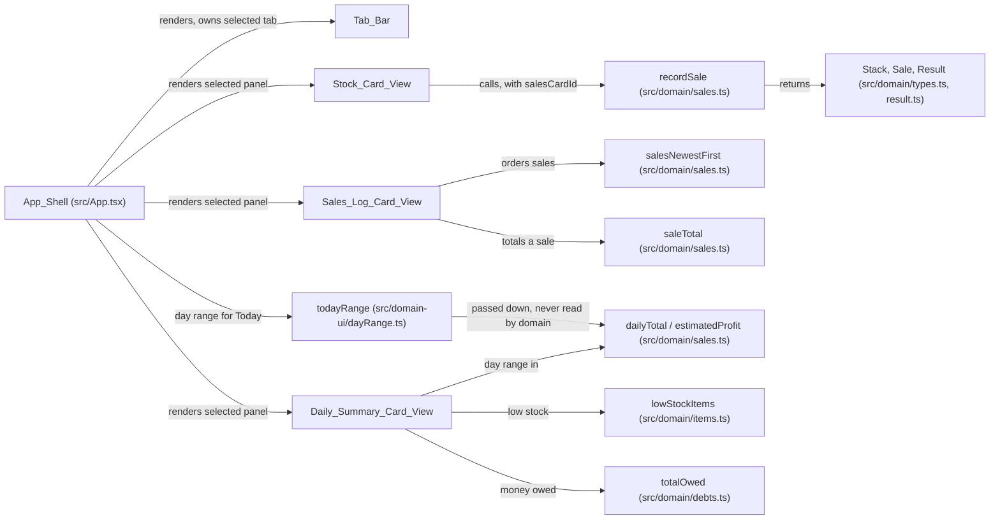

# Design: Sales log, Daily summary and tab bar

## Overview

This spec gives the owner the other half of the everyday loop. It adds three pure domain functions — `dailyTotal`, `estimatedProfit`, `lowStockItems` — plus a pure `salesNewestFirst` sort helper, wires a "Record a sale" form into the existing Stock_Card_View, and adds two new screens (Sales_Log_Card_View, Daily_Summary_Card_View) and a Tab_Bar that lets the owner switch between all four starter cards. It builds on `ghoststack-foundation` (`recordSale`, `saleTotal`, `Sale`/`Stack` types) and `app-shell-stock-card` (Card/Button/Field, `formatKobo`, `isLowStock`, the App_Shell's load/save queue). None of that existing code changes.

- **Domain** (`src/domain/`) gains `dailyTotal`, `estimatedProfit`, `lowStockItems` (all pure, no clock, no React) and `salesNewestFirst`.
- **UI** (`src/domain-ui/`, `src/components/`) gains a day-range helper (`todayRange`), a Sales_Log_Card_View, a Daily_Summary_Card_View, a "Record a sale" form inside Stock_Card_View, and a Tab_Bar.
- **App_Shell** (`src/App.tsx`) gains the Tab_Bar wiring, the day range for Today, and passes the Sales log card id down to Stock_Card_View.

## Architecture

Data flow is unchanged from `docs/ARCHITECTURE.md`: UI action → domain function → storage (via the existing save queue) → UI. The domain stays free of React, storage, and the clock; `todayRange` (which does read the clock) lives in the UI layer, not in `src/domain/` (Requirement 6.2, Glossary "Today").



## File layout

```
src/domain/
  sales.ts              + dailyTotal, estimatedProfit, salesNewestFirst (saleTotal, recordSale unchanged)
  sales.property.test.ts  (new property tests added alongside existing ones)
  sales.test.ts            (new unit test examples added)
  items.ts              + lowStockItems (addItem/updateItem/deleteItem/isLowStock/isOutOfStock unchanged)
  items.property.test.ts  (new property test added)
  items.test.ts            (new unit test examples added)
  index.ts              new exports added
src/domain-ui/
  money.ts               + formatSignedKobo (formatKobo, parseKobo unchanged)
  money.test.ts          (new unit test examples added)
  money.property.test.ts (new property test added)
  dayRange.ts            todayRange (UI-layer day range helper; reads the clock)
  dayRange.test.ts
src/components/
  TabBar.tsx / TabBar.css     Tab_Bar: tablist/tab/tabpanel, keyboard navigation (arrows, Home, End)
  cards/
    StockCardView.tsx    + "Record a sale" button, SaleForm, aria-live "Sale recorded" message
    SaleForm.tsx          quantity-only form for recording a sale
    SalesLogCardView.tsx    Sales_Log_Card_View
    SalesLogCardView.css
    DailySummaryCardView.tsx  Daily_Summary_Card_View
    DailySummaryCardView.css
src/App.tsx              + Tab_Bar wiring, selected-tab state, todayRange (recomputed on tab select and on becoming visible), salesCardId (possibly missing) passed to Stock_Card_View
```

No new top-level folders. `todayRange` sits in `src/domain-ui/` next to `money.ts` and `wholeNumber.ts`: it is UI-layer logic (it reads the clock, which `src/domain/` must never do per `tech.md` and the Glossary's "Today" entry) but it is still a pure, framework-free function, so it does not belong in `src/components/` either — the same reasoning the previous spec used for `formatKobo`/`parseKobo`.

## Data Models

No persisted shape changes. `Sale`, `Stack`, `Item`, `Debt` and the four `Card` variants are unchanged (`src/domain/types.ts`). This spec adds one UI-only type, a day range:

```ts
// src/domain-ui/dayRange.ts
export interface DayRange {
  /** Inclusive. */
  start: IsoString;
  /** Exclusive. */
  end: IsoString;
}
```

`DayRange` is not added to `src/domain/types.ts`; the domain functions below take `start`/`end` as two plain `IsoString` parameters (see signatures), so the domain has no dependency on a UI-layer type, matching the existing style of `RecordSaleInput` etc. taking primitive fields.

## Components and Interfaces

### Domain: `dailyTotal` and `estimatedProfit` (`src/domain/sales.ts`)

Both follow the running-sum shape already used by `totalOwed` in `src/domain/debts.ts` (`reduce` over a list, each step guarded), extended with a time-window filter and an overflow check per step (`totalOwed` has no overflow check today because debts amounts are checked at `recordDebt` time; these two functions must check as they go, per Requirements 1.6 and 2.7).

```ts
export function dailyTotal(sales: Sale[], start: IsoString, end: IsoString): Result<Kobo>

export function estimatedProfit(sales: Sale[], start: IsoString, end: IsoString): Result<Kobo>
```

Algorithm (shared shape, `dailyTotal` shown; `estimatedProfit` differs only in the per-sale amount):

1. Parse `start` and `end` once with `Date.parse`, giving `startMs` and `endMs`. (The day range is supplied by the caller and is always well-formed per the Glossary, but parsing once up front avoids re-parsing it per sale.)
2. For each `sale` in `sales`, in input order:
   a. Parse `sale.time` with `Date.parse`, giving `saleMs`. If `Number.isNaN(saleMs)`, skip this Sale (Requirement 1.8 / 2.9 — unparseable times are excluded, never compared as strings, never produce `NaN` in the sum).
   b. If `saleMs < startMs || saleMs >= endMs`, skip this Sale (half-open window: start inclusive, end exclusive, per Requirement 1.2 / 2.2 and the Glossary's Day range entry).
   c. Otherwise add this Sale's amount to the running sum — `sale.quantity * sale.unitPrice` for `dailyTotal`, `(sale.unitPrice - sale.unitCost) * sale.quantity` for `estimatedProfit`.
   d. After adding, if the new running sum is not `Number.isSafeInteger`, return `err("AMOUNT_TOO_BIG")` immediately (Requirement 1.6 / 2.7). This reuses the existing `AMOUNT_TOO_BIG` code and message from `src/domain/result.ts` — no new error code is added by this spec.
3. If every Sale was processed without an overflow, return `ok(sum)`. An empty `sales` list, or a `sales` list where no Sale falls in the range, returns `ok(0)` (Requirement 1.3 / 2.3), since the running sum starts at 0 and `reduce`/the loop never runs its body.

Both functions build a new local sum on each step and never write to `sales`, any `Sale`, or the two `IsoString` inputs (Requirement 1.5 / 2.6). Neither reads `Date.now()` or any other clock — `start`/`end` are the only source of "now" (Requirement 1.4 / 2.5).

`estimatedProfit` uses each Sale's own stored `unitPrice`/`unitCost` fields (copied onto the `Sale` at `recordSale` time, per the foundation design), never the current Item's prices, so a later price change never changes a past Sale's estimated profit (Requirement 2.4) — this falls out of using `sale.unitPrice`/`sale.unitCost` rather than looking the Item up.

### Domain: `salesNewestFirst` (`src/domain/sales.ts`)

```ts
export function salesNewestFirst(sales: Sale[]): Sale[]
```

1. Build `indexed = sales.map((sale, index) => ({ sale, index }))` so input order is available as a tie-breaker without mutating `sales`.
2. Sort `indexed` with a comparator that:
   - Parses both sales' `time` with `Date.parse`. A `NaN` parse (unparseable time) sorts **after** every parseable time, regardless of the other side's value (Requirement 5.3's "put any Sale whose time cannot be parsed after all Sales with a valid time").
   - When both times parse, compare descending by parsed time (newest first).
   - When both times are equal (including both unparseable, or both parsed to the same instant), compare by `index` **descending** — the Sale that appears later in the input list sorts first (Requirement 5.3's later-recorded-first tie-break; this also covers Requirement 5.2's "later-recorded Sale first" for the view, since `salesNewestFirst` is the only ordering `Sales_Log_Card_View` uses).
3. Return `indexed.map((entry) => entry.sale)` — a new array; the elements themselves are the same `Sale` object references as in the input, and the input array is never reordered or written to.

`Array.prototype.sort` is not guaranteed stable across all engines by the language in the way this spec needs (actually ES2019+ guarantees a stable sort, but the explicit `index` tie-break makes the "later-recorded first" rule explicit and readable rather than relying on an engine guarantee, and it is what makes the rule testable independent of input order).

### Domain: `lowStockItems` (`src/domain/items.ts`)

```ts
export function lowStockItems(stack: Stack): Item[]
```

1. Walk `stack.cards` in order; for each card with `type === "stock"`, walk its `items` in order.
2. Keep an Item if `isLowStock(item)` is `true` — the existing function from `src/domain/items.ts`, not duplicated (Requirement 3.2).
3. Return the kept Items as a new flat array, in the order: all kept Items of the first Stock card (in that card's `items` order), then all kept Items of the next Stock card, and so on (Requirement 3.5). A Stack with no Stock card, or no low-stock Item anywhere, returns `[]` (Requirement 3.3).

Implementation is a plain `flatMap`-and-`filter` (or equivalent) over `stack.cards`; it reads `stack` and never assigns into `stack`, any card, or any Item (Requirement 3.4).

### UI-layer: `todayRange` (`src/domain-ui/dayRange.ts`)

```ts
export function todayRange(now: Date = new Date()): DayRange
```

This is the "UI-layer day range helper" for the owner's local calendar day (Requirement 6.2, Glossary "Today" / "Day range"). It takes an optional `now` (defaulting to `new Date()`) purely so unit tests can pass a fixed `Date` without mocking the global clock; callers in the App_Shell call it with no argument.

1. Read `now.getFullYear()`, `now.getMonth()`, `now.getDate()` — local-time getters, so the day boundary follows the device's time zone, matching "the owner's local calendar day" in the Glossary.
2. `start = new Date(year, month, date, 0, 0, 0, 0)` — local midnight at the start of today.
3. `end = new Date(year, month, date + 1, 0, 0, 0, 0)` — local midnight at the start of *tomorrow*. Passing `date + 1` to the `Date` constructor rolls over month/year boundaries correctly (JavaScript's `Date` normalizes out-of-range day-of-month values), so this handles end-of-month and end-of-year without special-casing.
4. Return `{ start: start.toISOString(), end: end.toISOString() }`. Both are full ISO 8601 instants (UTC, with the `Z` suffix `toISOString()` always produces), so `Date.parse` in the domain functions reads them as unambiguous instants — this is what the Glossary means by "both the start and the end are ISO 8601 strings" and by comparing times "as instants, never as strings" (Requirement 1.7 / 2.8).

`end` is exactly the start of the next local calendar day, computed here in the UI layer and passed down — the domain never computes it and never reads the clock (Requirement 6.2, Confirmed decision "Day range boundary").

### UI-layer: `formatSignedKobo` (`src/domain-ui/money.ts`)

```ts
export function formatSignedKobo(kobo: number): string
```

Formats a kobo amount that can be negative, for estimated profit (Requirement 6.4).

1. If `kobo < 0`, return `"Loss: " + formatKobo(Math.abs(kobo))`, for example `"Loss: ₦12.50"` for `-1250`.
2. Otherwise (zero or positive), return `"Profit: " + formatKobo(kobo)`, for example `"Profit: ₦0.00"` for `0`.

The sign is carried by the word, never by a minus sign, and the amount part is always produced by the existing `formatKobo`, so grouping, decimals and the Naira symbol stay in one place. Zero counts as "Profit" because `0 < 0` is false. `formatKobo` is unchanged. Callers pass safe integers (the `estimatedProfit` result), so `Math.abs` never loses precision.

### UI: "Record a sale" (inside `StockCardView.tsx`, new `SaleForm.tsx`)

#### UI state additions to `StockCardView`

```ts
type FormMode =
  | { kind: "closed" }
  | { kind: "add" }
  | { kind: "edit"; itemId: string }
  | { kind: "sale"; itemId: string };   // new

interface SaleFormState {
  quantityText: string;   // raw typed text, survives a failed submit
  error?: string;         // next to the quantity Field
  formError?: string;     // shown at the top of the form, for non-quantity errors
}
```

`StockCardView` takes one new prop, `salesCardId: string | undefined` (see "Passing `salesCardId` down" below), alongside the existing `stack`, `card`, `onStackChange`. `undefined` means the Stack has no Sales log card.

When `salesCardId` is `undefined`, `StockCardView` does not pass an `onRecordSale` handler to `ItemRow`, so no "Record a sale" button is rendered on any row, and it renders this message once, above the item list, in a `<p>`: "Sales can't be recorded because this shop has no Sales log card." (Requirement 4.11). The sale form and `recordSale` call are then unreachable. The starter Stack always has a Sales log card, so this path covers only a damaged or hand-edited Stack.

#### `SaleForm` component

```ts
export interface SaleFormProps {
  itemName: string;
  initialQuantityText: string;   // "1" when freshly opened
  onSubmit: (quantityText: string) => void;
  onCancel: () => void;
  error?: string;
  formError?: string;
}
function SaleForm(props: SaleFormProps): JSX.Element
```

Renders the Item's name, one `Field` for quantity (`inputMode="numeric"`, defaulting to `"1"`, Requirement 4.2), and Save/Cancel `Button`s, reusing the same form-chrome pattern as `ItemForm` (title, `formError` as a top `role="alert"` paragraph, field `error` passed straight to `Field`).

#### Flow in `StockCardView`

1. When `salesCardId` is defined, tapping "Record a sale" on an `ItemRow` sets `formMode = { kind: "sale", itemId }` and `saleForm = { quantityText: "1" }` (Requirement 4.1, 4.2).
2. On submit, call `parseWholeNumber(quantityText)` (reused from `src/domain-ui/wholeNumber.ts`, no new parsing helper needed since quantity here is the same shape as the existing quantity Field).
   - If parsing fails (not a positive whole number, or not a safe integer), set `saleForm.error` to the parse error's message and keep the form open with the typed text (Requirement 4.4). `parseWholeNumber` accepts `0`; since `recordSale` already rejects non-positive quantities via `isPositiveWhole`, a typed `"0"` is instead caught by the domain's `BAD_QUANTITY` error in the next step — both paths land on the same message, so no extra zero-check is needed in the UI.
3. If parsing succeeds, call:
   ```ts
   recordSale({
     stack,
     stockCardId: card.id,
     salesCardId,            // the new prop; defined here, because the button is hidden otherwise
     itemId,
     quantity: parsedQuantity,
     saleId: crypto.randomUUID(),   // made in the UI layer (Requirement 4.8)
     time: new Date().toISOString(), // read in the UI layer (Requirement 4.8)
   })
   ```
4. If the Result is `{ ok: false, error: { code: "NOT_ENOUGH_STOCK", message } }`, show `message` as `saleForm.error` next to the quantity Field and keep the form open with the typed quantity (Requirement 4.5) — this is the one domain error shown next to the Field rather than at the top, because the requirement calls it out specifically and it is squarely about the quantity the owner typed.
5. If the Result is any other error, show `error.message` as `saleForm.formError` at the top of the form and keep it open with the typed quantity (Requirement 4.6).
6. If the Result is success: close the form (`formMode = { kind: "closed" }`), call `onStackChange(result.value)` (the reduced quantity then flows down and re-renders the `ItemRow`, Requirement 4.3), and trigger the "Sale recorded" message (next section, Requirement 4.10).
7. Cancel sets `formMode = { kind: "closed" }` without calling `recordSale` (Requirement 4.7).

#### "Sale recorded" live region

```ts
const [saleNotice, setSaleNotice] = useState<string | null>(null);
// on recordSale success:
setSaleNotice("Sale recorded");
if (noticeTimer.current !== null) window.clearTimeout(noticeTimer.current);
noticeTimer.current = window.setTimeout(() => setSaleNotice(null), 3000);
// declared once: const noticeTimer = useRef<number | null>(null);
// cleared on unmount:
useEffect(() => () => {
  if (noticeTimer.current !== null) window.clearTimeout(noticeTimer.current);
}, []);
```//
rendered once near the top of `StockCardView`'s returned JSX:
```tsx
<p aria-live="polite" className="stock-card__notice">{saleNotice ?? ""}</p>
```
The element is always present (so screen readers are already subscribed to it when the text changes, which `aria-live` regions need in order to announce a change) and its text is cleared after a few seconds by the timeout (Requirement 4.10). The `noticeTimer` ref holds the latest timeout id, cleared and reset on every new notice, so two rapid sales cannot race two timeouts and clear a newer message early. A cleanup effect with an empty dependency list clears the pending timeout when `StockCardView` unmounts (for example when the owner switches to another tab), so the timeout never calls `setSaleNotice` on an unmounted component (Requirement 4.10).

### UI: `SalesLogCardView` (`src/components/cards/SalesLogCardView.tsx`)

```ts
export interface SalesLogCardViewProps {
  stack: Stack;
  card: SalesLogCard;
}
function SalesLogCardView(props: SalesLogCardViewProps): JSX.Element
```

Read-only (Requirement 5.8 — Play mode only, no builder controls, so no `onStackChange` prop is needed).

1. Render inside `Card` using `card.title` (Requirement 5.1).
2. Compute `const ordered = salesNewestFirst(card.sales)` (Requirement 5.3's "the view SHALL use `salesNewestFirst` for its order").
3. If `ordered.length === 0`, show a friendly empty-state message, e.g. "No sales yet." (Requirement 5.6).
4. Otherwise render a `<ul>` of rows, one per Sale in `ordered` order. Each row:
   - Looks up the sold Item by `sale.itemId` across every Stock card in `stack.cards` (`stack.cards.flatMap(c => c.type === "stock" ? c.items : []).find(i => i.id === sale.itemId)`). If no Item matches, show the name **"Deleted item"** instead (Requirement 5.5; see "Deleted item lookup" below for why this always matches `app-shell-stock-card`'s Assumption A1).
   - Shows the quantity sold (`sale.quantity`).
   - Shows the sale's total price via `formatKobo(saleTotal(sale))`, reusing the existing `saleTotal` from `src/domain/sales.ts` and the existing `formatKobo` (Requirement 5.7).
   - Shows the sale's time. Since `sale.time` is an ISO string and this is a read-only display (not a value fed back into a domain comparison), it is rendered with `new Date(sale.time).toLocaleString()`; if `Date.parse(sale.time)` is `NaN`, `toLocaleString()` on an Invalid Date renders the literal text `"Invalid Date"` — acceptable here because an unparseable time is a data anomaly the owner should be able to notice, and Requirement 5's acceptance criteria constrain ordering and amounts, not this display string.

### UI: `DailySummaryCardView` (`src/components/cards/DailySummaryCardView.tsx`)

```ts
export interface DailySummaryCardViewProps {
  stack: Stack;
  dayRange: DayRange;   // passed down from the App_Shell, Requirement 6.2
}
function DailySummaryCardView(props: DailySummaryCardViewProps): JSX.Element
```

Also read-only Play mode only (Requirement 6.8).

1. Render inside `Card` using the Daily summary card's `title` (Requirement 6.1) — found via `stack.cards.find(c => c.type === "daily-summary")`.
2. Find the Stack's one Sales log card (`stack.cards.find(c => c.type === "sales-log")`); if absent, treat its `sales` as `[]` (defensive — the starter stack always has exactly one, so this path is unreachable in practice but keeps the component total).
3. Compute `const totalResult = dailyTotal(salesCard.sales, dayRange.start, dayRange.end)` and `const profitResult = estimatedProfit(salesCard.sales, dayRange.start, dayRange.end)`, passing `dayRange` straight through — the component never reads the clock itself (Requirement 6.2).
4. Render the total as `formatKobo(totalResult.value)` and the estimated profit as `formatSignedKobo(profitResult.value)` (for example "Profit: ₦1,250.00" or "Loss: ₦300.00"), each when its `result.ok`, or `result.error.message` in place of the amount when not (Requirement 6.3, 6.4, 6.7).
5. Compute `const lowStock = lowStockItems(stack)` and render each Item's name in a list, or a friendly message ("Nothing is low on stock right now.") when `lowStock.length === 0` (Requirement 6.5).
6. Find the Stack's Debts card (`stack.cards.find(c => c.type === "debts")`) and render `formatKobo(totalOwed(debtsCard.debts))`, reusing the existing `totalOwed` from `src/domain/debts.ts` (Requirement 6.6); if absent, treat as `0` (same defensive reasoning as step 2).

### UI: `Tab_Bar` (`src/components/TabBar.tsx`)

```ts
export interface TabItem {
  id: string;        // also used to build the panel id
  label: string;
}
export interface TabBarProps {
  tabs: TabItem[];          // exactly the 4 starter cards, in order (Requirement 7.1)
  selectedId: string;
  onSelect: (id: string) => void;
}
function TabBar(props: TabBarProps): JSX.Element
```

Structure (Requirement 7.7):

```tsx
<div role="tablist" aria-label="Cards" className="tab-bar">
  {tabs.map((tab, index) => (
    <button
      key={tab.id}
      role="tab"
      id={`tab-${tab.id}`}
      aria-selected={tab.id === selectedId}
      aria-controls={`panel-${tab.id}`}
      tabIndex={tab.id === selectedId ? 0 : -1}
      className="tab-bar__tab"
      onClick={() => onSelect(tab.id)}
      ref={(el) => { tabRefs.current[index] = el; }}
      onKeyDown={handleKeyDown}
    >
      {tab.id === selectedId && <span aria-hidden="true" className="tab-bar__marker">▸ </span>}
      {tab.label}
    </button>
  ))}
</div>
```

- Each `<button role="tab">` links to its panel via `aria-controls` / the panel's matching `id` (Requirement 7.7). The App_Shell renders the selected panel with `role="tabpanel" id={`panel-${selectedId}`} aria-labelledby={`tab-${selectedId}`}`.
- The selected tab is marked both by `aria-selected="true"` and by a visible, non-colour marker (`▸`, rendered `aria-hidden` since `aria-selected` already carries the state to assistive tech) — satisfying "does not rely on colour alone" (Requirement 7.5) without needing a second colour-independent cue beyond the glyph plus the ARIA state.
- `min-height: var(--tap-min); min-width: var(--tap-min)` on `.tab-bar__tab` in `TabBar.css`, reusing the existing `--tap-min: 44px` variable from `theme.css` (Requirement 7.6).
- `:focus-visible` outline is inherited from the shared rule already defined once in `theme.css` (Requirement 7.10) — no new focus style is added.
- Roving tabindex: only the selected tab has `tabIndex={0}`; every other tab has `tabIndex={-1}`, so a single `Tab` key-press from outside the bar lands on the selected tab (standard ARIA `tablist` pattern), and the arrow, Home and End keys move focus within the bar.
- The component keeps `const tabRefs = useRef<Array<HTMLButtonElement | null>>([])`, filled by the `ref` callback on each tab button, so the key handler can call `focus()` on the target button directly. The target button has `tabIndex={-1}` until the re-render, which does not stop a programmatic `focus()`.

`handleKeyDown` (Requirements 7.8, 7.9):

```ts
function handleKeyDown(e: React.KeyboardEvent<HTMLButtonElement>) {
  const currentIndex = tabs.findIndex((t) => t.id === selectedId);
  let nextIndex: number;
  if (e.key === "ArrowRight") nextIndex = (currentIndex + 1) % tabs.length;
  else if (e.key === "ArrowLeft") nextIndex = (currentIndex - 1 + tabs.length) % tabs.length;
  else if (e.key === "Home") nextIndex = 0;
  else if (e.key === "End") nextIndex = tabs.length - 1;
  else return;
  e.preventDefault();
  onSelect(tabs[nextIndex].id);
  tabRefs.current[nextIndex]?.focus();
}
```

A key press selects the target tab with `onSelect` and moves focus with an explicit `focus()` call on the target button from `tabRefs`; the design does not rely on the browser to move focus. This satisfies "move focus and selection to the previous or next tab, wrapping from the last tab to the first and the first to the last" (Requirement 7.8) and "move focus and selection to the first or last tab" for Home and End (Requirement 7.9). The `+ tabs.length` before `% tabs.length` makes ArrowLeft wrap from index 0 to index 3, and `% tabs.length` makes ArrowRight wrap from index 3 to index 0. A click selects the tab and the browser's default click behaviour focuses it.

### App_Shell changes (`src/App.tsx`)

1. **Selected tab state**: `const [selectedTab, setSelectedTab] = useState<CardType>("stock")`, so the Stock card's view shows first on load (Requirement 7.3). The four tab ids are the Stack's four `CardType` values (`"stock" | "sales-log" | "debts" | "daily-summary"`), which also happen to be stable ids for `TabBar`'s `tabs` array — one `TabItem` per `CardType`, with fixed labels "Stock", "Sales log", "Debts", "Daily summary" (Requirement 7.1, 7.6's "simple English labels").
2. **Day range for Today** (Requirement 6.2): the day range lives in state, `const [dayRange, setDayRange] = useState<DayRange>(() => todayRange())`, and is recomputed in two places. There is no `useMemo` and no mount-once computation.
   - Tab selection: the `onSelect` handler passed to `TabBar` calls `setDayRange(todayRange())` every time the selected id is `"daily-summary"`, then calls `setSelectedTab(id)`. Selecting the tab again while it is already shown also recomputes.
   - Visibility: a `useEffect` with an empty dependency list adds a `visibilitychange` listener on `document`. The listener calls `setDayRange(todayRange())` when `document.visibilityState === "visible"`. The event fires only when visibility changes, so a visible state means the document was hidden before. The effect's cleanup removes the listener.

   This lets the summary move to the new day when the owner leaves the app open overnight and comes back to it. The calls to `todayRange()` happen in event handlers, never during render, so a render does not read the clock. No timer runs while the document stays visible, so a summary that stays on screen across local midnight does not roll over until the owner switches tabs or hides and shows the app.
3. **Finding the four cards**: alongside the existing `stockCard` lookup, add `salesCard = stack?.cards.find((c): c is SalesLogCard => c.type === "sales-log")`, `debtsCard = stack?.cards.find(...)`, `summaryCard` similarly — all four looked up once per render from the one loaded `stack`.
4. **Passing `salesCardId` down** (Requirements 4.9, 4.11): `<StockCardView stack={stack} card={stockCard} salesCardId={salesCard?.id} onStackChange={onStackChange} />`. There is no non-null assertion. When `salesCard` is `undefined`, `salesCardId` is `undefined` and `StockCardView` hides "Record a sale" and shows the missing-card message (see "UI: Record a sale"). The App_Shell is the one place that already knows every card's id (it loaded or built the whole `Stack`), so it is the natural owner of this wiring — `StockCardView` itself never searches the Stack for a Sales log card id.
5. **Rendering the selected panel**:
   ```tsx
   <TabBar tabs={TABS} selectedId={selectedTab} onSelect={selectTab} />
   {/* selectTab(id): if (id === "daily-summary") setDayRange(todayRange()); setSelectedTab(id as CardType); */}
   <div role="tabpanel" id={`panel-${selectedTab}`} aria-labelledby={`tab-${selectedTab}`}>
     {selectedTab === "stock" && stockCard && (
       <StockCardView stack={stack} card={stockCard} salesCardId={salesCard?.id} onStackChange={onStackChange} />
     )}
     {selectedTab === "sales-log" && salesCard && (
       <SalesLogCardView stack={stack} card={salesCard} />
     )}
     {selectedTab === "debts" && (
       <p>Coming soon: a Debts card view.</p>   // placeholder, Requirement 7.4
     )}
     {selectedTab === "daily-summary" && (
       <DailySummaryCardView stack={stack} dayRange={dayRange} />
     )}
   </div>
   ```
   Only the selected card's view is mounted; the other three are not rendered at all, which satisfies "show that card's view and hide the other three" (Requirement 7.2) by simply not putting the hidden ones in the tree (so they also cannot run their own effects while hidden).
6. No change to the load effect, the save queue, `latestStackRef`, or the theme toggle — this spec only adds the tab/day-range/salesCardId wiring described above, on top of the existing App_Shell responsibilities from `app-shell-stock-card`.

### Deleted item lookup

A Sale's `itemId` can outlive the Item it refers to, because `deleteItem` removes the Item from its Stock card's `items` list but never touches any Sale (per `app-shell-stock-card`'s Property 3 and Assumption A1: "a Sale's `itemId` may not resolve to an Item if the Item has since been deleted; this is expected and not an error"). `Sales_Log_Card_View`'s lookup — searching every Stock card's `items` for a matching `id` — therefore has exactly two outcomes: a match (show the Item's current name) or no match anywhere in the Stack (show "Deleted item", Requirement 5.5). No new domain code is needed for this: it is a plain `Array.prototype.find` the view performs itself, over data the domain already exposes unchanged.

## Correctness Properties

*A property is a characteristic or behavior that should hold true across all valid executions of a system — essentially, a formal statement about what the system should do. Properties serve as the bridge between human-readable specifications and machine-verifiable correctness guarantees.*

### Reflection on redundant properties

- Requirements 1.2/1.3 (window exclusion, empty-range zero) and 2.2/2.3 describe the same fact as the sum equality in invariants 3 and 4 — a Sale either contributes `quantity * unitPrice` (or the profit amount) when inside the range, or contributes nothing. These collapse into Properties 16 and 17 rather than separate "boundary excluded" and "equals sum" properties.
- The "no mutation" requirements (1.5, 2.6, 3.4) and the "never read the clock" requirements (1.4, 2.5, 6.2) are not independently testable as one property each without reading like restatements of the function signature; "no mutation" is folded into one frozen-input property (Property 21) shared across all three new domain functions, matching how the previous spec's Property 7 covered three functions with one statement.
- The "never `NaN`" requirements for unparseable times (1.8, 2.9) and the "safe integer or error" requirements (1.6, 2.7) are related but distinct: one is about a bad *input* (unparseable time) and one is about a bad *intermediate result* (overflow) — kept as two separate properties (19 and 20) because they are triggered by different generators and guard different code paths.
- `salesNewestFirst`'s three guarantees — permutation, sort order, tie-break — are one property about the function's one contract (Property 23), not three, mirroring how the previous design folded "grows by one" and "field equality" into single properties per function.

### Property 16: `dailyTotal` equals the sum of in-range sale amounts

*For any* list of Sales (each with a parseable time) and *for any* day range, `dailyTotal(sales, start, end)` SHALL return `ok(sum)` where `sum` equals the sum of `quantity * unitPrice` over exactly the Sales whose parsed time is at or after `start` and strictly before `end`, and every Sale whose parsed time is before `start` or at or after `end` SHALL contribute nothing to `sum`.

**Validates: Requirements 1.1, 1.2, 1.3, 1.7**

### Property 17: `estimatedProfit` equals the sum of in-range profit amounts

*For any* list of Sales (each with a parseable time) and *for any* day range, `estimatedProfit(sales, start, end)` SHALL return `ok(sum)` where `sum` equals the sum of `(unitPrice - unitCost) * quantity` over exactly the Sales whose parsed time is at or after `start` and strictly before `end`, and every Sale whose parsed time is before `start` or at or after `end` SHALL contribute nothing to `sum`.

**Validates: Requirements 2.1, 2.2, 2.3, 2.8**

### Property 18: Split-point additivity for daily totals and estimated profit

*For any* list of Sales, *for any* day range, and *for any* split instant inside that range, `dailyTotal` over the whole range SHALL equal `dailyTotal` over the first part (`start` to the split instant) plus `dailyTotal` over the second part (the split instant to `end`), when neither call overflows; the same relationship SHALL hold for `estimatedProfit`.

**Validates: Requirements 8.9**

### Property 19: `lowStockItems` matches `isLowStock`, in stack order

*For any* Stack, `lowStockItems(stack)` SHALL return exactly the Items for which `isLowStock(item)` is `true`, in the order: the matching Items of the first Stock card (in that card's item order), then those of the next Stock card, and so on — with no Item appearing that is not in some Stock card's `items`, and no omission of a matching Item.

**Validates: Requirements 3.1, 3.2, 3.3, 3.5**

### Property 20: Unparseable Sale times never make a total `NaN`

*For any* list of Sales where some entries have a `time` string that `Date.parse` cannot read, and *for any* day range, `dailyTotal` and `estimatedProfit` SHALL exclude every such Sale from the sum and SHALL return either `ok` with a finite, safe-integer value or an `AMOUNT_TOO_BIG` error — never a result containing `NaN`.

**Validates: Requirements 1.8, 2.9**

### Property 21: Overflow always returns an error, never an unsafe number

*For any* list of Sales and *for any* day range such that the true in-range sum of sale amounts (or profit amounts) is not representable as a safe integer, `dailyTotal` (respectively `estimatedProfit`) SHALL return an error result with code `AMOUNT_TOO_BIG`, and SHALL NOT return `ok` with a value that is `NaN`, `Infinity`, or not `Number.isSafeInteger`.

**Validates: Requirements 1.6, 2.7**

### Property 22: `dailyTotal`, `estimatedProfit` and `lowStockItems` never mutate a frozen input

*For any* deep-frozen list of Sales, deep-frozen day range strings, or deep-frozen Stack, calling `dailyTotal`, `estimatedProfit`, or `lowStockItems` (with any input, valid or invalid) SHALL complete without throwing, and the frozen input SHALL remain deep-equal to a snapshot taken before the call.

**Validates: Requirements 1.5, 2.6, 3.4**

### Property 23: `salesNewestFirst` is a permutation, sorted newest-first, ties broken by later input position, and does not mutate its input

*For any* list of Sales, `salesNewestFirst(sales)` SHALL return a list that is a permutation of `sales` (same elements, same multiset, by reference), sorted so that for any two Sales with a parseable time, the one with the later parsed time comes first; any Sale whose time cannot be parsed SHALL come after every Sale with a parseable time; and when two Sales compare equal (same parsed time, or both unparseable), the Sale that appears later in the input list SHALL come first in the output. `sales` itself SHALL remain deep-equal to a snapshot taken before the call.

**Validates: Requirements 5.2, 5.3**

### Property 24: `formatSignedKobo` labels the sign and reuses `formatKobo` for the amount

*For any* safe integer `n`, `formatSignedKobo(n)` SHALL start with `"Loss: "` if and only if `n < 0`, and otherwise SHALL start with `"Profit: "`; and the amount part (the output with that prefix removed) SHALL equal `formatKobo(Math.abs(n))`.

**Validates: Requirements 6.4, 8.14**

## Error handling

- `dailyTotal` and `estimatedProfit` reuse the existing `AMOUNT_TOO_BIG` error code and message from `src/domain/result.ts` (`"This amount is too big to work with. Please use a smaller amount."`) — no new error code is added by this spec, matching the Confirmed decision on overflow handling. `lowStockItems` and `salesNewestFirst` are total functions and never return a `Result`; they cannot fail.
- `recordSale` is unchanged: `StockCardView`'s new sale form reuses its existing error codes (`BAD_QUANTITY`, `CARD_NOT_FOUND`, `ITEM_NOT_FOUND`, `DUPLICATE_ID`, `NOT_ENOUGH_STOCK`, `AMOUNT_TOO_BIG`). `NOT_ENOUGH_STOCK` is shown next to the quantity Field (Requirement 4.5); every other error is shown as a `formError` at the top of the sale form (Requirement 4.6), mirroring how `StockCardView` already treats `addItem`/`updateItem` errors.
- `parseWholeNumber`'s existing `BAD_QUANTITY` error is shown next to the quantity Field when the typed text cannot be read as a positive whole number (Requirement 4.4), before `recordSale` is ever called — the same pattern `parseItemForm` already uses for the quantity Field on the Add/Edit item form.
- A Stack with no Sales log card is not an error that stops the app: `StockCardView` hides "Record a sale" and shows "Sales can't be recorded because this shop has no Sales log card." (Requirement 4.11). No `recordSale` call is made, so `CARD_NOT_FOUND` cannot come from a missing Sales log card through this form.
- `Daily_Summary_Card_View` shows `result.error.message` in place of a Naira amount for whichever of `dailyTotal`/`estimatedProfit` returns an error, independently of the other (Requirement 6.7) — one failing does not hide the other's value.
- `Sales_Log_Card_View` has no error path of its own: `salesNewestFirst` and `saleTotal` are total, and a Sale with no matching Item is not an error state, it is the expected "Deleted item" display (Requirement 5.5).
- The Tab_Bar and the Debts placeholder have no failure modes to handle; they are pure rendering plus a `useState` setter.

## Testing Strategy

**Unit tests** (Vitest) cover specific examples and edge cases:

- `dailyTotal`, `estimatedProfit`: an empty-Sales example (→ `ok(0)`); a Sale exactly at `start` (included) and a Sale exactly at `end` (excluded), to pin down the half-open boundary; a Sale with an unparseable `time` mixed with parseable Sales; a running sum that overflows on the second Sale, to confirm the error is returned rather than a partial sum.
- `lowStockItems`: a Stack with no Stock card (→ `[]`); a Stack with two Stock cards, each with a mix of low-stock and not-low-stock Items, to pin down the card-then-item ordering; an Item exactly at its `lowStockLevel` (included, boundary of `isLowStock`).
- `salesNewestFirst`: an already-sorted input; two Sales with identical times (later input position wins); a Sale with an unparseable time mixed with parseable ones (sorts last); an empty list.
- `formatSignedKobo` (`src/domain-ui/money.test.ts`): zero (→ `"Profit: "` + `formatKobo(0)`); a positive value; a negative value (→ starts with `"Loss: "`, no minus sign, amount equals `formatKobo` of the absolute value); a large value near `Number.MAX_SAFE_INTEGER` and its negation (`-Number.MAX_SAFE_INTEGER`).
- `todayRange` (`src/domain-ui/dayRange.test.ts`): for each fixed `Date`, parse `start` and `end` back into `Date` objects and assert that `start` is local midnight by checking `getHours()`, `getMinutes()`, `getSeconds()` and `getMilliseconds()` are all `0`, and likewise for `end`. Assert that `end` is the next calendar day by comparing `end`'s local year, month and date with those of a `Date` built from `start`'s local year, month and `date + 1`. The tests do not assert a fixed 24-hour gap, because a day with a daylight-saving change is 23 or 25 hours long. Cases: a fixed `Date` mid-month; a fixed `Date` on the last day of a month (→ `end` rolls into the next month); a fixed `Date` on 31 December (→ `end` rolls into the next year).
- `StockCardView`'s sale flow, `SalesLogCardView`, `DailySummaryCardView`, and `TabBar`: per Assumption A4 (carried over from `app-shell-stock-card`), `@testing-library/react` and a DOM test environment are not yet approved, so component-level behaviour (the sale form, the aria-live notice, the Deleted-item display, the missing-Sales-log-card message, the notice timeout being cleared on unmount, the day range recompute on tab select and on `visibilitychange`, arrow/Home/End navigation with focus moving) is checked manually against the acceptance criteria in Requirements 4, 5, 6, 7, the same approach the previous spec took for `StockCardView`'s add/edit/delete flows. The pure logic each screen depends on — `dailyTotal`, `estimatedProfit`, `lowStockItems`, `salesNewestFirst`, `todayRange`, and the already-tested `recordSale`/`saleTotal`/`formatKobo`/`parseWholeNumber` — is fully covered by the unit and property tests here and in the foundation/app-shell specs.

**Property tests** (fast-check, `numRuns: 100` minimum, each tagged with its design property number), added to the existing property test files so each property sits with the function it covers:

| Property | Location |
| --- | --- |
| 16, 18, 20, 21 (dailyTotal/estimatedProfit parts), 22 (sales/day-range part) | `src/domain/sales.property.test.ts` |
| 17 | `src/domain/sales.property.test.ts` |
| 23 | `src/domain/sales.property.test.ts` |
| 19, 22 (Stack part) | `src/domain/items.property.test.ts` |
| 24 | `src/domain-ui/money.property.test.ts` |

Generators extend the existing ones from `src/domain/invariants.property.test.ts` and `src/domain/items.property.test.ts`:

- `arbIsoInstant`: `fc.date({ min: new Date("2000-01-01"), max: new Date("2100-01-01") }).map(d => d.toISOString())`, used for `start`/`end` and for most Sale times, so most generated times parse.
- `arbUnparseableTime`: `fc.constantFrom("", "not-a-date", "2024-13-45", "NaN")`, mixed into Sale time generation via `fc.oneof({ weight: 4, arbitrary: arbIsoInstant }, { weight: 1, arbitrary: arbUnparseableTime })` so most Sales have a valid time but some do not, for Properties 20 and 23.
- `arbSale`: extends the foundation's Sale shape with `quantity` from `fc.integer({ min: 1, max: 50 })`, `unitPrice`/`unitCost` from the existing `priceArb`-style generator in `invariants.property.test.ts`, and `time` from the mixed generator above.
- `arbDayRange`: generates `start` from `arbIsoInstant` and `end` as `start` plus a random positive duration (in milliseconds, via `fc.integer`), converted back to `toISOString()`, so `end` is always strictly after `start`.
- `arbSplitInstant` (Property 18): an instant strictly between a generated `arbDayRange`'s `start` and `end`, built by picking a random fraction of the interval.
- `arbStack` with multiple Stock cards (Property 19): extends `app-shell-stock-card`'s `arbStack` to place a variable number of Items with varied `quantity`/`lowStockLevel` combinations (including `quantity === lowStockLevel`) across two or more Stock cards.

- `arbSafeInteger` (Property 24): `fc.integer({ min: Number.MIN_SAFE_INTEGER, max: Number.MAX_SAFE_INTEGER })`, so negative, zero and positive values all occur.

Generators for Properties 16 to 20, 22 and 23 use bounded values (`quantity` up to 50, prices from the existing bounded generator, lists of limited length), so a generated list never overflows by accident. This matters for `estimatedProfit`, whose result can depend on order (see Decisions). Property 21 is the exception: it builds overflowing lists on purpose with values near `Number.MAX_SAFE_INTEGER`.

Each property test is written in the same task as the function it covers, per `money-rules.md`.

## Dependencies

No new packages. `fast-check`, `vitest`, `react`, `idb` are already installed and approved (`package.json`, carried over from the foundation and `app-shell-stock-card` specs). No new npm package is needed for `Date.parse`/`Date` (built into the JavaScript runtime) or for the ARIA tablist pattern (built with plain `<button>` elements and `role`/`aria-*` attributes, no new UI library).

## Decisions

- **`dailyTotal` and `estimatedProfit` take `start`/`end` as two `IsoString` parameters, not a `DayRange` object, in the domain signature.** This keeps `src/domain/` free of any dependency on the UI-layer `DayRange` type (defined in `src/domain-ui/dayRange.ts`), matching the existing pattern where domain functions take primitive fields (e.g. `RecordSaleInput.time: IsoString`) rather than UI-defined shapes.
- **Both functions re-check `Number.isSafeInteger` after every addition, not once at the end**, so a sum that overflows partway through a long list is caught immediately with `AMOUNT_TOO_BIG` rather than continuing to accumulate a value that has already become unsafe (and potentially wrapping into a value that looks safe again after further additions, if that were ever possible with floating point — checking every step avoids relying on that not happening).
- **`formatSignedKobo` lives in `src/domain-ui/money.ts` next to `formatKobo` and builds on it.** The sign is written as the word "Loss" or "Profit" (plain language) and the amount comes from `formatKobo(Math.abs(kobo))`, so Naira formatting stays in one function. Zero is shown as "Profit".
- **`salesNewestFirst` carries the original index through the sort as an explicit tie-breaker** rather than relying on JavaScript's guaranteed-stable `sort`, so the "later-recorded Sale first" rule is visible in the code and directly testable, not an incidental consequence of input order.
- **The sale form's quantity reuses `parseWholeNumber`, not a new parser.** The quantity being recorded is the same shape (a positive whole number typed as text) as the existing Add/Edit item form's quantity Field, so introducing a second parser would duplicate `src/domain-ui/wholeNumber.ts` for no behavioural difference.
- **The App_Shell recomputes `todayRange()` when the Daily summary tab is selected and when the document becomes visible after being hidden, not once per mount and not on a timer.** A mount-once value goes stale when the app stays open overnight. Recomputing on those two events keeps the summary on the right day with no timer. A summary that stays on screen across local midnight is not rolled over until one of the two events occurs, which is accepted.
- **`dailyTotal` and `estimatedProfit` stop at the first unsafe running sum, so the result can depend on order.** Each function adds Sales in input order and returns `AMOUNT_TOO_BIG` the moment the running sum is not a safe integer. For `dailyTotal` every amount is non-negative, so the error appears exactly when the true total is unsafe. For `estimatedProfit` an amount can be negative (a Sale sold below cost), so a list whose final sum is safe can still fail if an earlier partial sum overflowed; the same Sales in another order might succeed. This is accepted: a partial sum beyond the safe range already means the numbers are too large to trust. The property generators therefore use bounded values (see Testing Strategy), so a generated list never hits this order-dependent case by accident. Property 21 builds its overflow cases on purpose.
- **Only the selected tab's panel is mounted in the DOM** (not mounted-but-hidden with CSS), so hidden panels cannot run effects or hold stale state, and "hide the other three" (Requirement 7.2) is satisfied structurally rather than visually.
- **The Debts tab shows a plain placeholder paragraph, not a stub component file.** Out of scope explicitly excludes a Debts card UI; a one-line inline placeholder avoids creating a throwaway component that the next spec would just delete.
- **"Deleted item" is computed by the view searching every Stock card's Items each render, not by a domain lookup function.** The search is a plain `find` over data the domain already returns unchanged; adding a domain function for it would be a one-line wrapper with no behaviour of its own to test beyond what `Array.prototype.find` already guarantees.
