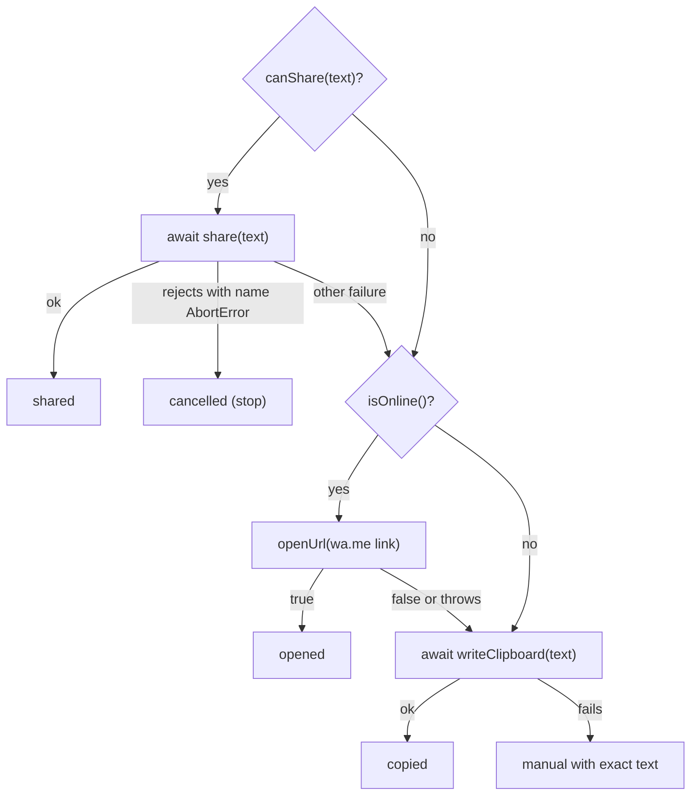

# Design: WhatsApp sharing

## Overview

The owner taps a button. The app builds a short message from numbers and names it already has, then hands the text to the phone. It never sends anything itself.

- **Builders** (`src/domain-ui/share/`) are pure functions: `buildDebtReminder` and `buildDailySummary`. All wording lives in one typed record keyed by `Language`.
- **Delivery** (`src/domain-ui/share/deliver.ts`) is `deliverMessage(text, env)`. It tries the share sheet, then the `wa.me` link, then the clipboard, then gives up and returns the text for manual copying. It never throws. The browser powers are injected through `ShareEnvironment`, so tests use fakes.
- **UI** (`src/components/share/`) holds a provider, a button, one `role="status"` notice and a manual-copy box. Two existing views each gain one button.

No change to `src/domain`, `src/storage`, storage schema (`schemaVersion` stays 1) or `package.json`. Nothing under `src/components/ghost` is imported.

## What the existing code already gives us

These were found by reading the code. They are reused, not rewritten.

| Need | Existing code | Notes |
| --- | --- | --- |
| Show kobo as naira, no ".00" for whole naira (1.4, 4.3) | `formatDisplay` in `src/components/formatMoney.ts` | It wraps `formatKobo` from `src/domain-ui/money.ts` and drops ".00". The cards use it. |
| Outstanding balance of a debt (1.6) | `totalOwed(debts)` in `src/domain/debts.ts` | The domain has **no partial payments**. A `Debt` has `amount` and `status` (`unpaid` or `paid`). So the outstanding balance of one debt is `totalOwed([debt])`: its amount when unpaid, `0` when paid. The UI uses this. |
| Money owed, sales, profit, low stock for Today | `totalOwed`, `dailyTotal`, `estimatedProfit`, `lowStockItems` from `src/domain` | Same calls as `DailySummaryCardView` already makes. |
| Focus pattern (7.2) | `pendingFocus` state plus an effect, in `DebtsCardView` | Same shape is used for the manual box. |
| Button | `src/components/Button.tsx` | Gets one optional prop, `ariaDisabled`. See "Button change". |
| Focus ring | `:focus-visible` rule in `src/components/theme.css` | Applies to every new control. |
| Notice colours | `--color-notice-bg` and `--color-notice-fg`, already in `PAIR_LIST` | The status notice uses them. No new colour. |

## Decisions and assumptions

1. **Own Result type.** `src/domain/result.ts` has a closed `ErrorCode` union, and we may not edit it. The share module defines `ShareResult<T>` with the same shape (`{ ok: true, value }` or `{ ok: false, error: { code, message } }`) and its own two codes, `INVALID_AMOUNT` and `ALREADY_PAID`, each with a plain-language message.
2. **Builders import `formatDisplay` from `src/components`.** That points from `domain-ui` up to `components`, which is the wrong way round. It is the only way to reuse the function the cards use without editing or moving existing files. The rule in 1.4 (reuse, do not write another) wins. The ghost boundary test only bans `components/ghost`, so this is allowed. A later spec could move `formatDisplay` into `domain-ui`.
3. **`fc.fullUnicodeString` does not exist in the installed fast-check (4.11.0).** It was removed in v4. The test helpers expose an arbitrary called `fullUnicodeString` built from `fc.string({ unit: "binary" })`. It is the same idea: any code point.
4. **`dateLabel` is sanitised too.** Requirement 3.1 lists only names and items, but 3.3 says the 1800 limit holds for ANY input, and `dateLabel` is a free string. It gets the same clean-up with a cap of 30 code points. Without this, one long `dateLabel` would break 3.3 and a newline in it would break the line structure of 2.4.
5. **Sanitising also repairs lone surrogates.** `encodeURIComponent` throws `URIError` on a lone surrogate, so "ANY unicode input" (3.3) needs them replaced with U+FFFD. This step comes first.
6. **Control characters are removed, not turned into spaces.** 3.1 says "stripped of". So `"a\nb"` becomes `"ab"`. Spaces that are not control characters are collapsed as 3.1 says.
7. **Requirement 4.1 and user-written names.** A customer called "null" would put "null" in the text, and 4.1 says the text never contains it. The builders cannot change a customer's name, so property tests check 4.1 on the text with every sanitised user-supplied string cut out. The fixed wording and the amount must be clean. A unit test also checks that the templates themselves and the amount never contain a forbidden word.
8. **A day with a loss cannot be shared.** `estimatedProfit` can be negative. 2.3 says a negative kobo value is `INVALID_AMOUNT`. The UI does not hide this. It shows the message of the error in the status notice, so the owner is told the message could not be made, and no wrong number is sent. This is listed as an open item in the final report.
9. **Default `openUrl` uses a temporary link.** `window.open(url, "_blank", "noopener,noreferrer")` always returns `null`, even on success, so a blocked popup cannot be told apart from success. The default implementation instead clicks a temporary `<a target="_blank" rel="noopener noreferrer">`. It returns `false` only if there is no document or the click throws. The `false` path in 5.5 is fully tested with fakes. A silently blocked popup is a known limit of the browser, noted in the architecture doc.
10. **All share buttons are `aria-disabled` while a delivery runs.** 6.4 requires this for the pressed button. `navigator.share` also throws if called twice from different buttons, so one guard covers the whole provider and every share button shows the same state.
11. **A delivery that finishes after the owner changed tab is dropped.** The outcome is not shown on the other tab. The in-flight guard is still released.
12. **"Today card"** means the Daily summary card (`type: "daily-summary"`). Its title differs by starter stack ("Daily summary", "Today's totals"), so the button is attached to the card type, not the title.
13. **The `register-new-card` hook** fires only when a file is created in `src/components/cards/`. This spec creates files only in `src/components/share/`, so it does not fire. It edits two existing card views.

## Architecture

```mermaid
flowchart LR
    Debts["DebtsCardView (existing)"] -->|per open debt| Btn["ShareButton"]
    Today["DailySummaryCardView (existing)"] -->|one button| Btn
    Btn -->|share(makeText, origin)| Prov["ShareProvider"]
    Prov -->|text| Deliver["deliverMessage (deliver.ts)"]
    Deliver -->|injected| Env["ShareEnvironment"]
    Env -.default.-> Browser["navigator / window"]
    Btn -->|calls| BuildD["buildDebtReminder"]
    Btn -->|calls| BuildS["buildDailySummary"]
    BuildD --> San["sanitise"]
    BuildS --> San
    BuildD --> Tpl["TEMPLATES (by Language)"]
    BuildS --> Tpl
    BuildD -->|amount text| Fmt["formatDisplay (existing)"]
    BuildS -->|amount text| Fmt
    Prov --> Status["ShareStatus: role=status + manual box"]
    App["App.tsx"] -->|wraps main, resetKey| Prov
    App -->|renders once| Status
```

Data flow: press, build text (pure), deliver (injected env), show outcome. Nothing is saved.

## Files

### `src/domain-ui/share/`

| File | Contents |
| --- | --- |
| `types.ts` | `Language`, `ShareErrorCode`, `SHARE_ERROR_MESSAGES`, `ShareResult<T>`, `DebtReminderInput`, `DailySummaryInput`, `MessageText` (`{ text: string }`) |
| `templates.ts` | `Templates` interface and `TEMPLATES: Record<Language, Templates>` |
| `sanitise.ts` | `sanitiseText(value, maxCodePoints)`, plus `NAME_MAX = 30` and `ITEM_MAX = 20` |
| `buildDebtReminder.ts` | `buildDebtReminder(input)` |
| `buildDailySummary.ts` | `buildDailySummary(input)` |
| `deliver.ts` | `ShareEnvironment`, `ShareOutcome`, `deliverMessage(text, env)` |
| `browserEnvironment.ts` | `browserShareEnvironment`: the default `ShareEnvironment` on `window` and `navigator` |
| `index.ts` | re-exports |

### `src/components/share/`

| File | Contents |
| --- | --- |
| `ShareProvider.tsx` | context, state, in-flight guard, focus effect, `useShare()` |
| `ShareButton.tsx` | one button built on `Button`. Props: `label`, `ariaLabel?`, `makeText: () => ShareResult<MessageText>` |
| `ShareStatus.tsx` and `ShareStatus.css` | the always-present `role="status"` paragraph, and the manual-copy box |
| `shareMessages.ts` | the five outcome strings from 7.1 and the textarea and Done labels |
| `dateLabel.ts` | `formatDateLabel(iso)` for the Today button |

### Edits to existing files

- `src/components/Button.tsx` and `Button.css`: optional `ariaDisabled` prop and its style.
- `src/components/cards/DebtsCardView.tsx`: a `ShareButton` on each open debt row.
- `src/components/cards/DailySummaryCardView.tsx`: a `ShareButton` under the totals. `displayName` becomes an exported function so the shared text uses the same item names as the card.
- `src/App.tsx`: wrap the page in `ShareProvider` and render `ShareStatus` once.
- `docs/ARCHITECTURE.md`, `KIRO_NOTES.md`.
- New test helper `src/test/shareArbitraries.ts`.

## Builders

### Types

```ts
export type Language = "en";
export type ShareErrorCode = "INVALID_AMOUNT" | "ALREADY_PAID";
export type ShareResult<T> =
  | { ok: true; value: T }
  | { ok: false; error: { code: ShareErrorCode; message: string } };

export interface DebtReminderInput {
  personName: string; shopName: string; outstandingKobo: number; language: Language;
}
export interface DailySummaryInput {
  shopName: string; dateLabel: string;
  salesKobo: number; profitKobo: number; owedKobo: number;
  lowStockNames: string[]; language: Language;
}
```

`buildDebtReminder` returns `ShareResult<{ text: string }>`. The same for `buildDailySummary`.

### Templates record (8.3)

All wording and fallbacks live here, so a new language edits only this record.

```ts
export interface Templates {
  fallbackPerson: string;   // "there"
  fallbackShop: string;     // "my shop"
  itemsNone: string;        // "nothing"
  itemsSeparator: string;   // ", "
  itemsMore(n: number): string;                 // " and {n} more"
  debtReminder(p: { personName: string; shopName: string; amount: string }): string;
  dailySummary(p: {
    shopName: string; dateLabel: string; sales: string; profit: string; owed: string; items: string;
  }): string;               // the five lines joined with "\n"
}
export const TEMPLATES: Record<Language, Templates> = { en: { ... } };
```

English values are exactly those in 1.4 and 2.4. Builders read `TEMPLATES[input.language]` and contain no English words.

### Sanitising (3.1, 3.2)

`sanitiseText(value, max)` runs these steps in order:

1. Replace lone surrogates with U+FFFD (decision 5).
2. Remove `[\u0000-\u001F\u007F\u202A-\u202E\u2066-\u2069]`.
3. Collapse every run of whitespace (`\s+`) to one space.
4. Trim.
5. Cut to `max` code points: `Array.from(text).slice(0, max).join("")`. Never `.length`.
6. Trim the end again. Step 5 can end on a space, and without this step the function is not idempotent. Property P4 is expected to catch this if it is forgotten.

Caps: `NAME_MAX = 30` for person, shop and `dateLabel`. `ITEM_MAX = 20` for items.

Builders then apply 3.2: empty person becomes `fallbackPerson`, empty shop becomes `fallbackShop`, empty items are dropped before counting.

### Amount checks

- Debt: `outstandingKobo === 0` gives `ALREADY_PAID`. Otherwise not a safe integer or less than 1 gives `INVALID_AMOUNT`. (`-0` equals `0`, so it is `ALREADY_PAID`.)
- Summary: any of the three values not a safe integer or less than 0 gives `INVALID_AMOUNT`.
- The check runs before formatting, so `formatDisplay` never sees a bad number and no "NaN" can appear.

### Items line (2.4)

Sanitise each name, drop empties. Take the first 3, join with `itemsSeparator`. If more remain, append `itemsMore(rest)`. If none remain, use `itemsNone`. Example: `a, b, c and 2 more`.

### Why 30 and 20 satisfy 3.3

`encodeURIComponent` makes at most 12 characters per code point (a 4-byte code point is 4 × `%XX`). Worst case for the daily summary, with every name made of 4-byte code points and every number at the maximum:

| Part | Encoded length |
| --- | --- |
| shopName, 30 code points | 360 |
| `, ` | 6 |
| dateLabel, 30 code points | 360 |
| four `\n` | 12 |
| labels `Sales: `, `Profit: `, `Owed to me: `, `Low on stock: ` | 65 |
| three amounts, `₦90,071,992,547,409.91` each | 114 |
| three items, 20 code points each | 720 |
| two item separators | 12 |
| ` and 47 more` | 18 |
| **Total** | **1667** |

That is under 1800 with 133 to spare. A bigger "more" count adds one character per extra digit. The debt reminder is about 900. Property tests check the limit on random and on worst-case input.

## Delivery

```ts
export type ShareOutcome =
  | { kind: "shared" } | { kind: "opened" } | { kind: "copied" }
  | { kind: "cancelled" } | { kind: "manual"; text: string };

export interface ShareEnvironment {
  canShare(text: string): boolean;
  share(text: string): Promise<void>;
  isOnline(): boolean;
  openUrl(url: string): boolean;
  writeClipboard(text: string): Promise<void>;
}
```

`deliverMessage(text, env)` runs this chain. Every call to `env` is inside a `try`, and a throw counts as that step failing.



- The URL is `"https://wa.me/?text=" + encodeURIComponent(text)`. If building it throws, step (b) counts as failed.
- `AbortError` is detected by reading `name` on the rejection value inside a `try`. It works for `DOMException` and for plain objects. On `AbortError` nothing else is called.
- The whole function body is wrapped, so a bug or an odd value still resolves to `manual`. It cannot reject.
- If `canShare` throws it is treated as `false`. If `isOnline` throws it is treated as `false`.

### Default environment

`browserShareEnvironment`:

- `canShare`: `navigator.share` is a function, and `navigator.canShare({ text })` is true when that function exists.
- `share`: `navigator.share({ text })`.
- `isOnline`: `navigator.onLine !== false`.
- `openUrl`: temporary `<a href target="_blank" rel="noopener noreferrer">`, clicked once, then removed (decision 9).
- `writeClipboard`: `navigator.clipboard.writeText(text)`. If the API is missing it rejects, which leads to `manual`.

Every function guards for a missing `window` or `navigator`.

## UI

### `ShareProvider`

Props: `env?: ShareEnvironment` (default `browserShareEnvironment`), `resetKey?: string`, `children`.

State: `view` is `none`, `notice` (with text) or `manual` (with the text to copy). `busy` is a boolean for rendering, and `busyRef` is the guard that is read synchronously, so two presses in the same tick cannot both start. `originRef` holds the button that started the action. `pendingFocus` is `undefined`, `"textarea"` or `"origin"`.

`useShare()` returns `{ busy, share(makeText, origin) }`, or `undefined` when there is no provider. `ShareButton` renders nothing without a provider, so existing tests that render a card alone still pass.

`share(makeText, origin)`:

1. If `busyRef.current` is true, return (6.4).
2. Set `busyRef` and `busy`. Save `origin`. Set `view` to `none` (7.3, "after the next press").
3. Call `makeText()`. If it fails, show the error message as a notice and release the guard.
4. Otherwise `await deliverMessage(text, env)`. Map the outcome:
   - `shared`, `opened`, `copied`: notice with the exact string from 7.1.
   - `cancelled`: `view` stays `none`.
   - `manual`: `view` = manual with the text, and `pendingFocus = "textarea"`.
5. Release the guard in a `finally`.

A generation counter goes up when `resetKey` changes. If it changed during a delivery, the outcome is dropped (decision 11). `resetKey` changing sets `view` to `none` (7.3, "navigating to another tab"). `App` passes `` `${mode}:${selectedCard?.id}` ``, so a tab change or a mode change both clear it.

The effect that handles `pendingFocus` follows the pattern in `DebtsCardView`: read the target, focus it, then clear `pendingFocus`. For `"origin"` it focuses `originRef.current` only if it is still in the document.

### `ShareStatus`

```tsx
<div className="share-status">
  <p role="status" className="share-status__text">{noticeText}</p>
  {manual && (
    <div className="share-status__manual">
      <label htmlFor="share-manual-text">Your message</label>
      <textarea id="share-manual-text" readOnly rows={6} value={text}
        onFocus={(e) => e.currentTarget.select()} ref={textareaRef} />
      <Button onClick={done}>Done</Button>
    </div>
  )}
</div>
```

The `<p role="status">` is always rendered, and only its text changes. `App` renders `ShareStatus` once, outside the tab panel, so it exists on every screen. The manual box is outside the status element so a screen reader does not read the whole message twice.

### Strings (7.1, plain language)

| Outcome | Notice text |
| --- | --- |
| shared | `Shared. Thank you!` |
| opened | `The ghost has packed your message. Tap send in WhatsApp.` |
| copied | `Copied. Paste it in WhatsApp.` |
| cancelled | empty |
| manual | `Could not share. Select the message below and copy it.` |

A message that cannot be built shows `SHARE_ERROR_MESSAGES[code]`:

- `INVALID_AMOUNT`: "We could not make this message because an amount is not valid."
- `ALREADY_PAID`: "This debt is already paid, so there is nothing to remind about."

### `ShareButton`

Wraps `Button` with `buttonRef`, `ariaDisabled={busy}` and an `onClick` that calls `share(makeText, buttonRef.current)`. It makes no network request itself.

### Placement

- **Debts:** in the `debts-card__actions` area of each row, shown only when `totalOwed([debt]) >= 1`. `label="Send a reminder"`, `ariaLabel={`Send a reminder to ${debt.customer}`}`. `makeText` builds the reminder with `personName: debt.customer`, `shopName: stack.name`, `outstandingKobo: totalOwed([debt])`, `language: "en"`. Paid debts get no button.
- **Today:** one button under the totals, `label="Share today's totals"`. `makeText` builds the summary with `shopName: stack.name`, `dateLabel: formatDateLabel(dayRange.start)`, the three values from `dailyTotal`, `estimatedProfit` and `totalOwed` (a `Result` that is not ok is passed as `NaN`, so the builder returns `INVALID_AMOUNT`), and `lowStockNames: lowStockItems(stack).map((i) => displayName(i.name))`. The clock is never read: the label comes from `dayRange`.

### Button change

`Button` gets `ariaDisabled?: boolean`, written to `aria-disabled`. `Button.css` gets a rule for `.button[aria-disabled="true"]`, including its hover and active states, that uses `--color-disabled-bg` and `--color-disabled-fg` with `cursor: not-allowed`. The element is not `disabled`, so it stays focusable and a screen reader still announces it. Button height already comes from `min-height: var(--tap-min)` (44px).

### Styling (6.3, 8.2)

`ShareStatus.css` uses only theme variables: `--color-notice-bg` and `--color-notice-fg` for the notice, `--color-bg`, `--color-fg` and `--color-border` for the textarea, and `--space-*`, `--border-width`. No new colour variable is added, so `PAIR_LIST` does not change. No rule removes the outline. The shared `:focus-visible` rule gives the ring.

## Error handling

| Situation | Result |
| --- | --- |
| Amount is not valid | Builder returns `INVALID_AMOUNT`. UI shows its message. Nothing is delivered. |
| Debt already paid | Builder returns `ALREADY_PAID`. The UI normally never reaches this because paid debts have no button. |
| Share sheet closed by the owner | `cancelled`. Notice is cleared. |
| Share sheet error, offline, popup problem, clipboard problem | The chain moves on. The worst case is `manual`. |
| Lone surrogate or other odd text | Sanitiser repairs it. `deliverMessage` also guards `encodeURIComponent`. |

## Testing strategy

Property tests use fast-check with at least 100 runs each. A small helper in `src/test/shareArbitraries.ts` wraps `fc.check` and, on failure, throws an error that includes the seed and the counterexample, so a failure can be replayed.

### Arbitraries (`src/test/shareArbitraries.ts`)

- `fullUnicodeString`: `fc.string({ unit: "binary" })` (decision 3).
- Lone-surrogate strings.
- The empty string.
- Very long strings (200 to 2000 characters).
- RTL strings (Arabic and Hebrew letters, with bidi override characters mixed in).
- Emoji strings, including a joined family sequence.
- Strings full of control characters and whitespace.
- `nameArb`: `fc.oneof` over all of the above.
- `validKoboArb`: 1 to `Number.MAX_SAFE_INTEGER`, with the edges added (`1`, `100`, `MAX_SAFE_INTEGER`).
- `zeroOrMoreKoboArb`: 0 to `Number.MAX_SAFE_INTEGER`.
- `lowStockNamesArb`: 0 to 50 names from `nameArb`.

### Properties

| ID | Property | File |
| --- | --- | --- |
| P1 | Any valid debt input gives ok. The text satisfies 4.1 (user strings cut out, decision 7), 4.2 and 3.3. | `buildDebtReminder.property.test.ts` |
| P2 | Same for the daily summary, with 0 to 50 low-stock names. | `buildDailySummary.property.test.ts` |
| P3 | `decodeURIComponent(encodeURIComponent(text)) === text` for both builders. | both property files |
| P4 | `sanitiseText(sanitiseText(x, n), n)` equals `sanitiseText(x, n)`. The output has no forbidden character and at most `n` code points. | `sanitise.property.test.ts` |
| P5 | Any `outstandingKobo` that is not a safe integer >= 1 gives `INVALID_AMOUNT`, and `0` gives `ALREADY_PAID`. | `buildDebtReminder.property.test.ts` |
| P6 | Any mix of fake capabilities and failures: `deliverMessage` resolves, never throws, returns one of the five kinds. `manual` carries the exact text. `AbortError` gives `cancelled` with no other call made. Fakes may also throw synchronously. | `deliver.property.test.ts` |
| P7 | Same input twice gives the same text, for both builders. | both property files |

### Example tests

- `sanitise.test.ts`: each forbidden character, whitespace collapse, cut at the cap, emoji count as one code point, cut that ends on a space.
- `templates.test.ts`: English text matches 1.4 and 2.4 exactly. No banned word (threat, deadline and shaming words, such as "overdue", "final", "legal", "police", "court", "shame", "urgent", "immediately", "or else") in any template. No emoji.
- `buildDebtReminder.test.ts` and `buildDailySummary.test.ts`: exact text for known inputs, `₦1,250.50` and a whole-naira amount without ".00", fallbacks "there" and "my shop", item line for 0, 1, 3 and 5 names, `ALREADY_PAID`, `INVALID_AMOUNT`.
- `deliver.test.ts`: one test per row of 5.3 to 5.6, and a check that the URL is exactly `https://wa.me/?text=` plus the encoded text.
- `browserEnvironment.test.ts` (jsdom): `canShare`, `isOnline`, `openUrl` creates a link with `rel="noopener noreferrer"` and removes it, and `writeClipboard` rejects when there is no clipboard.
- Component tests, each file starting with `// @vitest-environment jsdom` and importing `../../test/setup`:
  - `DebtsCardView.share.test.tsx`: 6.1 label and aria-label, paid debts show no button, 6.4 (double press makes one `share` call and the button is `aria-disabled`), reminder text passed to `share`.
  - `DailySummaryCardView.share.test.tsx`: 6.2 label, text passed to `share`, a loss day shows the error message and calls nothing.
  - `ShareStatus.test.tsx`: the five 7.1 outcomes, the `role="status"` element exists before any press, the next press clears the notice, a `resetKey` change clears it, 7.2 (textarea is read-only, holds the exact text, receives focus, selects all on focus, Done returns focus to the starting button), and 6.5 (offline run with a `fetch` spy never called).
  - `shareCss.test.ts`: no new `--color-*` variable, no `outline: none` or `outline: 0` in the new CSS or in `Button.css`.

## Documentation

Task 3.x adds a "WhatsApp sharing" section to `docs/ARCHITECTURE.md`, and a row plus the counts to `KIRO_NOTES.md`. The credits are read from the Kiro usage panel, as the earlier rows say.
