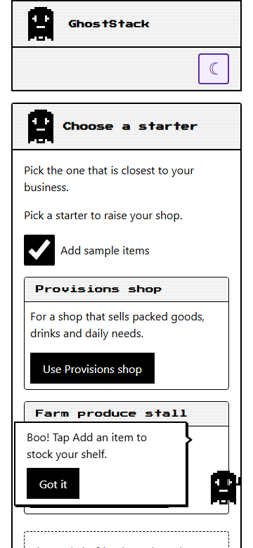
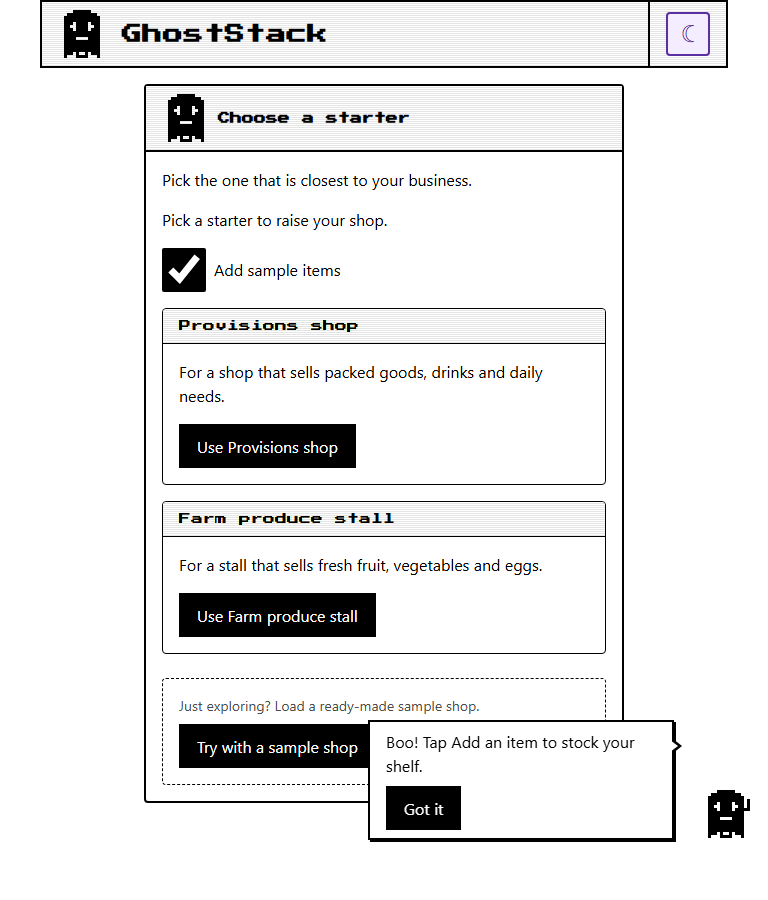
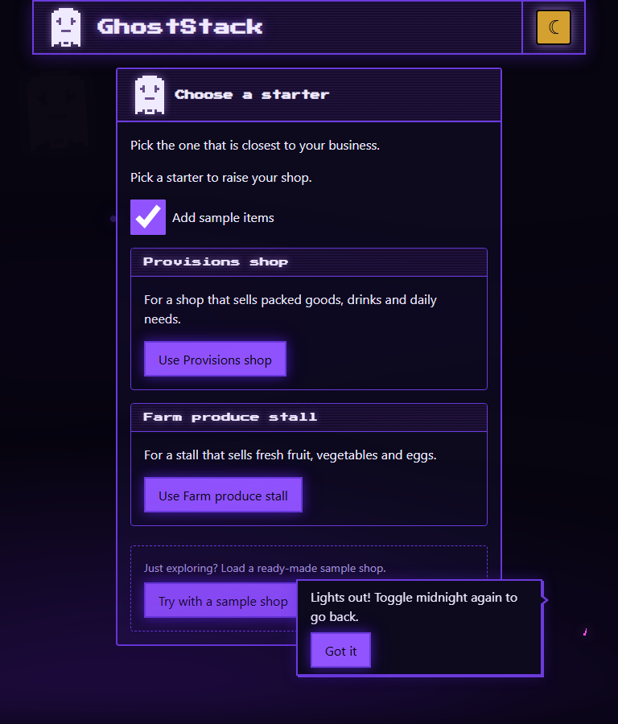

# Screenshots

UI screenshots captured at three breakpoints × two themes (light and midnight).

Generated by `scripts/take-screenshots.cjs`. To regenerate: start the dev server on port 5174 then run `node scripts/take-screenshots.cjs`.

## 360px (mobile)

| Light | Midnight |
|-------|---------|
|  |  |

## 768px (tablet)

| Light | Midnight |
|-------|---------|
|  |  |

## 1440px (desktop)

| Light | Midnight |
|-------|---------|
|  |  |

## File list

```
docs/screenshots/
  360-light.png
  360-midnight.png
  768-light.png
  768-midnight.png
  1440-light.png
  1440-midnight.png
```

To toggle midnight mode: click the moon (☾) button in the app header.
