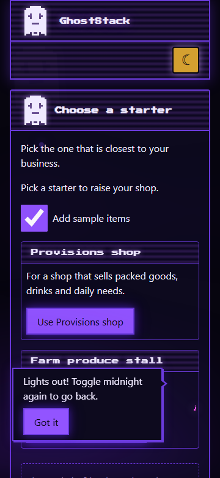
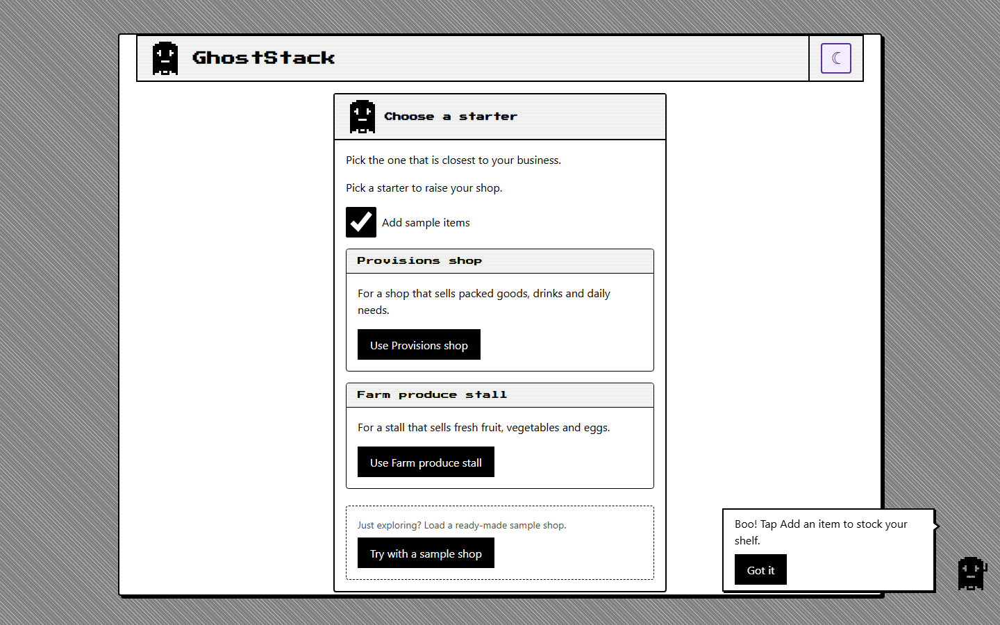
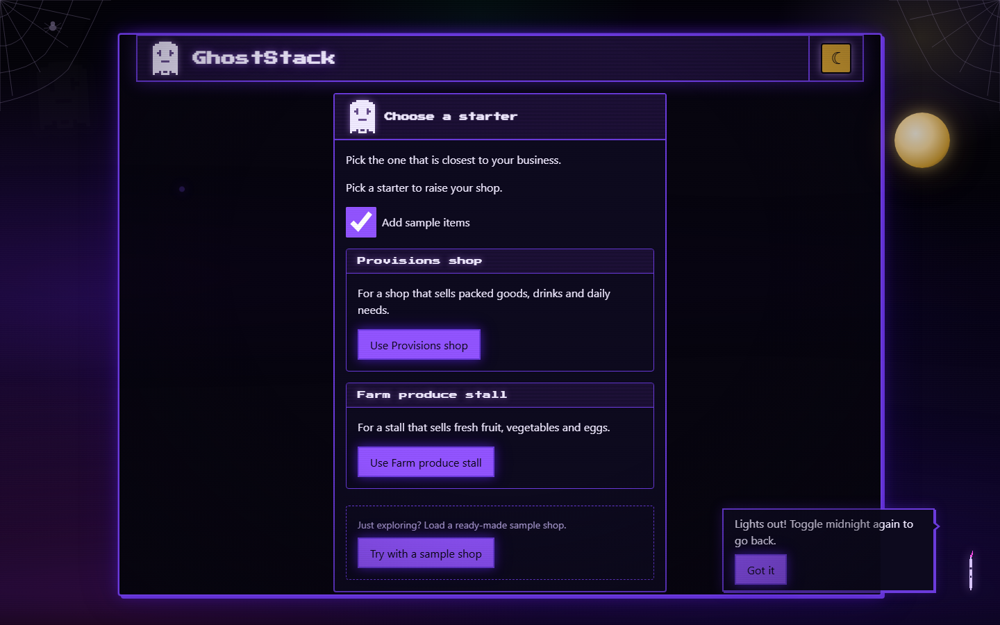

# Screenshots

UI screenshots captured at three breakpoints × two themes (light and midnight).

## Naming convention

Files use `NN-screen-name-WIDTH-THEME.png` where `NN` is a two-digit sort
order, `screen-name` is lowercase-hyphenated, `WIDTH` is `360`, `768`, or
`1440`, and `THEME` is `light` or `midnight`.

Example: `01-starter-chooser-360-light.png`

Files live in `docs/screenshots/`.

## Screen list

| # | Screen | Description |
|---|--------|-------------|
| 01 | Starter chooser | First-run shop selection |
| 02 | Stock card with items | Stock card populated with inventory |
| 03 | Stock card empty state | Stock card before first item |
| 04 | "Sale recorded" notice | Toast after a sale is logged |
| 05 | Sales log | Full sales history |
| 06 | Debts card | Who owes what |
| 07 | Daily summary | Today's totals |
| 08 | Builder mode | Card and button editor |
| 09 | Backup controls | Save/load file panel |
| 10 | Update notice | Service worker update banner |
| 11 | Offline notice | No-connection banner |

## Breakpoints

| Width | Label |
|-------|-------|
| 360px | Mobile |
| 768px | Tablet |
| 1440px | Desktop |

Both **light** and **midnight** themes are captured at each breakpoint.

## Current captures

The six captures below cover all three breakpoints × both themes for the
demo stack (Step 10, Mama Ife's Provision Shop). Full per-screen captures
at 360 and 768 (naming convention above) are pending.

| Light | Midnight |
|-------|---------|
|  |  |
|  |  |
|  |  |

To regenerate: start the dev server on port 5174 then run
`node scripts/take-screenshots.cjs`.

To toggle midnight mode: click the moon (☾) button in the app header.
